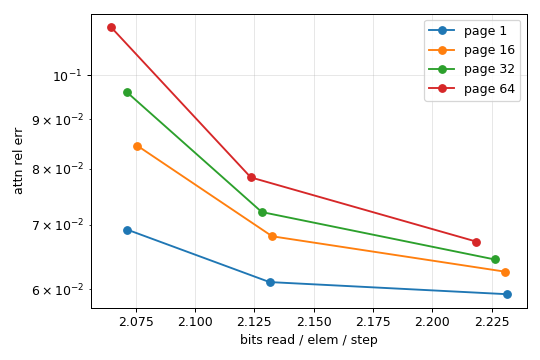

# E5 Page-granular selection (token budget fixed; page score = max over tokens and GQA group of estimated log-prob)

**TL;DR:** at k=5%, captured true mass: page 1 → 0.883, 16 → 0.802, 32 → 0.773, 64 → 0.738;
attn err 0.0610 / 0.0681 / 0.0721 / 0.0783. Pages trade selection precision for transfer granularity.

## Config
floor(k/page) pages selected by coarse(+RHT) estimate; sinks (4) and recent window (64) added at token granularity, so the
actual hot fraction is reported. Reference = exact attention on int8 cache. 256 decode queries/layer, 5 corpora, 6 layers.

| page | k | actual hot % | true mass mean | true mass worst (corpus,layer) | attn err | read bits/elem |
|---|---|---|---|---|---|---|
| 1 | 2% | 2.0062 | 0.7867 | 0.6618 | 0.0692 | 2.0714 |
| 1 | 5% | 5.0064 | 0.8827 | 0.7738 | 0.0610 | 2.1314 |
| 1 | 10% | 10.0063 | 0.9314 | 0.8478 | 0.0593 | 2.2314 |
| 16 | 2% | 2.2194 | 0.6942 | 0.5165 | 0.0845 | 2.0756 |
| 16 | 5% | 5.0618 | 0.8022 | 0.6442 | 0.0681 | 2.1325 |
| 16 | 10% | 9.9614 | 0.8682 | 0.7420 | 0.0626 | 2.2305 |
| 32 | 2% | 2.0043 | 0.6449 | 0.4625 | 0.0960 | 2.0713 |
| 32 | 5% | 4.8432 | 0.7734 | 0.5948 | 0.0721 | 2.1281 |
| 32 | 10% | 9.7558 | 0.8475 | 0.7023 | 0.0644 | 2.2264 |
| 64 | 2% | 1.6600 | 0.5821 | 0.4075 | 0.1122 | 2.0645 |
| 64 | 5% | 4.6121 | 0.7385 | 0.5531 | 0.0783 | 2.1235 |
| 64 | 10% | 9.3664 | 0.8230 | 0.6600 | 0.0672 | 2.2186 |

## Caveats
- Bytes are counted at element level; real PCIe efficiency for page 1 (256-dim × 2 bit = 64 B per token/head/plane) would be poor without gathering; pages ≥ 16 give ≥ 1 KB transfers.
runtime 81s
