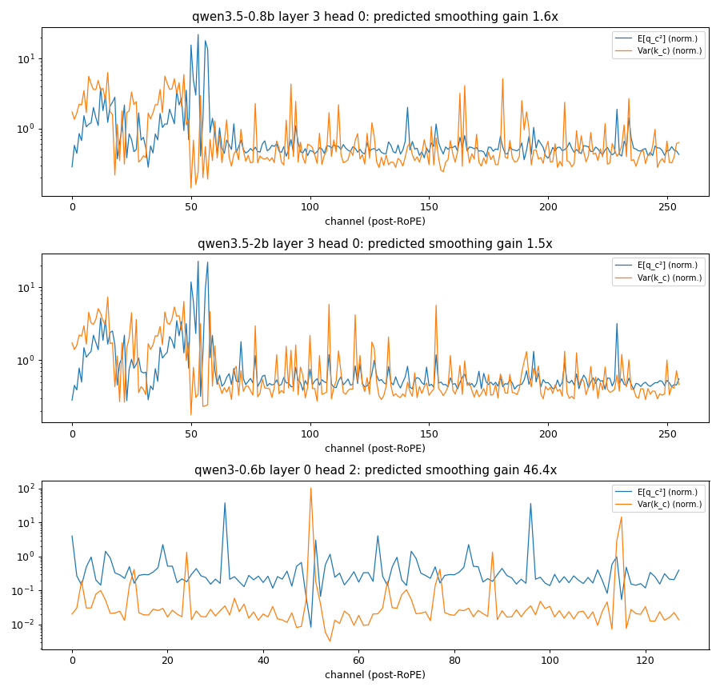
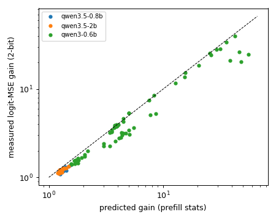

# E19 Why key smoothing matters on some models (pipeline check + characterization)

**TL;DR:** pipeline check (offline exact attention vs the model's own o_proj input), max rel. error: qwen3.5-0.8b 0.014, qwen3.5-2b 0.012, qwen3-0.6b 0.006.
Median predicted smoothing gain (Σq²·Σk²/(Σ√(q²k²))², from prefill stats): qwen3.5-0.8b 1.34x, qwen3.5-2b 1.29x, qwen3-0.6b 4.09x;
measured 2-bit logit-MSE gain: qwen3.5-0.8b 1.21x, qwen3.5-2b 1.20x, qwen3-0.6b 3.41x (Spearman predicted vs measured over heads 0.97).

## Config
Reference per model: {'qwen3.5-0.8b': 'int8', 'qwen3.5-2b': 'int8', 'qwen3-0.6b': 'fp16'}. Corpora ['prose', 'code']; up to 4 attention layers per model; all KV heads; 2-bit (coarse) gain-shape keys with 128-token block means.
Logit error is measured on every 4th decode query over all causal positions. k² = per-channel variance of post-RoPE prefill keys,
q² = per-channel mean square of post-RoPE prefill queries (averaged over the GQA group). runtime 131s.

## (A) Pipeline check
| model | corpus | layer | rel err vs model |
|---|---|---|---|
| qwen3.5-0.8b | prose | 3 | 0.0060 |
| qwen3.5-0.8b | prose | 11 | 0.0138 |
| qwen3.5-0.8b | prose | 15 | 0.0098 |
| qwen3.5-0.8b | prose | 23 | 0.0124 |
| qwen3.5-0.8b | code | 3 | 0.0063 |
| qwen3.5-0.8b | code | 11 | 0.0102 |
| qwen3.5-0.8b | code | 15 | 0.0105 |
| qwen3.5-0.8b | code | 23 | 0.0131 |
| qwen3.5-2b | prose | 3 | 0.0063 |
| qwen3.5-2b | prose | 11 | 0.0113 |
| qwen3.5-2b | prose | 15 | 0.0123 |
| qwen3.5-2b | prose | 23 | 0.0103 |
| qwen3.5-2b | code | 3 | 0.0074 |
| qwen3.5-2b | code | 11 | 0.0096 |
| qwen3.5-2b | code | 15 | 0.0114 |
| qwen3.5-2b | code | 23 | 0.0107 |
| qwen3-0.6b | prose | 0 | 0.0038 |
| qwen3-0.6b | prose | 9 | 0.0052 |
| qwen3-0.6b | prose | 18 | 0.0056 |
| qwen3-0.6b | prose | 27 | 0.0063 |
| qwen3-0.6b | code | 0 | 0.0034 |
| qwen3-0.6b | code | 9 | 0.0044 |
| qwen3-0.6b | code | 18 | 0.0054 |
| qwen3-0.6b | code | 27 | 0.0064 |

## (B) Summary per model (medians over layer × head × corpus)
| model | n heads | Gpred median | Gpred max | measured gain median | measured max | logit err/spread (no smooth) | logit err/spread (smooth) | k² max/median | q² max/median | Spearman(q², k²) | outlier: max/median mean|k| (median) | (max) |
|---|---|---|---|---|---|---|---|---|---|---|---|---|
| qwen3.5-0.8b | 16 | 1.339 | 1.552 | 1.208 | 1.373 | 0.172 | 0.154 | 7.254 | 22.029 | 0.265 | 4.572 | 11.281 |
| qwen3.5-2b | 16 | 1.294 | 1.483 | 1.198 | 1.345 | 0.179 | 0.163 | 7.485 | 21.044 | 0.400 | 5.236 | 9.871 |
| qwen3-0.6b | 64 | 4.088 | 55.499 | 3.414 | 39.859 | 0.269 | 0.157 | 41.714 | 103.281 | -0.045 | 26.786 | 332.214 |

## (B) Per head
| model | corpus | layer | head | Gpred | measured gain | err/spread no smooth | err/spread smooth | k² max/med | q² max/med | ρ(q²,k²) | max/med mean|k| |
|---|---|---|---|---|---|---|---|---|---|---|---|
| qwen3.5-0.8b | prose | 3 | 0 | 1.552 | 1.373 | 0.196 | 0.168 | 14.726 | 42.006 | 0.247 | 11.281 |
| qwen3.5-0.8b | prose | 3 | 1 | 1.386 | 1.324 | 0.173 | 0.150 | 6.143 | 24.736 | 0.243 | 6.622 |
| qwen3.5-0.8b | prose | 11 | 0 | 1.382 | 1.246 | 0.189 | 0.169 | 6.997 | 20.993 | 0.222 | 2.685 |
| qwen3.5-0.8b | prose | 11 | 1 | 1.421 | 1.189 | 0.148 | 0.136 | 12.332 | 19.404 | 0.102 | 3.865 |
| qwen3.5-0.8b | prose | 15 | 0 | 1.261 | 1.092 | 0.129 | 0.123 | 11.626 | 16.475 | 0.485 | 4.826 |
| qwen3.5-0.8b | prose | 15 | 1 | 1.497 | 1.339 | 0.171 | 0.148 | 4.943 | 28.633 | 0.245 | 4.401 |
| qwen3.5-0.8b | prose | 23 | 0 | 1.290 | 1.218 | 0.201 | 0.183 | 3.782 | 16.125 | 0.140 | 4.477 |
| qwen3.5-0.8b | prose | 23 | 1 | 1.324 | 1.186 | 0.186 | 0.171 | 5.712 | 21.158 | 0.482 | 3.738 |
| qwen3.5-0.8b | code | 3 | 0 | 1.367 | 1.266 | 0.208 | 0.185 | 9.766 | 30.098 | 0.143 | 8.971 |
| qwen3.5-0.8b | code | 3 | 1 | 1.345 | 1.299 | 0.159 | 0.140 | 6.486 | 24.348 | 0.266 | 6.930 |
| qwen3.5-0.8b | code | 11 | 0 | 1.259 | 1.155 | 0.181 | 0.169 | 8.622 | 21.810 | 0.384 | 3.351 |
| qwen3.5-0.8b | code | 11 | 1 | 1.332 | 1.185 | 0.156 | 0.144 | 15.482 | 25.082 | 0.300 | 4.544 |
| qwen3.5-0.8b | code | 15 | 0 | 1.289 | 1.135 | 0.154 | 0.145 | 11.649 | 17.294 | 0.461 | 5.266 |
| qwen3.5-0.8b | code | 15 | 1 | 1.355 | 1.284 | 0.172 | 0.152 | 5.011 | 15.308 | 0.264 | 3.724 |
| qwen3.5-0.8b | code | 23 | 0 | 1.267 | 1.176 | 0.170 | 0.157 | 5.404 | 22.248 | 0.377 | 4.599 |
| qwen3.5-0.8b | code | 23 | 1 | 1.326 | 1.198 | 0.171 | 0.157 | 7.510 | 29.856 | 0.411 | 4.944 |
| qwen3.5-2b | prose | 3 | 0 | 1.483 | 1.345 | 0.189 | 0.163 | 17.072 | 44.976 | 0.327 | 9.871 |
| qwen3.5-2b | prose | 3 | 1 | 1.350 | 1.272 | 0.170 | 0.151 | 7.444 | 22.619 | 0.317 | 7.301 |
| qwen3.5-2b | prose | 11 | 0 | 1.218 | 1.147 | 0.195 | 0.182 | 6.563 | 19.128 | 0.456 | 3.527 |
| qwen3.5-2b | prose | 11 | 1 | 1.300 | 1.191 | 0.160 | 0.146 | 11.512 | 24.856 | 0.460 | 4.550 |
| qwen3.5-2b | prose | 15 | 0 | 1.248 | 1.117 | 0.162 | 0.153 | 10.088 | 18.618 | 0.417 | 5.578 |
| qwen3.5-2b | prose | 15 | 1 | 1.411 | 1.280 | 0.188 | 0.166 | 4.090 | 21.636 | 0.241 | 4.407 |
| qwen3.5-2b | prose | 23 | 0 | 1.239 | 1.206 | 0.211 | 0.192 | 3.534 | 19.582 | 0.264 | 4.714 |
| qwen3.5-2b | prose | 23 | 1 | 1.292 | 1.215 | 0.199 | 0.180 | 4.675 | 18.773 | 0.249 | 5.485 |
| qwen3.5-2b | code | 3 | 0 | 1.353 | 1.249 | 0.200 | 0.179 | 9.064 | 36.069 | 0.229 | 8.384 |
| qwen3.5-2b | code | 3 | 1 | 1.324 | 1.263 | 0.161 | 0.144 | 7.527 | 27.398 | 0.391 | 7.595 |
| qwen3.5-2b | code | 11 | 0 | 1.198 | 1.119 | 0.183 | 0.173 | 7.725 | 22.559 | 0.503 | 3.798 |
| qwen3.5-2b | code | 11 | 1 | 1.296 | 1.143 | 0.157 | 0.147 | 10.105 | 31.069 | 0.466 | 4.504 |
| qwen3.5-2b | code | 15 | 0 | 1.231 | 1.110 | 0.158 | 0.150 | 10.461 | 20.453 | 0.520 | 5.884 |
| qwen3.5-2b | code | 15 | 1 | 1.322 | 1.258 | 0.183 | 0.163 | 5.382 | 16.161 | 0.330 | 4.428 |
| qwen3.5-2b | code | 23 | 0 | 1.234 | 1.165 | 0.175 | 0.162 | 4.491 | 18.827 | 0.417 | 5.644 |
| qwen3.5-2b | code | 23 | 1 | 1.231 | 1.139 | 0.171 | 0.160 | 3.980 | 17.491 | 0.408 | 4.987 |
| qwen3-0.6b | prose | 0 | 0 | 29.353 | 28.096 | 1.067 | 0.201 | 3339.426 | 83.558 | -0.308 | 219.338 |
| qwen3-0.6b | prose | 0 | 1 | 8.331 | 8.551 | 0.285 | 0.097 | 1016.811 | 66.446 | -0.056 | 20.692 |
| qwen3-0.6b | prose | 0 | 2 | 46.398 | 26.473 | 0.823 | 0.160 | 4600.588 | 144.657 | -0.276 | 305.198 |
| qwen3-0.6b | prose | 0 | 3 | 25.433 | 25.487 | 1.057 | 0.209 | 3126.551 | 42.944 | -0.200 | 162.292 |
| qwen3-0.6b | prose | 0 | 4 | 15.584 | 15.255 | 0.773 | 0.198 | 1413.390 | 79.300 | -0.136 | 191.264 |
| qwen3-0.6b | prose | 0 | 5 | 15.365 | 13.740 | 0.239 | 0.064 | 860.540 | 102.433 | -0.077 | 152.245 |
| qwen3-0.6b | prose | 0 | 6 | 38.548 | 20.926 | 0.701 | 0.153 | 4339.849 | 121.075 | -0.387 | 298.893 |
| qwen3-0.6b | prose | 0 | 7 | 35.525 | 33.899 | 1.156 | 0.199 | 3035.068 | 126.031 | -0.196 | 230.951 |
| qwen3-0.6b | prose | 9 | 0 | 4.284 | 2.827 | 0.249 | 0.148 | 97.744 | 107.175 | -0.357 | 29.984 |
| qwen3-0.6b | prose | 9 | 1 | 3.794 | 2.565 | 0.268 | 0.167 | 38.703 | 43.375 | -0.463 | 16.853 |
| qwen3-0.6b | prose | 9 | 2 | 5.553 | 3.625 | 0.361 | 0.189 | 93.896 | 111.347 | -0.497 | 21.277 |
| qwen3-0.6b | prose | 9 | 3 | 4.297 | 3.237 | 0.248 | 0.138 | 24.369 | 63.822 | -0.446 | 22.883 |
| qwen3-0.6b | prose | 9 | 4 | 4.985 | 3.418 | 0.302 | 0.163 | 71.498 | 110.718 | -0.539 | 22.014 |
| qwen3-0.6b | prose | 9 | 5 | 4.353 | 3.035 | 0.308 | 0.177 | 221.350 | 171.406 | 0.096 | 45.585 |
| qwen3-0.6b | prose | 9 | 6 | 3.026 | 2.407 | 0.225 | 0.145 | 30.691 | 44.222 | -0.321 | 21.110 |
| qwen3-0.6b | prose | 9 | 7 | 8.663 | 5.280 | 0.348 | 0.152 | 32.185 | 458.117 | -0.460 | 16.263 |
| qwen3-0.6b | prose | 18 | 0 | 1.588 | 1.407 | 0.205 | 0.173 | 13.469 | 19.610 | 0.246 | 7.542 |
| qwen3-0.6b | prose | 18 | 1 | 1.943 | 1.660 | 0.217 | 0.168 | 24.290 | 26.408 | 0.223 | 7.648 |
| qwen3-0.6b | prose | 18 | 2 | 2.046 | 1.716 | 0.224 | 0.171 | 56.963 | 79.209 | 0.497 | 8.307 |
| qwen3-0.6b | prose | 18 | 3 | 2.186 | 1.988 | 0.233 | 0.166 | 11.051 | 91.126 | -0.013 | 8.306 |
| qwen3-0.6b | prose | 18 | 4 | 1.756 | 1.491 | 0.238 | 0.195 | 24.196 | 42.211 | 0.399 | 9.243 |
| qwen3-0.6b | prose | 18 | 5 | 1.758 | 1.570 | 0.169 | 0.135 | 13.183 | 25.810 | -0.049 | 8.303 |
| qwen3-0.6b | prose | 18 | 6 | 1.828 | 1.567 | 0.186 | 0.149 | 8.849 | 36.539 | 0.055 | 9.262 |
| qwen3-0.6b | prose | 18 | 7 | 1.799 | 1.642 | 0.215 | 0.168 | 19.674 | 75.474 | 0.232 | 9.813 |
| qwen3-0.6b | prose | 27 | 0 | 3.403 | 3.218 | 0.302 | 0.168 | 35.484 | 270.837 | 0.199 | 31.860 |
| qwen3-0.6b | prose | 27 | 1 | 4.505 | 4.619 | 0.321 | 0.150 | 55.493 | 306.284 | 0.015 | 33.577 |
| qwen3-0.6b | prose | 27 | 2 | 4.056 | 3.923 | 0.274 | 0.138 | 35.604 | 551.397 | 0.371 | 38.211 |
| qwen3-0.6b | prose | 27 | 3 | 3.933 | 3.796 | 0.295 | 0.152 | 23.714 | 278.449 | -0.171 | 27.771 |
| qwen3-0.6b | prose | 27 | 4 | 3.533 | 3.256 | 0.293 | 0.162 | 14.049 | 251.715 | -0.186 | 25.802 |
| qwen3-0.6b | prose | 27 | 5 | 3.855 | 3.885 | 0.275 | 0.139 | 30.014 | 558.181 | 0.366 | 36.317 |
| qwen3-0.6b | prose | 27 | 6 | 3.764 | 3.693 | 0.271 | 0.141 | 19.502 | 265.326 | -0.038 | 27.873 |
| qwen3-0.6b | prose | 27 | 7 | 4.981 | 5.339 | 0.325 | 0.141 | 24.732 | 769.797 | 0.189 | 21.316 |
| qwen3-0.6b | code | 0 | 0 | 31.510 | 28.584 | 0.878 | 0.164 | 3980.503 | 73.496 | -0.293 | 229.651 |
| qwen3-0.6b | code | 0 | 1 | 7.484 | 7.449 | 0.252 | 0.092 | 1112.036 | 55.516 | 0.033 | 31.747 |
| qwen3-0.6b | code | 0 | 2 | 55.499 | 24.766 | 0.712 | 0.143 | 5755.379 | 160.339 | -0.231 | 332.214 |
| qwen3-0.6b | code | 0 | 3 | 20.576 | 18.570 | 0.902 | 0.209 | 2490.057 | 39.901 | -0.133 | 173.989 |
| qwen3-0.6b | code | 0 | 4 | 26.101 | 24.096 | 0.904 | 0.184 | 2610.498 | 80.013 | -0.042 | 189.305 |
| qwen3-0.6b | code | 0 | 5 | 12.874 | 11.707 | 0.215 | 0.063 | 814.293 | 120.472 | -0.002 | 159.331 |
| qwen3-0.6b | code | 0 | 6 | 48.232 | 20.362 | 0.609 | 0.135 | 5943.555 | 125.507 | -0.360 | 323.609 |
| qwen3-0.6b | code | 0 | 7 | 42.331 | 39.859 | 1.145 | 0.181 | 3609.993 | 122.971 | -0.158 | 238.853 |
| qwen3-0.6b | code | 9 | 0 | 4.120 | 2.803 | 0.227 | 0.136 | 103.586 | 110.413 | -0.293 | 27.940 |
| qwen3-0.6b | code | 9 | 1 | 3.420 | 2.259 | 0.238 | 0.158 | 37.064 | 41.903 | -0.360 | 18.361 |
| qwen3-0.6b | code | 9 | 2 | 5.067 | 3.077 | 0.282 | 0.161 | 82.215 | 104.128 | -0.448 | 21.630 |
| qwen3-0.6b | code | 9 | 3 | 4.346 | 3.141 | 0.235 | 0.133 | 40.640 | 80.891 | -0.370 | 24.240 |
| qwen3-0.6b | code | 9 | 4 | 4.685 | 3.156 | 0.253 | 0.143 | 62.827 | 99.076 | -0.473 | 23.347 |
| qwen3-0.6b | code | 9 | 5 | 4.464 | 3.158 | 0.311 | 0.175 | 211.437 | 171.111 | 0.113 | 41.985 |
| qwen3-0.6b | code | 9 | 6 | 3.009 | 2.270 | 0.192 | 0.127 | 42.795 | 36.950 | -0.279 | 20.807 |
| qwen3-0.6b | code | 9 | 7 | 7.694 | 5.067 | 0.302 | 0.134 | 20.118 | 461.845 | -0.417 | 15.320 |
| qwen3-0.6b | code | 18 | 0 | 1.571 | 1.427 | 0.205 | 0.172 | 19.327 | 19.757 | 0.202 | 5.766 |
| qwen3-0.6b | code | 18 | 1 | 1.790 | 1.439 | 0.187 | 0.156 | 23.171 | 21.759 | 0.301 | 7.378 |
| qwen3-0.6b | code | 18 | 2 | 1.712 | 1.579 | 0.208 | 0.166 | 87.319 | 63.775 | 0.541 | 9.029 |
| qwen3-0.6b | code | 18 | 3 | 2.047 | 1.803 | 0.236 | 0.175 | 8.771 | 81.010 | -0.023 | 7.969 |
| qwen3-0.6b | code | 18 | 4 | 1.684 | 1.421 | 0.220 | 0.184 | 19.596 | 37.756 | 0.337 | 9.223 |
| qwen3-0.6b | code | 18 | 5 | 1.666 | 1.531 | 0.159 | 0.129 | 16.755 | 22.154 | 0.078 | 7.320 |
| qwen3-0.6b | code | 18 | 6 | 1.738 | 1.495 | 0.193 | 0.158 | 10.183 | 35.257 | 0.289 | 8.556 |
| qwen3-0.6b | code | 18 | 7 | 1.742 | 1.507 | 0.202 | 0.164 | 12.709 | 69.463 | 0.205 | 8.998 |
| qwen3-0.6b | code | 27 | 0 | 3.939 | 3.819 | 0.325 | 0.166 | 45.628 | 259.744 | 0.074 | 35.911 |
| qwen3-0.6b | code | 27 | 1 | 4.502 | 4.294 | 0.306 | 0.148 | 47.825 | 293.260 | 0.040 | 40.245 |
| qwen3-0.6b | code | 27 | 2 | 3.919 | 3.972 | 0.256 | 0.128 | 42.788 | 523.649 | 0.349 | 51.244 |
| qwen3-0.6b | code | 27 | 3 | 3.551 | 3.296 | 0.250 | 0.137 | 16.402 | 274.810 | -0.079 | 28.389 |
| qwen3-0.6b | code | 27 | 4 | 3.531 | 3.410 | 0.321 | 0.174 | 20.713 | 237.990 | -0.053 | 30.242 |
| qwen3-0.6b | code | 27 | 5 | 3.788 | 3.880 | 0.267 | 0.136 | 49.318 | 404.522 | 0.300 | 44.321 |
| qwen3-0.6b | code | 27 | 6 | 3.706 | 3.663 | 0.253 | 0.132 | 19.871 | 335.459 | 0.015 | 28.436 |
| qwen3-0.6b | code | 27 | 7 | 5.002 | 5.349 | 0.288 | 0.125 | 28.426 | 633.969 | 0.151 | 19.381 |

## Plots
 — per-channel query energy and key variance for the head with the largest predicted gain.

