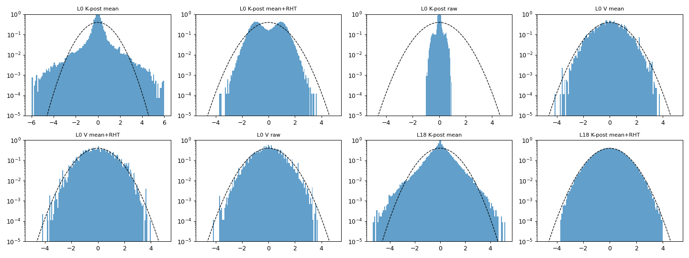

# E1 Gaussianization (Qwen3.5-0.8B, int8 reference cache, corpora prose+code, 6 attn layers × 2 KV heads)

**TL;DR:** mean removal + RHT brings key-shape kurtosis from median 32.3 (raw, max 118.4) to 2.85 (max 2.95; Gaussian = 3).
Empirical shape-MSE gap vs the Gaussian table after mean+RHT: keys post-RoPE median -0.14 dB (2b) / -0.23 dB (4b), worst +0.13 / -0.09 dB; values -0.06 / -0.11 dB.
1 (corpus, layer, tensor, head) cases exceed the 0.5 dB gap after mean+RHT.

## Config
- z = u·sqrt(d), u = y/||y||; y = x − mu (mu from prefill tokens [0, T−512)) then optionally RHT (seed 0). d = head_dim.
- Table: 2b nested-coarse MSE 0.1203, 4b Lloyd-Max 0.0095. gap dB = 10·log10(empirical/table) (positive = worse than Gaussian).
- Data: all 8192 tokens per corpus.

## Aggregate (median / max over corpus × layer × head)
| tensor | variant | kurt med | kurt max | gap2b med dB | gap2b max dB | gap4b med dB | gap4b max dB |
|---|---|---|---|---|---|---|---|
| K-post | raw | 32.34 | 118.41 | 6.25 | 8.66 | 13.77 | 17.65 |
| K-post | mean | 9.56 | 80.29 | 3.28 | 8.05 | 8.11 | 16.60 |
| K-post | mean+RHT | 2.85 | 2.95 | -0.14 | 0.13 | -0.23 | -0.09 |
| K-pre | raw | 33.57 | 120.96 | 6.45 | 8.71 | 14.01 | 17.71 |
| K-pre | mean | 10.59 | 92.79 | 3.48 | 8.25 | 8.61 | 16.93 |
| K-pre | mean+RHT | 2.83 | 2.95 | -0.16 | 0.54 | -0.24 | -0.08 |
| V | raw | 4.06 | 21.94 | 0.87 | 4.75 | 2.50 | 12.04 |
| V | mean | 3.58 | 19.30 | 0.47 | 3.95 | 1.40 | 11.17 |
| V | mean+RHT | 2.94 | 2.99 | -0.06 | 0.02 | -0.11 | -0.04 |

## Heads exceeding 0.5 dB after mean+RHT
| corpus | layer | tensor | head | gap2b dB | gap4b dB | kurt |
|---|---|---|---|---|---|---|
| code | 0 | K-pre | 0 | +0.54 | -0.80 | 1.55 |

## Per layer (mean+RHT, keys post-RoPE / values, prose)
| corpus | layer | tensor | head | variant | kurt | mse2 | gap2 dB | mse4 | gap4 dB |
|---|---|---|---|---|---|---|---|---|---|
| prose | 0 | K-post | 0 | mean+RHT | 1.8439 | 0.1148 | -0.2024 | 0.0081 | -0.6769 |
| prose | 0 | K-post | 1 | mean+RHT | 2.4618 | 0.1103 | -0.3749 | 0.0086 | -0.4251 |
| prose | 0 | K-post | 2 | mean+RHT | 1.8486 | 0.0960 | -0.9786 | 0.0081 | -0.7190 |
| prose | 0 | K-post | 3 | mean+RHT | 1.9242 | 0.1216 | 0.0462 | 0.0082 | -0.6334 |
| prose | 0 | K-post | 4 | mean+RHT | 2.2348 | 0.1132 | -0.2621 | 0.0084 | -0.5325 |
| prose | 0 | K-post | 5 | mean+RHT | 2.2687 | 0.1079 | -0.4702 | 0.0084 | -0.5248 |
| prose | 0 | K-post | 6 | mean+RHT | 1.9118 | 0.0944 | -1.0508 | 0.0081 | -0.6811 |
| prose | 0 | K-post | 7 | mean+RHT | 1.8114 | 0.1201 | -0.0053 | 0.0081 | -0.7049 |
| prose | 0 | V | 0 | mean+RHT | 2.9151 | 0.1182 | -0.0760 | 0.0092 | -0.1263 |
| prose | 0 | V | 1 | mean+RHT | 2.9056 | 0.1168 | -0.1285 | 0.0093 | -0.1067 |
| prose | 0 | V | 2 | mean+RHT | 2.7908 | 0.1148 | -0.2047 | 0.0090 | -0.2471 |
| prose | 0 | V | 3 | mean+RHT | 2.8594 | 0.1169 | -0.1230 | 0.0091 | -0.1742 |
| prose | 0 | V | 4 | mean+RHT | 2.8305 | 0.1144 | -0.2171 | 0.0091 | -0.1792 |
| prose | 0 | V | 5 | mean+RHT | 2.9668 | 0.1181 | -0.0794 | 0.0094 | -0.0585 |
| prose | 0 | V | 6 | mean+RHT | 2.8471 | 0.1161 | -0.1537 | 0.0092 | -0.1463 |
| prose | 0 | V | 7 | mean+RHT | 2.9642 | 0.1193 | -0.0353 | 0.0093 | -0.0730 |
| prose | 9 | K-post | 0 | mean+RHT | 2.7298 | 0.1127 | -0.2846 | 0.0088 | -0.3228 |
| prose | 9 | K-post | 1 | mean+RHT | 2.8673 | 0.1165 | -0.1400 | 0.0091 | -0.2096 |
| prose | 9 | K-post | 2 | mean+RHT | 2.7708 | 0.1143 | -0.2214 | 0.0089 | -0.2716 |
| prose | 9 | K-post | 3 | mean+RHT | 2.8853 | 0.1170 | -0.1195 | 0.0091 | -0.1758 |
| prose | 9 | K-post | 4 | mean+RHT | 2.7738 | 0.1139 | -0.2360 | 0.0089 | -0.2871 |
| prose | 9 | K-post | 5 | mean+RHT | 2.7106 | 0.1123 | -0.2970 | 0.0088 | -0.3400 |
| prose | 9 | K-post | 6 | mean+RHT | 2.8415 | 0.1156 | -0.1721 | 0.0090 | -0.2195 |
| prose | 9 | K-post | 7 | mean+RHT | 2.8667 | 0.1163 | -0.1455 | 0.0091 | -0.1888 |
| prose | 9 | V | 0 | mean+RHT | 2.9479 | 0.1188 | -0.0560 | 0.0093 | -0.0896 |
| prose | 9 | V | 1 | mean+RHT | 2.9730 | 0.1195 | -0.0287 | 0.0094 | -0.0485 |
| prose | 9 | V | 2 | mean+RHT | 2.9388 | 0.1186 | -0.0625 | 0.0093 | -0.0980 |
| prose | 9 | V | 3 | mean+RHT | 2.9542 | 0.1189 | -0.0521 | 0.0093 | -0.0711 |
| prose | 9 | V | 4 | mean+RHT | 2.9343 | 0.1184 | -0.0686 | 0.0092 | -0.1178 |
| prose | 9 | V | 5 | mean+RHT | 2.9106 | 0.1176 | -0.1002 | 0.0092 | -0.1452 |
| prose | 9 | V | 6 | mean+RHT | 2.9440 | 0.1187 | -0.0580 | 0.0092 | -0.1258 |
| prose | 9 | V | 7 | mean+RHT | 2.9517 | 0.1189 | -0.0514 | 0.0094 | -0.0544 |
| prose | 18 | K-post | 0 | mean+RHT | 2.9041 | 0.1176 | -0.0994 | 0.0091 | -0.1680 |
| prose | 18 | K-post | 1 | mean+RHT | 2.8587 | 0.1163 | -0.1465 | 0.0091 | -0.2016 |
| prose | 18 | K-post | 2 | mean+RHT | 2.8488 | 0.1160 | -0.1581 | 0.0090 | -0.2332 |
| prose | 18 | K-post | 3 | mean+RHT | 2.9137 | 0.1177 | -0.0953 | 0.0091 | -0.1660 |
| prose | 18 | K-post | 4 | mean+RHT | 2.8887 | 0.1172 | -0.1146 | 0.0091 | -0.1706 |
| prose | 18 | K-post | 5 | mean+RHT | 2.9074 | 0.1175 | -0.1005 | 0.0092 | -0.1308 |
| prose | 18 | K-post | 6 | mean+RHT | 2.8996 | 0.1175 | -0.1012 | 0.0092 | -0.1517 |
| prose | 18 | K-post | 7 | mean+RHT | 2.8947 | 0.1173 | -0.1088 | 0.0091 | -0.1749 |
| prose | 18 | V | 0 | mean+RHT | 2.9434 | 0.1186 | -0.0603 | 0.0093 | -0.0861 |
| prose | 18 | V | 1 | mean+RHT | 2.9144 | 0.1178 | -0.0910 | 0.0092 | -0.1584 |
| prose | 18 | V | 2 | mean+RHT | 2.9547 | 0.1190 | -0.0471 | 0.0093 | -0.1141 |
| prose | 18 | V | 3 | mean+RHT | 2.9388 | 0.1185 | -0.0651 | 0.0093 | -0.1103 |
| prose | 18 | V | 4 | mean+RHT | 2.9377 | 0.1186 | -0.0618 | 0.0093 | -0.1066 |
| prose | 18 | V | 5 | mean+RHT | 2.9343 | 0.1185 | -0.0643 | 0.0093 | -0.1044 |
| prose | 18 | V | 6 | mean+RHT | 2.9434 | 0.1186 | -0.0614 | 0.0093 | -0.0931 |
| prose | 18 | V | 7 | mean+RHT | 2.9595 | 0.1193 | -0.0377 | 0.0094 | -0.0538 |
| prose | 27 | K-post | 0 | mean+RHT | 2.8678 | 0.1164 | -0.1422 | 0.0091 | -0.1994 |
| prose | 27 | K-post | 1 | mean+RHT | 2.8281 | 0.1154 | -0.1790 | 0.0090 | -0.2462 |
| prose | 27 | K-post | 2 | mean+RHT | 2.8611 | 0.1161 | -0.1532 | 0.0090 | -0.2279 |
| prose | 27 | K-post | 3 | mean+RHT | 2.8907 | 0.1172 | -0.1140 | 0.0091 | -0.1765 |
| prose | 27 | K-post | 4 | mean+RHT | 2.9068 | 0.1178 | -0.0901 | 0.0092 | -0.1454 |
| prose | 27 | K-post | 5 | mean+RHT | 2.8779 | 0.1167 | -0.1316 | 0.0091 | -0.1847 |
| prose | 27 | K-post | 6 | mean+RHT | 2.8731 | 0.1168 | -0.1281 | 0.0091 | -0.2062 |
| prose | 27 | K-post | 7 | mean+RHT | 2.8798 | 0.1168 | -0.1269 | 0.0091 | -0.1832 |
| prose | 27 | V | 0 | mean+RHT | 2.9436 | 0.1187 | -0.0593 | 0.0093 | -0.1123 |
| prose | 27 | V | 1 | mean+RHT | 2.9460 | 0.1186 | -0.0628 | 0.0093 | -0.0858 |
| prose | 27 | V | 2 | mean+RHT | 2.9595 | 0.1192 | -0.0399 | 0.0093 | -0.0768 |
| prose | 27 | V | 3 | mean+RHT | 2.9575 | 0.1191 | -0.0428 | 0.0093 | -0.0994 |
| prose | 27 | V | 4 | mean+RHT | 2.9511 | 0.1189 | -0.0513 | 0.0094 | -0.0626 |
| prose | 27 | V | 5 | mean+RHT | 2.9635 | 0.1191 | -0.0426 | 0.0094 | -0.0668 |
| prose | 27 | V | 6 | mean+RHT | 2.9565 | 0.1190 | -0.0465 | 0.0094 | -0.0656 |
| prose | 27 | V | 7 | mean+RHT | 2.9831 | 0.1200 | -0.0090 | 0.0094 | -0.0399 |

## Plots
 — log-density of z (prose, head 0, layers 0/18) with N(0,1) dashed.

## Caveats
- The reference is the int8 cache (user decision); int8 noise (~1% rel) is far below 4-bit shape error, so it does not affect these gaps.
- Note that a negative gap means *better* than the Gaussian table (lighter tails / sub-Gaussian shape).

runtime 44s
