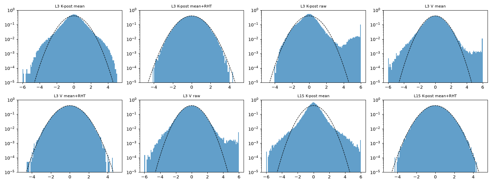

# E1 Gaussianization (Qwen3.5-0.8B, int8 reference cache, corpora prose+code, 6 attn layers × 2 KV heads)

**TL;DR:** mean removal + RHT brings key-shape kurtosis from median 5.1 (raw, max 8.0) to 2.96 (max 2.98; Gaussian = 3).
Empirical shape-MSE gap vs the Gaussian table after mean+RHT: keys post-RoPE median -0.04 dB (2b) / -0.07 dB (4b), worst -0.02 / -0.04 dB; values -0.05 / -0.08 dB.
0 (corpus, layer, tensor, head) cases exceed the 0.5 dB gap after mean+RHT.

## Config
- z = u·sqrt(d), u = y/||y||; y = x − mu (mu from prefill tokens [0, T−512)) then optionally RHT (seed 0). d = head_dim.
- Table: 2b nested-coarse MSE 0.1203, 4b Lloyd-Max 0.0095. gap dB = 10·log10(empirical/table) (positive = worse than Gaussian).
- Data: all 8192 tokens per corpus.

## Aggregate (median / max over corpus × layer × head)
| tensor | variant | kurt med | kurt max | gap2b med dB | gap2b max dB | gap4b med dB | gap4b max dB |
|---|---|---|---|---|---|---|---|
| K-post | raw | 5.08 | 8.02 | 1.54 | 2.56 | 3.93 | 7.00 |
| K-post | mean | 4.39 | 6.62 | 1.16 | 2.26 | 2.60 | 5.63 |
| K-post | mean+RHT | 2.96 | 2.98 | -0.04 | -0.02 | -0.07 | -0.04 |
| K-pre | raw | 5.11 | 8.04 | 1.56 | 2.60 | 3.96 | 6.97 |
| K-pre | mean | 4.69 | 6.77 | 1.29 | 2.38 | 3.34 | 5.76 |
| K-pre | mean+RHT | 2.96 | 2.98 | -0.04 | -0.02 | -0.07 | -0.00 |
| V | raw | 5.45 | 14.90 | 1.87 | 4.41 | 4.28 | 10.60 |
| V | mean | 5.44 | 11.51 | 1.60 | 2.97 | 4.45 | 8.70 |
| V | mean+RHT | 2.95 | 2.98 | -0.05 | -0.02 | -0.08 | -0.03 |

## Heads exceeding 0.5 dB after mean+RHT
None.

## Per layer (mean+RHT, keys post-RoPE / values, prose)
| corpus | layer | tensor | head | variant | kurt | mse2 | gap2 dB | mse4 | gap4 dB |
|---|---|---|---|---|---|---|---|---|---|
| prose | 3 | K-post | 0 | mean+RHT | 2.9501 | 0.1189 | -0.0506 | 0.0093 | -0.0771 |
| prose | 3 | K-post | 1 | mean+RHT | 2.9665 | 0.1193 | -0.0359 | 0.0094 | -0.0512 |
| prose | 3 | V | 0 | mean+RHT | 2.9703 | 0.1195 | -0.0279 | 0.0094 | -0.0562 |
| prose | 3 | V | 1 | mean+RHT | 2.9683 | 0.1195 | -0.0289 | 0.0094 | -0.0589 |
| prose | 7 | K-post | 0 | mean+RHT | 2.9501 | 0.1188 | -0.0539 | 0.0093 | -0.0936 |
| prose | 7 | K-post | 1 | mean+RHT | 2.9627 | 0.1192 | -0.0393 | 0.0094 | -0.0571 |
| prose | 7 | V | 0 | mean+RHT | 2.9574 | 0.1190 | -0.0478 | 0.0093 | -0.0897 |
| prose | 7 | V | 1 | mean+RHT | 2.9773 | 0.1196 | -0.0244 | 0.0094 | -0.0429 |
| prose | 11 | K-post | 0 | mean+RHT | 2.9571 | 0.1192 | -0.0407 | 0.0094 | -0.0690 |
| prose | 11 | K-post | 1 | mean+RHT | 2.9537 | 0.1189 | -0.0517 | 0.0093 | -0.0986 |
| prose | 11 | V | 0 | mean+RHT | 2.9470 | 0.1188 | -0.0536 | 0.0093 | -0.0986 |
| prose | 11 | V | 1 | mean+RHT | 2.9502 | 0.1188 | -0.0530 | 0.0093 | -0.0774 |
| prose | 15 | K-post | 0 | mean+RHT | 2.9594 | 0.1193 | -0.0349 | 0.0093 | -0.0867 |
| prose | 15 | K-post | 1 | mean+RHT | 2.9759 | 0.1195 | -0.0287 | 0.0094 | -0.0525 |
| prose | 15 | V | 0 | mean+RHT | 2.9430 | 0.1187 | -0.0576 | 0.0093 | -0.0844 |
| prose | 15 | V | 1 | mean+RHT | 2.8947 | 0.1172 | -0.1121 | 0.0092 | -0.1617 |
| prose | 19 | K-post | 0 | mean+RHT | 2.9537 | 0.1189 | -0.0507 | 0.0093 | -0.0858 |
| prose | 19 | K-post | 1 | mean+RHT | 2.9797 | 0.1198 | -0.0177 | 0.0094 | -0.0512 |
| prose | 19 | V | 0 | mean+RHT | 2.9115 | 0.1179 | -0.0884 | 0.0092 | -0.1363 |
| prose | 19 | V | 1 | mean+RHT | 2.8931 | 0.1173 | -0.1109 | 0.0091 | -0.1660 |
| prose | 23 | K-post | 0 | mean+RHT | 2.9708 | 0.1195 | -0.0273 | 0.0094 | -0.0412 |
| prose | 23 | K-post | 1 | mean+RHT | 2.9715 | 0.1195 | -0.0285 | 0.0094 | -0.0493 |
| prose | 23 | V | 0 | mean+RHT | 2.9186 | 0.1180 | -0.0841 | 0.0092 | -0.1218 |
| prose | 23 | V | 1 | mean+RHT | 2.9352 | 0.1184 | -0.0702 | 0.0092 | -0.1261 |

## Plots
 — log-density of z (prose, head 0, layers 3/15) with N(0,1) dashed.

## Caveats
- The reference is the int8 cache (user decision); int8 noise (~1% rel) is far below 4-bit shape error, so it does not affect these gaps.
- Note that a negative gap means *better* than the Gaussian table (lighter tails / sub-Gaussian shape).

runtime 57s
