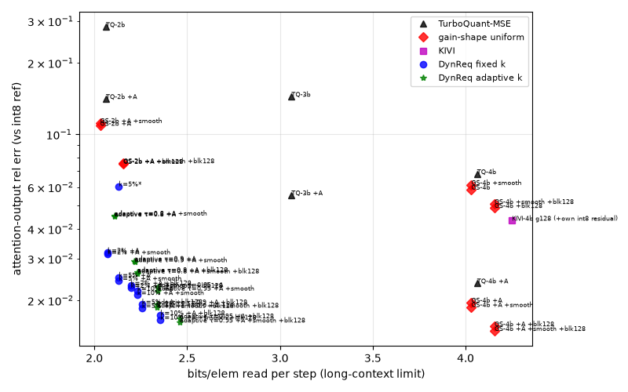

# E11 Low-hanging improvements + TurboQuant-MSE baseline (offline, int8 reference, 5 corpora × 6 layers)

**TL;DR:** E8 config DYN k=5%: attn err 0.0604. Adding (A) an exact sink+recent set outside the budget → 0.0250;
plus (C) block-local centering (128-token fp16 means) → 0.0193 at 2.26 bits (long-context limit); (B) key smoothing alone: 0.0242. References: GS-4b +A 0.0196 (4.03 b),
TurboQuant-MSE 2/3/4b (+A): 0.1409 / 0.0554 / 0.0236, KIVI-4b 0.0433 (4.25 b).
Adaptive k (τ=0.9, +A, +blk128): 0.0192 at 2.34 bits. GS-4b +A +blk128: 0.0155.

## Config
- A = first 4 tokens + last 128 tokens at reference (int8) precision, not counted in k. bits@8K include A (8.06 b for ~132 of ~8K tokens);
  the long-context limit drops A (→ coarse + 2·hot fraction).
- Smoothing: s_c = (E[(k_c−μ_c)²]/E[q_c²])^(1/4) per KV head from prefill keys and prefill queries (group-averaged); keys stored as (k−μ)/s, queries scaled by s.
- TurboQuant-MSE: RHT + Lloyd-Max N(0,1/d) codebook + fp16 norm, no mean removal, no QJL; b + 16/256 bits.
- Block centering: per-channel mean of each complete 128-token block (fp16), subtracted from K and V before RHT; +0.125 bits/elem.
- Adaptive: per query head smallest k s.t. estimated mass (coarse logits; exact for A) ≥ τ, capped at 20%; union over the query heads of a group.

| scheme | bits @8K | bits (long ctx) | attn err | attn err worst | resid err | layer-3 attn err |
|---|---|---|---|---|---|---|
| GS-2b +A | 2.1316 | 2.0312 | 0.1087 | 0.1782 | 0.1752 | 0.0691 |
| GS-2b +A +smooth | 2.1316 | 2.0312 | 0.1116 | 0.1892 | 0.1765 | 0.0699 |
| TQ-2b | 2.0625 | 2.0625 | 0.2832 | 0.4215 | 0.4871 | 0.2462 |
| TQ-2b +A | 2.1623 | 2.0625 | 0.1409 | 0.2158 | 0.2349 | 0.0895 |
| DYN k=2% +A +smooth | 2.1717 | 2.0714 | 0.0312 | 0.0516 | 0.0506 | 0.0293 |
| DYN k=2% +A | 2.1717 | 2.0714 | 0.0317 | 0.0537 | 0.0524 | 0.0301 |
| DYN adaptive τ=0.8 +A | 2.2080 | 2.1077 | 0.0451 | 0.0769 | 0.0702 | 0.0233 |
| DYN adaptive τ=0.8 +A +smooth | 2.2085 | 2.1082 | 0.0455 | 0.0805 | 0.0698 | 0.0225 |
| DYN k=5% (E8 config) | 2.1314 | 2.1314 | 0.0604 | 0.0930 | 0.0991 | 0.0496 |
| DYN k=5% +A | 2.2317 | 2.1314 | 0.0250 | 0.0405 | 0.0435 | 0.0223 |
| DYN k=5% +A +smooth | 2.2317 | 2.1314 | 0.0242 | 0.0380 | 0.0414 | 0.0214 |
| GS-2b +A +blk128 | 2.2545 | 2.1562 | 0.0751 | 0.1154 | 0.1344 | 0.0575 |
| GS-2b +A +smooth +blk128 | 2.2545 | 2.1562 | 0.0755 | 0.1168 | 0.1334 | 0.0578 |
| DYN k=2% +A +smooth +blk128 | 2.2946 | 2.1964 | 0.0226 | 0.0345 | 0.0390 | 0.0246 |
| DYN k=2% +A +blk128 | 2.2946 | 2.1964 | 0.0232 | 0.0351 | 0.0406 | 0.0253 |
| DYN adaptive τ=0.9 +A | 2.3168 | 2.2164 | 0.0293 | 0.0487 | 0.0488 | 0.0155 |
| DYN adaptive τ=0.9 +A +smooth | 2.3173 | 2.2170 | 0.0289 | 0.0494 | 0.0474 | 0.0147 |
| DYN k=10% +A | 2.3317 | 2.2314 | 0.0219 | 0.0360 | 0.0397 | 0.0173 |
| DYN k=10% +A +smooth | 2.3317 | 2.2314 | 0.0211 | 0.0334 | 0.0375 | 0.0164 |
| DYN adaptive τ=0.8 +A +blk128 | 2.3303 | 2.2321 | 0.0263 | 0.0430 | 0.0447 | 0.0183 |
| DYN adaptive τ=0.8 +A +smooth +blk128 | 2.3308 | 2.2326 | 0.0260 | 0.0417 | 0.0437 | 0.0178 |
| DYN k=5% +A +smooth +blk128 | 2.3546 | 2.2564 | 0.0186 | 0.0288 | 0.0335 | 0.0185 |
| DYN k=5% +A +blk128 | 2.3546 | 2.2564 | 0.0193 | 0.0300 | 0.0351 | 0.0193 |
| DYN adaptive τ=0.9 +A +blk128 | 2.4356 | 2.3373 | 0.0192 | 0.0319 | 0.0345 | 0.0133 |
| DYN adaptive τ=0.9 +A +smooth +blk128 | 2.4361 | 2.3379 | 0.0186 | 0.0305 | 0.0332 | 0.0126 |
| DYN adaptive τ=0.95 +A +smooth | 2.4418 | 2.3415 | 0.0220 | 0.0350 | 0.0386 | 0.0123 |
| DYN adaptive τ=0.95 +A | 2.4420 | 2.3416 | 0.0227 | 0.0369 | 0.0405 | 0.0131 |
| DYN k=10% +A +smooth +blk128 | 2.4546 | 2.3564 | 0.0166 | 0.0270 | 0.0309 | 0.0144 |
| DYN k=10% +A +blk128 | 2.4546 | 2.3564 | 0.0173 | 0.0283 | 0.0324 | 0.0153 |
| DYN adaptive τ=0.95 +A +smooth +blk128 | 2.5578 | 2.4596 | 0.0161 | 0.0271 | 0.0301 | 0.0109 |
| DYN adaptive τ=0.95 +A +blk128 | 2.5580 | 2.4597 | 0.0168 | 0.0284 | 0.0315 | 0.0116 |
| TQ-3b | 3.0625 | 3.0625 | 0.1440 | 0.2460 | 0.2573 | 0.1174 |
| TQ-3b +A | 3.1457 | 3.0625 | 0.0554 | 0.0867 | 0.1025 | 0.0369 |
| GS-4b | 4.0312 | 4.0312 | 0.0585 | 0.0884 | 0.0968 | 0.0457 |
| GS-4b +A | 4.0983 | 4.0312 | 0.0196 | 0.0339 | 0.0369 | 0.0119 |
| GS-4b +smooth | 4.0312 | 4.0312 | 0.0612 | 0.1119 | 0.0979 | 0.0431 |
| GS-4b +A +smooth | 4.0983 | 4.0312 | 0.0187 | 0.0317 | 0.0348 | 0.0112 |
| TQ-4b | 4.0625 | 4.0625 | 0.0680 | 0.0893 | 0.1271 | 0.0556 |
| TQ-4b +A | 4.1290 | 4.0625 | 0.0236 | 0.0394 | 0.0461 | 0.0151 |
| GS-4b +blk128 | 4.1562 | 4.1562 | 0.0490 | 0.0706 | 0.0815 | 0.0390 |
| GS-4b +A +blk128 | 4.2212 | 4.1562 | 0.0155 | 0.0270 | 0.0302 | 0.0105 |
| GS-4b +smooth +blk128 | 4.1562 | 4.1562 | 0.0509 | 0.0842 | 0.0817 | 0.0374 |
| GS-4b +A +smooth +blk128 | 4.2212 | 4.1562 | 0.0149 | 0.0257 | 0.0288 | 0.0099 |
| KIVI-4b g128 (+own int8 residual) | 4.2500 | 4.2500 | 0.0433 | 0.0716 | 0.0809 | 0.0147 |

## Per layer
| layer | scheme | attn err | resid err |
|---|---|---|---|
| 3 | GS-4b +A | 0.0119 | 0.0231 |
| 3 | DYN k=5% +A | 0.0223 | 0.0388 |
| 3 | DYN k=5% +A +blk128 | 0.0193 | 0.0350 |
| 3 | DYN adaptive τ=0.9 +A +blk128 | 0.0133 | 0.0242 |
| 3 | TQ-4b +A | 0.0151 | 0.0297 |
| 3 | TQ-2b +A | 0.0895 | 0.1626 |
| 7 | GS-4b +A | 0.0177 | 0.0413 |
| 7 | DYN k=5% +A | 0.0220 | 0.0477 |
| 7 | DYN k=5% +A +blk128 | 0.0164 | 0.0368 |
| 7 | DYN adaptive τ=0.9 +A +blk128 | 0.0184 | 0.0404 |
| 7 | TQ-4b +A | 0.0200 | 0.0460 |
| 7 | TQ-2b +A | 0.1228 | 0.2556 |
| 11 | GS-4b +A | 0.0264 | 0.0500 |
| 11 | DYN k=5% +A | 0.0322 | 0.0558 |
| 11 | DYN k=5% +A +blk128 | 0.0229 | 0.0414 |
| 11 | DYN adaptive τ=0.9 +A +blk128 | 0.0259 | 0.0449 |
| 11 | TQ-4b +A | 0.0291 | 0.0543 |
| 11 | TQ-2b +A | 0.1931 | 0.2652 |
| 15 | GS-4b +A | 0.0270 | 0.0421 |
| 15 | DYN k=5% +A | 0.0320 | 0.0457 |
| 15 | DYN k=5% +A +blk128 | 0.0235 | 0.0364 |
| 15 | DYN adaptive τ=0.9 +A +blk128 | 0.0244 | 0.0378 |
| 15 | TQ-4b +A | 0.0300 | 0.0477 |
| 15 | TQ-2b +A | 0.1803 | 0.2230 |
| 19 | GS-4b +A | 0.0297 | 0.0418 |
| 19 | DYN k=5% +A | 0.0352 | 0.0468 |
| 19 | DYN k=5% +A +blk128 | 0.0281 | 0.0379 |
| 19 | DYN adaptive τ=0.9 +A +blk128 | 0.0287 | 0.0387 |
| 19 | TQ-4b +A | 0.0355 | 0.0478 |
| 19 | TQ-2b +A | 0.1804 | 0.2311 |
| 23 | GS-4b +A | 0.0048 | 0.0230 |
| 23 | DYN k=5% +A | 0.0062 | 0.0265 |
| 23 | DYN k=5% +A +blk128 | 0.0055 | 0.0229 |
| 23 | DYN adaptive τ=0.9 +A +blk128 | 0.0048 | 0.0212 |
| 23 | TQ-4b +A | 0.0120 | 0.0513 |
| 23 | TQ-2b +A | 0.0791 | 0.2716 |

runtime 1033s
