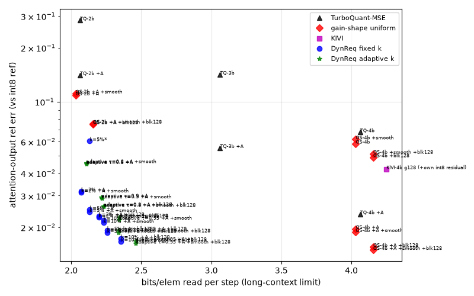

# E11 Low-hanging improvements + TurboQuant-MSE baseline (offline, int8 reference, 5 corpora × 6 layers)

**TL;DR:** E8 config DYN k=5%: attn err 0.0604. Adding (A) an exact sink+recent set outside the budget → 0.0250;
plus (C) block-local centering (128-token fp16 means) → 0.0192 at 2.26 bits (long-context limit); (B) key smoothing alone: 0.0243. References: GS-4b +A 0.0196 (4.03 b),
TurboQuant-MSE 2/3/4b (+A): 0.1408 / 0.0553 / 0.0237, KIVI-4b 0.0421 (4.25 b).
Adaptive k (τ=0.9, +A, +blk128): 0.0192 at 2.34 bits. GS-4b +A +blk128: 0.0155.

## Config
- A = first 4 tokens + last 128 tokens at reference (int8) precision, not counted in k. bits@8K include A (8.06 b for ~132 of ~8K tokens);
  the long-context limit drops A (→ coarse + 2·hot fraction).
- Smoothing: s_c = (E[(k_c−μ_c)²]/E[q_c²])^(1/4) per KV head from prefill keys and prefill queries (group-averaged); keys stored as (k−μ)/s, queries scaled by s.
- TurboQuant-MSE: RHT + Lloyd-Max N(0,1/d) codebook + fp16 norm, no mean removal, no QJL; b + 16/256 bits.
- Block centering: per-channel mean of each complete 128-token block (fp16), subtracted from K and V before RHT; +0.125 bits/elem.
- Adaptive: per query head smallest k s.t. estimated mass (coarse logits; exact for A) ≥ τ, capped at 20%; union over the query heads of a group.

| scheme | bits @8K | bits (long ctx) | attn err | attn err worst | resid err | layer-3 attn err |
|---|---|---|---|---|---|---|
| GS-2b +A | 2.1316 | 2.0312 | 0.1087 | 0.1766 | 0.1751 | 0.0694 |
| GS-2b +A +smooth | 2.1316 | 2.0312 | 0.1114 | 0.1857 | 0.1763 | 0.0700 |
| TQ-2b | 2.0625 | 2.0625 | 0.2842 | 0.4167 | 0.4884 | 0.2465 |
| TQ-2b +A | 2.1623 | 2.0625 | 0.1408 | 0.2131 | 0.2348 | 0.0896 |
| DYN k=2% +A | 2.1717 | 2.0714 | 0.0317 | 0.0533 | 0.0524 | 0.0302 |
| DYN k=2% +A +smooth | 2.1717 | 2.0714 | 0.0313 | 0.0519 | 0.0508 | 0.0293 |
| DYN adaptive τ=0.8 +A | 2.2080 | 2.1077 | 0.0450 | 0.0767 | 0.0702 | 0.0233 |
| DYN adaptive τ=0.8 +A +smooth | 2.2085 | 2.1081 | 0.0455 | 0.0792 | 0.0700 | 0.0225 |
| DYN k=5% (E8 config) | 2.1314 | 2.1314 | 0.0604 | 0.0943 | 0.0982 | 0.0496 |
| DYN k=5% +A | 2.2317 | 2.1314 | 0.0250 | 0.0403 | 0.0435 | 0.0223 |
| DYN k=5% +A +smooth | 2.2317 | 2.1314 | 0.0243 | 0.0385 | 0.0416 | 0.0214 |
| GS-2b +A +blk128 | 2.2545 | 2.1562 | 0.0751 | 0.1155 | 0.1343 | 0.0573 |
| GS-2b +A +smooth +blk128 | 2.2545 | 2.1562 | 0.0756 | 0.1169 | 0.1335 | 0.0579 |
| DYN k=2% +A +blk128 | 2.2946 | 2.1964 | 0.0231 | 0.0347 | 0.0405 | 0.0251 |
| DYN k=2% +A +smooth +blk128 | 2.2946 | 2.1964 | 0.0227 | 0.0348 | 0.0392 | 0.0246 |
| DYN adaptive τ=0.9 +A | 2.3168 | 2.2165 | 0.0293 | 0.0483 | 0.0488 | 0.0156 |
| DYN adaptive τ=0.9 +A +smooth | 2.3173 | 2.2170 | 0.0290 | 0.0493 | 0.0475 | 0.0147 |
| DYN k=10% +A +smooth | 2.3317 | 2.2314 | 0.0211 | 0.0340 | 0.0377 | 0.0163 |
| DYN k=10% +A | 2.3317 | 2.2314 | 0.0219 | 0.0359 | 0.0397 | 0.0173 |
| DYN adaptive τ=0.8 +A +blk128 | 2.3303 | 2.2321 | 0.0262 | 0.0431 | 0.0446 | 0.0182 |
| DYN adaptive τ=0.8 +A +smooth +blk128 | 2.3308 | 2.2326 | 0.0260 | 0.0414 | 0.0438 | 0.0179 |
| DYN k=5% +A +blk128 | 2.3546 | 2.2564 | 0.0192 | 0.0301 | 0.0350 | 0.0192 |
| DYN k=5% +A +smooth +blk128 | 2.3546 | 2.2564 | 0.0187 | 0.0289 | 0.0336 | 0.0186 |
| DYN adaptive τ=0.9 +A +blk128 | 2.4355 | 2.3373 | 0.0192 | 0.0319 | 0.0345 | 0.0132 |
| DYN adaptive τ=0.9 +A +smooth +blk128 | 2.4361 | 2.3379 | 0.0187 | 0.0302 | 0.0334 | 0.0127 |
| DYN adaptive τ=0.95 +A +smooth | 2.4418 | 2.3414 | 0.0220 | 0.0349 | 0.0388 | 0.0123 |
| DYN adaptive τ=0.95 +A | 2.4420 | 2.3416 | 0.0227 | 0.0368 | 0.0405 | 0.0131 |
| DYN k=10% +A +smooth +blk128 | 2.4546 | 2.3564 | 0.0167 | 0.0269 | 0.0311 | 0.0146 |
| DYN k=10% +A +blk128 | 2.4546 | 2.3564 | 0.0173 | 0.0283 | 0.0324 | 0.0152 |
| DYN adaptive τ=0.95 +A +smooth +blk128 | 2.5579 | 2.4596 | 0.0162 | 0.0269 | 0.0303 | 0.0110 |
| DYN adaptive τ=0.95 +A +blk128 | 2.5579 | 2.4597 | 0.0168 | 0.0285 | 0.0315 | 0.0115 |
| TQ-3b | 3.0625 | 3.0625 | 0.1418 | 0.2260 | 0.2536 | 0.1175 |
| TQ-3b +A | 3.1457 | 3.0625 | 0.0553 | 0.0871 | 0.1026 | 0.0368 |
| GS-4b | 4.0312 | 4.0312 | 0.0585 | 0.0899 | 0.0959 | 0.0457 |
| GS-4b +A | 4.0983 | 4.0312 | 0.0196 | 0.0339 | 0.0369 | 0.0119 |
| GS-4b +smooth | 4.0312 | 4.0312 | 0.0617 | 0.1079 | 0.0978 | 0.0431 |
| GS-4b +A +smooth | 4.0983 | 4.0312 | 0.0188 | 0.0320 | 0.0350 | 0.0112 |
| TQ-4b | 4.0625 | 4.0625 | 0.0677 | 0.0886 | 0.1266 | 0.0556 |
| TQ-4b +A | 4.1290 | 4.0625 | 0.0237 | 0.0400 | 0.0463 | 0.0151 |
| GS-4b +blk128 | 4.1562 | 4.1562 | 0.0491 | 0.0714 | 0.0819 | 0.0391 |
| GS-4b +A +blk128 | 4.2212 | 4.1562 | 0.0155 | 0.0270 | 0.0303 | 0.0104 |
| GS-4b +smooth +blk128 | 4.1562 | 4.1562 | 0.0513 | 0.0859 | 0.0830 | 0.0375 |
| GS-4b +A +smooth +blk128 | 4.2212 | 4.1562 | 0.0149 | 0.0259 | 0.0290 | 0.0100 |
| KIVI-4b g128 (+own int8 residual) | 4.2500 | 4.2500 | 0.0421 | 0.0687 | 0.0786 | 0.0147 |

## Per layer
| layer | scheme | attn err | resid err |
|---|---|---|---|
| 3 | GS-4b +A | 0.0119 | 0.0232 |
| 3 | DYN k=5% +A | 0.0223 | 0.0388 |
| 3 | DYN k=5% +A +blk128 | 0.0192 | 0.0348 |
| 3 | DYN adaptive τ=0.9 +A +blk128 | 0.0132 | 0.0240 |
| 3 | TQ-4b +A | 0.0151 | 0.0298 |
| 3 | TQ-2b +A | 0.0896 | 0.1627 |
| 7 | GS-4b +A | 0.0176 | 0.0411 |
| 7 | DYN k=5% +A | 0.0219 | 0.0476 |
| 7 | DYN k=5% +A +blk128 | 0.0163 | 0.0366 |
| 7 | DYN adaptive τ=0.9 +A +blk128 | 0.0183 | 0.0401 |
| 7 | TQ-4b +A | 0.0200 | 0.0461 |
| 7 | TQ-2b +A | 0.1225 | 0.2551 |
| 11 | GS-4b +A | 0.0262 | 0.0499 |
| 11 | DYN k=5% +A | 0.0320 | 0.0558 |
| 11 | DYN k=5% +A +blk128 | 0.0228 | 0.0413 |
| 11 | DYN adaptive τ=0.9 +A +blk128 | 0.0258 | 0.0449 |
| 11 | TQ-4b +A | 0.0291 | 0.0543 |
| 11 | TQ-2b +A | 0.1920 | 0.2647 |
| 15 | GS-4b +A | 0.0271 | 0.0422 |
| 15 | DYN k=5% +A | 0.0322 | 0.0458 |
| 15 | DYN k=5% +A +blk128 | 0.0234 | 0.0364 |
| 15 | DYN adaptive τ=0.9 +A +blk128 | 0.0243 | 0.0378 |
| 15 | TQ-4b +A | 0.0302 | 0.0479 |
| 15 | TQ-2b +A | 0.1811 | 0.2236 |
| 19 | GS-4b +A | 0.0298 | 0.0419 |
| 19 | DYN k=5% +A | 0.0353 | 0.0468 |
| 19 | DYN k=5% +A +blk128 | 0.0283 | 0.0384 |
| 19 | DYN adaptive τ=0.9 +A +blk128 | 0.0288 | 0.0392 |
| 19 | TQ-4b +A | 0.0356 | 0.0481 |
| 19 | TQ-2b +A | 0.1807 | 0.2313 |
| 23 | GS-4b +A | 0.0048 | 0.0230 |
| 23 | DYN k=5% +A | 0.0062 | 0.0264 |
| 23 | DYN k=5% +A +blk128 | 0.0055 | 0.0228 |
| 23 | DYN adaptive τ=0.9 +A +blk128 | 0.0048 | 0.0212 |
| 23 | TQ-4b +A | 0.0120 | 0.0514 |
| 23 | TQ-2b +A | 0.0791 | 0.2716 |

runtime 1000s
