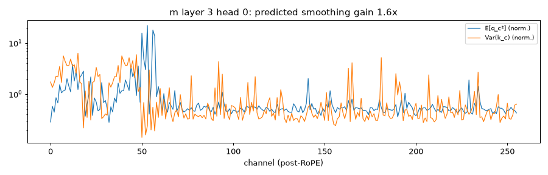
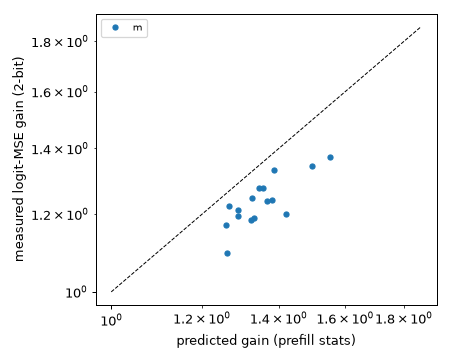

# E19 Why key smoothing matters on some models (pipeline check + characterization)

**TL;DR:** pipeline check (offline exact attention vs the model's own o_proj input), max rel. error: m 0.013.
Median predicted smoothing gain (Σq²·Σk²/(Σ√(q²k²))², from prefill stats): m 1.34x;
measured 2-bit logit-MSE gain: m 1.23x (Spearman predicted vs measured over heads 0.76).

## Config
Reference per model: {'m': 'int8'}. Corpora ['prose', 'code']; up to 4 attention layers per model; all KV heads; 2-bit (coarse) gain-shape keys with 128-token block means.
Logit error is measured on every 4th decode query over all causal positions. k² = per-channel variance of post-RoPE prefill keys,
q² = per-channel mean square of post-RoPE prefill queries (averaged over the GQA group). runtime 23s.

## (A) Pipeline check
| model | corpus | layer | rel err vs model |
|---|---|---|---|
| m | prose | 3 | 0.0061 |
| m | prose | 11 | 0.0133 |
| m | prose | 15 | 0.0096 |
| m | prose | 23 | 0.0124 |
| m | code | 3 | 0.0053 |
| m | code | 11 | 0.0102 |
| m | code | 15 | 0.0092 |
| m | code | 23 | 0.0103 |

## (B) Summary per model (medians over layer × head × corpus)
| model | n heads | Gpred median | Gpred max | measured gain median | measured max | logit err/spread (no smooth) | logit err/spread (smooth) | k² max/median | q² max/median | Spearman(q², k²) | outlier: max/median mean|k| (median) | (max) |
|---|---|---|---|---|---|---|---|---|---|---|---|---|
| m | 16 | 1.339 | 1.552 | 1.232 | 1.371 | 0.172 | 0.152 | 7.219 | 21.910 | 0.263 | 4.576 | 11.284 |

## (B) Per head
| model | corpus | layer | head | Gpred | measured gain | err/spread no smooth | err/spread smooth | k² max/med | q² max/med | ρ(q²,k²) | max/med mean|k| |
|---|---|---|---|---|---|---|---|---|---|---|---|
| m | prose | 3 | 0 | 1.552 | 1.371 | 0.196 | 0.168 | 14.730 | 41.999 | 0.247 | 11.284 |
| m | prose | 3 | 1 | 1.386 | 1.331 | 0.173 | 0.150 | 6.147 | 24.725 | 0.244 | 6.624 |
| m | prose | 11 | 0 | 1.381 | 1.241 | 0.189 | 0.169 | 7.002 | 20.991 | 0.223 | 2.686 |
| m | prose | 11 | 1 | 1.420 | 1.201 | 0.148 | 0.135 | 12.349 | 19.395 | 0.102 | 3.864 |
| m | prose | 15 | 0 | 1.261 | 1.095 | 0.129 | 0.123 | 11.617 | 16.457 | 0.486 | 4.825 |
| m | prose | 15 | 1 | 1.497 | 1.343 | 0.172 | 0.148 | 4.942 | 28.703 | 0.246 | 4.401 |
| m | prose | 23 | 0 | 1.290 | 1.213 | 0.201 | 0.183 | 3.786 | 16.135 | 0.140 | 4.478 |
| m | prose | 23 | 1 | 1.324 | 1.183 | 0.186 | 0.171 | 5.714 | 21.143 | 0.482 | 3.743 |
| m | code | 3 | 0 | 1.367 | 1.239 | 0.204 | 0.183 | 9.789 | 30.142 | 0.142 | 8.882 |
| m | code | 3 | 1 | 1.346 | 1.277 | 0.167 | 0.147 | 6.428 | 24.290 | 0.265 | 6.895 |
| m | code | 11 | 0 | 1.260 | 1.169 | 0.181 | 0.167 | 8.569 | 21.853 | 0.373 | 3.300 |
| m | code | 11 | 1 | 1.333 | 1.190 | 0.161 | 0.148 | 15.449 | 24.741 | 0.293 | 4.630 |
| m | code | 15 | 0 | 1.289 | 1.195 | 0.162 | 0.148 | 11.734 | 17.202 | 0.463 | 5.153 |
| m | code | 15 | 1 | 1.357 | 1.277 | 0.157 | 0.139 | 4.987 | 15.380 | 0.260 | 3.606 |
| m | code | 23 | 0 | 1.266 | 1.225 | 0.169 | 0.153 | 5.432 | 21.967 | 0.373 | 4.523 |
| m | code | 23 | 1 | 1.326 | 1.247 | 0.173 | 0.155 | 7.436 | 29.542 | 0.412 | 4.903 |

## Plots
 — per-channel query energy and key variance for the head with the largest predicted gain.

