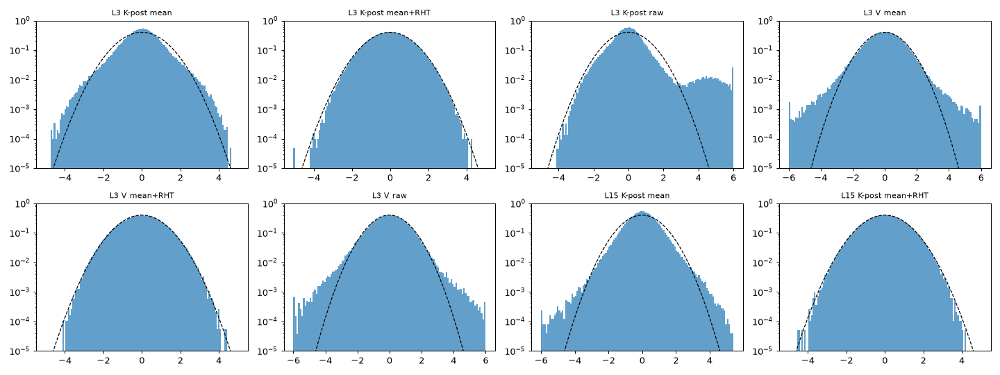

# E1 Gaussianization (Qwen3.5-0.8B, int8 reference cache, corpora prose+code, 6 attn layers × 2 KV heads)

**TL;DR:** mean removal + RHT brings key-shape kurtosis from median 5.3 (raw, max 8.4) to 2.96 (max 2.98; Gaussian = 3).
Empirical shape-MSE gap vs the Gaussian table after mean+RHT: keys post-RoPE median -0.04 dB (2b) / -0.07 dB (4b), worst -0.02 / -0.03 dB; values -0.05 / -0.09 dB.
0 (corpus, layer, tensor, head) cases exceed the 0.5 dB gap after mean+RHT.

## Config
- z = u·sqrt(d), u = y/||y||; y = x − mu (mu from prefill tokens [0, T−512)) then optionally RHT (seed 0). d = head_dim.
- Table: 2b nested-coarse MSE 0.1203, 4b Lloyd-Max 0.0095. gap dB = 10·log10(empirical/table) (positive = worse than Gaussian).
- Data: all 8192 tokens per corpus.

## Aggregate (median / max over corpus × layer × head)
| tensor | variant | kurt med | kurt max | gap2b med dB | gap2b max dB | gap4b med dB | gap4b max dB |
|---|---|---|---|---|---|---|---|
| K-post | raw | 5.33 | 8.44 | 1.54 | 2.74 | 4.34 | 7.28 |
| K-post | mean | 4.03 | 6.33 | 0.87 | 2.13 | 2.38 | 5.48 |
| K-post | mean+RHT | 2.96 | 2.98 | -0.04 | -0.02 | -0.07 | -0.03 |
| K-pre | raw | 5.35 | 8.61 | 1.61 | 2.85 | 4.34 | 7.28 |
| K-pre | mean | 4.64 | 7.00 | 1.17 | 2.39 | 3.20 | 6.17 |
| K-pre | mean+RHT | 2.96 | 2.98 | -0.04 | -0.01 | -0.08 | -0.03 |
| V | raw | 4.73 | 19.78 | 1.36 | 4.44 | 3.13 | 11.35 |
| V | mean | 5.73 | 13.42 | 1.72 | 3.15 | 4.78 | 9.20 |
| V | mean+RHT | 2.95 | 3.01 | -0.05 | 0.01 | -0.09 | 0.06 |

## Heads exceeding 0.5 dB after mean+RHT
None.

## Per layer (mean+RHT, keys post-RoPE / values, prose)
| corpus | layer | tensor | head | variant | kurt | mse2 | gap2 dB | mse4 | gap4 dB |
|---|---|---|---|---|---|---|---|---|---|
| prose | 3 | K-post | 0 | mean+RHT | 2.9300 | 0.1183 | -0.0732 | 0.0093 | -0.1137 |
| prose | 3 | K-post | 1 | mean+RHT | 2.9636 | 0.1192 | -0.0384 | 0.0094 | -0.0495 |
| prose | 3 | V | 0 | mean+RHT | 2.9652 | 0.1192 | -0.0395 | 0.0094 | -0.0542 |
| prose | 3 | V | 1 | mean+RHT | 2.9589 | 0.1191 | -0.0448 | 0.0093 | -0.0727 |
| prose | 7 | K-post | 0 | mean+RHT | 2.9642 | 0.1191 | -0.0430 | 0.0093 | -0.0713 |
| prose | 7 | K-post | 1 | mean+RHT | 2.9604 | 0.1192 | -0.0415 | 0.0093 | -0.0733 |
| prose | 7 | V | 0 | mean+RHT | 2.9672 | 0.1194 | -0.0307 | 0.0094 | -0.0602 |
| prose | 7 | V | 1 | mean+RHT | 2.9741 | 0.1196 | -0.0258 | 0.0094 | -0.0365 |
| prose | 11 | K-post | 0 | mean+RHT | 2.9603 | 0.1191 | -0.0433 | 0.0093 | -0.0717 |
| prose | 11 | K-post | 1 | mean+RHT | 2.9472 | 0.1188 | -0.0552 | 0.0093 | -0.0956 |
| prose | 11 | V | 0 | mean+RHT | 2.9538 | 0.1189 | -0.0490 | 0.0093 | -0.0824 |
| prose | 11 | V | 1 | mean+RHT | 2.9448 | 0.1187 | -0.0596 | 0.0093 | -0.0938 |
| prose | 15 | K-post | 0 | mean+RHT | 2.9685 | 0.1194 | -0.0318 | 0.0094 | -0.0615 |
| prose | 15 | K-post | 1 | mean+RHT | 2.9752 | 0.1197 | -0.0217 | 0.0094 | -0.0450 |
| prose | 15 | V | 0 | mean+RHT | 2.9385 | 0.1186 | -0.0630 | 0.0093 | -0.1075 |
| prose | 15 | V | 1 | mean+RHT | 2.8868 | 0.1172 | -0.1129 | 0.0091 | -0.1806 |
| prose | 19 | K-post | 0 | mean+RHT | 2.9618 | 0.1193 | -0.0352 | 0.0094 | -0.0646 |
| prose | 19 | K-post | 1 | mean+RHT | 2.9540 | 0.1191 | -0.0425 | 0.0094 | -0.0648 |
| prose | 19 | V | 0 | mean+RHT | 2.9083 | 0.1178 | -0.0913 | 0.0092 | -0.1242 |
| prose | 19 | V | 1 | mean+RHT | 2.8931 | 0.1175 | -0.1033 | 0.0091 | -0.1733 |
| prose | 23 | K-post | 0 | mean+RHT | 2.9813 | 0.1197 | -0.0213 | 0.0094 | -0.0370 |
| prose | 23 | K-post | 1 | mean+RHT | 2.9596 | 0.1191 | -0.0449 | 0.0094 | -0.0616 |
| prose | 23 | V | 0 | mean+RHT | 2.9081 | 0.1179 | -0.0867 | 0.0092 | -0.1206 |
| prose | 23 | V | 1 | mean+RHT | 2.9485 | 0.1189 | -0.0492 | 0.0093 | -0.0795 |

## Plots
 — log-density of z (prose, head 0, layers 3/15) with N(0,1) dashed.

## Caveats
- The reference is the int8 cache (user decision); int8 noise (~1% rel) is far below 4-bit shape error, so it does not affect these gaps.
- Note that a negative gap means *better* than the Gaussian table (lighter tails / sub-Gaussian shape).

runtime 55s
