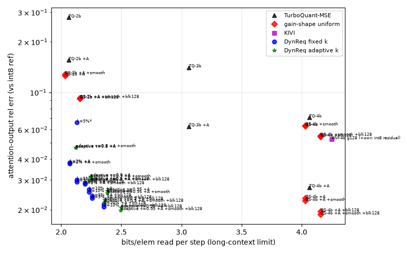

# E11 Low-hanging improvements + TurboQuant-MSE baseline (offline, int8 reference, 5 corpora × 6 layers)

**TL;DR:** E8 config DYN k=5%: attn err 0.0661. Adding (A) an exact sink+recent set outside the budget → 0.0301;
plus (C) block-local centering (128-token fp16 means) → 0.0240 at 2.26 bits (long-context limit); (B) key smoothing alone: 0.0293. References: GS-4b +A 0.0235 (4.03 b),
TurboQuant-MSE 2/3/4b (+A): 0.1556 / 0.0627 / 0.0272, KIVI-4b 0.0525 (4.25 b).
Adaptive k (τ=0.9, +A, +blk128): 0.0229 at 2.36 bits. GS-4b +A +blk128: 0.0195.

## Config
- A = first 4 tokens + last 128 tokens at reference (int8) precision, not counted in k. bits@8K include A (8.06 b for ~132 of ~8K tokens);
  the long-context limit drops A (→ coarse + 2·hot fraction).
- Smoothing: s_c = (E[(k_c−μ_c)²]/E[q_c²])^(1/4) per KV head from prefill keys and prefill queries (group-averaged); keys stored as (k−μ)/s, queries scaled by s.
- TurboQuant-MSE: RHT + Lloyd-Max N(0,1/d) codebook + fp16 norm, no mean removal, no QJL; b + 16/256 bits.
- Block centering: per-channel mean of each complete 128-token block (fp16), subtracted from K and V before RHT; +0.125 bits/elem.
- Adaptive: per query head smallest k s.t. estimated mass (coarse logits; exact for A) ≥ τ, capped at 20%; union over the query heads of a group.

| scheme | bits @8K | bits (long ctx) | attn err | attn err worst | resid err | layer-3 attn err |
|---|---|---|---|---|---|---|
| GS-2b +A | 2.1316 | 2.0312 | 0.1259 | 0.2289 | 0.1857 | 0.0699 |
| GS-2b +A +smooth | 2.1316 | 2.0312 | 0.1283 | 0.2365 | 0.1860 | 0.0711 |
| TQ-2b | 2.0625 | 2.0625 | 0.2793 | 0.3567 | 0.4150 | 0.2477 |
| TQ-2b +A | 2.1623 | 2.0625 | 0.1556 | 0.2758 | 0.2360 | 0.0909 |
| DYN k=2% +A | 2.1717 | 2.0714 | 0.0381 | 0.0723 | 0.0565 | 0.0290 |
| DYN k=2% +A +smooth | 2.1717 | 2.0714 | 0.0377 | 0.0689 | 0.0551 | 0.0292 |
| DYN adaptive τ=0.8 +A | 2.2215 | 2.1211 | 0.0467 | 0.0772 | 0.0681 | 0.0244 |
| DYN adaptive τ=0.8 +A +smooth | 2.2220 | 2.1216 | 0.0471 | 0.0791 | 0.0681 | 0.0247 |
| DYN k=5% (E8 config) | 2.1314 | 2.1314 | 0.0661 | 0.1232 | 0.0943 | 0.0524 |
| DYN k=5% +A | 2.2317 | 2.1314 | 0.0301 | 0.0542 | 0.0470 | 0.0217 |
| DYN k=5% +A +smooth | 2.2317 | 2.1314 | 0.0293 | 0.0513 | 0.0453 | 0.0216 |
| GS-2b +A +blk128 | 2.2545 | 2.1562 | 0.0919 | 0.1641 | 0.1475 | 0.0581 |
| GS-2b +A +smooth +blk128 | 2.2545 | 2.1562 | 0.0926 | 0.1701 | 0.1467 | 0.0576 |
| DYN k=2% +A +blk128 | 2.2946 | 2.1964 | 0.0288 | 0.0562 | 0.0451 | 0.0235 |
| DYN k=2% +A +smooth +blk128 | 2.2946 | 2.1964 | 0.0284 | 0.0558 | 0.0437 | 0.0237 |
| DYN k=10% +A +smooth | 2.3317 | 2.2314 | 0.0254 | 0.0455 | 0.0409 | 0.0167 |
| DYN k=10% +A | 2.3317 | 2.2314 | 0.0263 | 0.0473 | 0.0428 | 0.0171 |
| DYN adaptive τ=0.8 +A +blk128 | 2.3418 | 2.2436 | 0.0301 | 0.0485 | 0.0466 | 0.0181 |
| DYN adaptive τ=0.8 +A +smooth +blk128 | 2.3419 | 2.2437 | 0.0298 | 0.0459 | 0.0455 | 0.0181 |
| DYN adaptive τ=0.9 +A | 2.3446 | 2.2443 | 0.0316 | 0.0512 | 0.0489 | 0.0163 |
| DYN adaptive τ=0.9 +A +smooth | 2.3453 | 2.2449 | 0.0311 | 0.0511 | 0.0478 | 0.0160 |
| DYN k=5% +A +blk128 | 2.3546 | 2.2564 | 0.0240 | 0.0447 | 0.0391 | 0.0182 |
| DYN k=5% +A +smooth +blk128 | 2.3546 | 2.2564 | 0.0234 | 0.0441 | 0.0376 | 0.0181 |
| DYN k=10% +A +blk128 | 2.4546 | 2.3564 | 0.0216 | 0.0398 | 0.0361 | 0.0147 |
| DYN k=10% +A +smooth +blk128 | 2.4546 | 2.3564 | 0.0209 | 0.0392 | 0.0347 | 0.0144 |
| DYN adaptive τ=0.9 +A +blk128 | 2.4590 | 2.3607 | 0.0229 | 0.0392 | 0.0373 | 0.0133 |
| DYN adaptive τ=0.9 +A +smooth +blk128 | 2.4590 | 2.3608 | 0.0223 | 0.0383 | 0.0359 | 0.0130 |
| DYN adaptive τ=0.95 +A | 2.4840 | 2.3837 | 0.0260 | 0.0443 | 0.0422 | 0.0136 |
| DYN adaptive τ=0.95 +A +smooth | 2.4844 | 2.3841 | 0.0251 | 0.0429 | 0.0405 | 0.0132 |
| DYN adaptive τ=0.95 +A +smooth +blk128 | 2.5943 | 2.4960 | 0.0199 | 0.0366 | 0.0332 | 0.0114 |
| DYN adaptive τ=0.95 +A +blk128 | 2.5947 | 2.4964 | 0.0206 | 0.0371 | 0.0347 | 0.0118 |
| TQ-3b | 3.0625 | 3.0625 | 0.1409 | 0.1859 | 0.2241 | 0.1191 |
| TQ-3b +A | 3.1457 | 3.0625 | 0.0627 | 0.1047 | 0.1045 | 0.0374 |
| GS-4b | 4.0312 | 4.0312 | 0.0631 | 0.1111 | 0.0912 | 0.0492 |
| GS-4b +A | 4.0983 | 4.0312 | 0.0235 | 0.0437 | 0.0397 | 0.0123 |
| GS-4b +smooth | 4.0312 | 4.0312 | 0.0635 | 0.1000 | 0.0918 | 0.0467 |
| GS-4b +A +smooth | 4.0983 | 4.0312 | 0.0226 | 0.0413 | 0.0378 | 0.0120 |
| TQ-4b | 4.0625 | 4.0625 | 0.0709 | 0.1062 | 0.1141 | 0.0580 |
| TQ-4b +A | 4.1290 | 4.0625 | 0.0272 | 0.0471 | 0.0477 | 0.0156 |
| GS-4b +blk128 | 4.1562 | 4.1562 | 0.0544 | 0.0908 | 0.0793 | 0.0417 |
| GS-4b +A +blk128 | 4.2212 | 4.1562 | 0.0195 | 0.0364 | 0.0338 | 0.0110 |
| GS-4b +smooth +blk128 | 4.1562 | 4.1562 | 0.0551 | 0.0982 | 0.0773 | 0.0393 |
| GS-4b +A +smooth +blk128 | 4.2212 | 4.1562 | 0.0187 | 0.0359 | 0.0322 | 0.0106 |
| KIVI-4b g128 (+own int8 residual) | 4.2500 | 4.2500 | 0.0525 | 0.0999 | 0.0851 | 0.0168 |

## Per layer
| layer | scheme | attn err | resid err |
|---|---|---|---|
| 3 | GS-4b +A | 0.0123 | 0.0231 |
| 3 | DYN k=5% +A | 0.0217 | 0.0381 |
| 3 | DYN k=5% +A +blk128 | 0.0182 | 0.0336 |
| 3 | DYN adaptive τ=0.9 +A +blk128 | 0.0133 | 0.0235 |
| 3 | TQ-4b +A | 0.0156 | 0.0291 |
| 3 | TQ-2b +A | 0.0909 | 0.1560 |
| 7 | GS-4b +A | 0.0204 | 0.0409 |
| 7 | DYN k=5% +A | 0.0246 | 0.0463 |
| 7 | DYN k=5% +A +blk128 | 0.0188 | 0.0371 |
| 7 | DYN adaptive τ=0.9 +A +blk128 | 0.0205 | 0.0396 |
| 7 | TQ-4b +A | 0.0224 | 0.0447 |
| 7 | TQ-2b +A | 0.1279 | 0.2328 |
| 11 | GS-4b +A | 0.0300 | 0.0517 |
| 11 | DYN k=5% +A | 0.0364 | 0.0572 |
| 11 | DYN k=5% +A +blk128 | 0.0276 | 0.0452 |
| 11 | DYN adaptive τ=0.9 +A +blk128 | 0.0295 | 0.0482 |
| 11 | TQ-4b +A | 0.0330 | 0.0564 |
| 11 | TQ-2b +A | 0.1990 | 0.2728 |
| 15 | GS-4b +A | 0.0347 | 0.0492 |
| 15 | DYN k=5% +A | 0.0423 | 0.0532 |
| 15 | DYN k=5% +A +blk128 | 0.0325 | 0.0438 |
| 15 | DYN adaptive τ=0.9 +A +blk128 | 0.0326 | 0.0448 |
| 15 | TQ-4b +A | 0.0379 | 0.0533 |
| 15 | TQ-2b +A | 0.2292 | 0.2565 |
| 19 | GS-4b +A | 0.0382 | 0.0496 |
| 19 | DYN k=5% +A | 0.0485 | 0.0590 |
| 19 | DYN k=5% +A +blk128 | 0.0410 | 0.0502 |
| 19 | DYN adaptive τ=0.9 +A +blk128 | 0.0366 | 0.0462 |
| 19 | TQ-4b +A | 0.0430 | 0.0555 |
| 19 | TQ-2b +A | 0.2040 | 0.2387 |
| 23 | GS-4b +A | 0.0051 | 0.0236 |
| 23 | DYN k=5% +A | 0.0067 | 0.0285 |
| 23 | DYN k=5% +A +blk128 | 0.0059 | 0.0246 |
| 23 | DYN adaptive τ=0.9 +A +blk128 | 0.0049 | 0.0214 |
| 23 | TQ-4b +A | 0.0111 | 0.0472 |
| 23 | TQ-2b +A | 0.0825 | 0.2593 |

runtime 1071s
