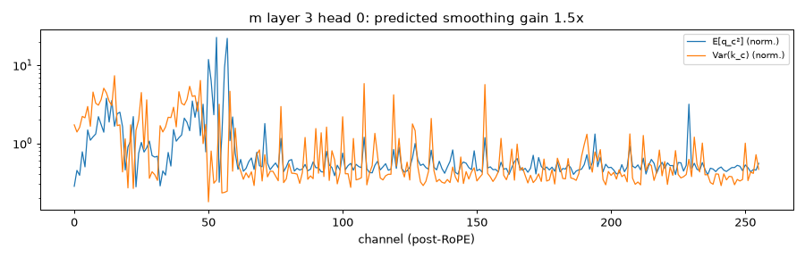
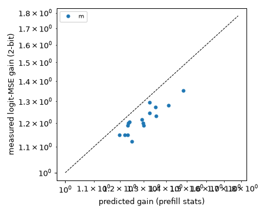

# E19 Why key smoothing matters on some models (pipeline check + characterization)

**TL;DR:** pipeline check (offline exact attention vs the model's own o_proj input), max rel. error: m 0.013.
Median predicted smoothing gain (Σq²·Σk²/(Σ√(q²k²))², from prefill stats): m 1.29x;
measured 2-bit logit-MSE gain: m 1.20x (Spearman predicted vs measured over heads 0.86).

## Config
Reference per model: {'m': 'int8'}. Corpora ['prose', 'code']; up to 4 attention layers per model; all KV heads; 2-bit (coarse) gain-shape keys with 128-token block means.
Logit error is measured on every 4th decode query over all causal positions. k² = per-channel variance of post-RoPE prefill keys,
q² = per-channel mean square of post-RoPE prefill queries (averaged over the GQA group). runtime 28s.

## (A) Pipeline check
| model | corpus | layer | rel err vs model |
|---|---|---|---|
| m | prose | 3 | 0.0063 |
| m | prose | 11 | 0.0114 |
| m | prose | 15 | 0.0127 |
| m | prose | 23 | 0.0103 |
| m | code | 3 | 0.0064 |
| m | code | 11 | 0.0090 |
| m | code | 15 | 0.0105 |
| m | code | 23 | 0.0084 |

## (B) Summary per model (medians over layer × head × corpus)
| model | n heads | Gpred median | Gpred max | measured gain median | measured max | logit err/spread (no smooth) | logit err/spread (smooth) | k² max/median | q² max/median | Spearman(q², k²) | outlier: max/median mean|k| (median) | (max) |
|---|---|---|---|---|---|---|---|---|---|---|---|---|
| m | 16 | 1.294 | 1.484 | 1.203 | 1.353 | 0.179 | 0.163 | 7.481 | 21.101 | 0.398 | 5.219 | 9.873 |

## (B) Per head
| model | corpus | layer | head | Gpred | measured gain | err/spread no smooth | err/spread smooth | k² max/med | q² max/med | ρ(q²,k²) | max/med mean|k| |
|---|---|---|---|---|---|---|---|---|---|---|---|
| m | prose | 3 | 0 | 1.484 | 1.353 | 0.190 | 0.163 | 17.061 | 44.983 | 0.328 | 9.873 |
| m | prose | 3 | 1 | 1.350 | 1.274 | 0.170 | 0.151 | 7.441 | 22.621 | 0.318 | 7.303 |
| m | prose | 11 | 0 | 1.218 | 1.149 | 0.195 | 0.182 | 6.563 | 19.135 | 0.456 | 3.527 |
| m | prose | 11 | 1 | 1.300 | 1.191 | 0.160 | 0.147 | 11.507 | 24.855 | 0.460 | 4.547 |
| m | prose | 15 | 0 | 1.248 | 1.122 | 0.162 | 0.153 | 10.062 | 18.618 | 0.416 | 5.576 |
| m | prose | 15 | 1 | 1.411 | 1.281 | 0.188 | 0.166 | 4.085 | 21.616 | 0.241 | 4.404 |
| m | prose | 23 | 0 | 1.239 | 1.204 | 0.211 | 0.192 | 3.534 | 19.599 | 0.264 | 4.715 |
| m | prose | 23 | 1 | 1.292 | 1.215 | 0.199 | 0.180 | 4.677 | 18.765 | 0.249 | 5.485 |
| m | code | 3 | 0 | 1.354 | 1.233 | 0.200 | 0.180 | 9.059 | 36.146 | 0.230 | 8.599 |
| m | code | 3 | 1 | 1.324 | 1.296 | 0.167 | 0.146 | 7.521 | 27.430 | 0.388 | 7.541 |
| m | code | 11 | 0 | 1.198 | 1.150 | 0.188 | 0.175 | 7.769 | 22.493 | 0.499 | 3.876 |
| m | code | 11 | 1 | 1.296 | 1.201 | 0.168 | 0.154 | 10.112 | 30.959 | 0.467 | 4.574 |
| m | code | 15 | 0 | 1.230 | 1.150 | 0.167 | 0.156 | 10.417 | 20.587 | 0.516 | 5.815 |
| m | code | 15 | 1 | 1.324 | 1.247 | 0.173 | 0.155 | 5.383 | 16.228 | 0.327 | 4.315 |
| m | code | 23 | 0 | 1.234 | 1.200 | 0.178 | 0.163 | 4.444 | 18.738 | 0.415 | 5.601 |
| m | code | 23 | 1 | 1.232 | 1.190 | 0.180 | 0.165 | 3.976 | 17.490 | 0.407 | 4.953 |

## Plots
 — per-channel query energy and key variance for the head with the largest predicted gain.

