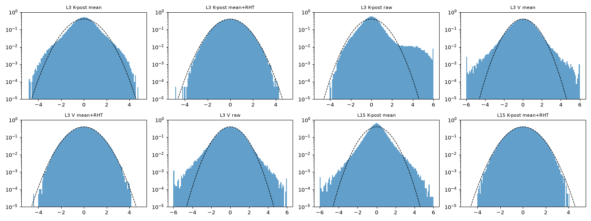

# E1 Gaussianization (Qwen3.5-0.8B, int8 reference cache, corpora prose+code, 6 attn layers × 2 KV heads)

**TL;DR:** mean removal + RHT brings key-shape kurtosis from median 4.8 (raw, max 8.0) to 2.96 (max 2.98; Gaussian = 3).
Empirical shape-MSE gap vs the Gaussian table after mean+RHT: keys post-RoPE median -0.04 dB (2b) / -0.07 dB (4b), worst -0.02 / -0.03 dB; values -0.06 / -0.10 dB.
0 (corpus, layer, tensor, head) cases exceed the 0.5 dB gap after mean+RHT.

## Config
- z = u·sqrt(d), u = y/||y||; y = x − mu (mu from prefill tokens [0, T−512)) then optionally RHT (seed 0). d = head_dim.
- Table: 2b nested-coarse MSE 0.1203, 4b Lloyd-Max 0.0095. gap dB = 10·log10(empirical/table) (positive = worse than Gaussian).
- Data: all 8192 tokens per corpus.

## Aggregate (median / max over corpus × layer × head)
| tensor | variant | kurt med | kurt max | gap2b med dB | gap2b max dB | gap4b med dB | gap4b max dB |
|---|---|---|---|---|---|---|---|
| K-post | raw | 4.84 | 8.02 | 1.41 | 2.57 | 3.71 | 6.87 |
| K-post | mean | 4.32 | 7.33 | 1.02 | 2.53 | 2.60 | 6.40 |
| K-post | mean+RHT | 2.96 | 2.98 | -0.04 | -0.02 | -0.07 | -0.03 |
| K-pre | raw | 4.85 | 8.11 | 1.44 | 2.65 | 3.74 | 6.88 |
| K-pre | mean | 4.74 | 7.55 | 1.25 | 2.65 | 3.13 | 6.56 |
| K-pre | mean+RHT | 2.96 | 2.98 | -0.04 | -0.02 | -0.08 | -0.01 |
| V | raw | 4.79 | 19.84 | 1.37 | 4.39 | 3.21 | 11.35 |
| V | mean | 5.69 | 13.39 | 1.69 | 3.15 | 4.77 | 9.19 |
| V | mean+RHT | 2.94 | 3.00 | -0.06 | -0.00 | -0.10 | 0.04 |

## Heads exceeding 0.5 dB after mean+RHT
None.

## Per layer (mean+RHT, keys post-RoPE / values, prose)
| corpus | layer | tensor | head | variant | kurt | mse2 | gap2 dB | mse4 | gap4 dB |
|---|---|---|---|---|---|---|---|---|---|
| prose | 3 | K-post | 0 | mean+RHT | 2.9393 | 0.1185 | -0.0657 | 0.0093 | -0.0993 |
| prose | 3 | K-post | 1 | mean+RHT | 2.9610 | 0.1192 | -0.0388 | 0.0094 | -0.0540 |
| prose | 3 | V | 0 | mean+RHT | 2.9642 | 0.1193 | -0.0365 | 0.0094 | -0.0645 |
| prose | 3 | V | 1 | mean+RHT | 2.9658 | 0.1192 | -0.0393 | 0.0094 | -0.0569 |
| prose | 7 | K-post | 0 | mean+RHT | 2.9611 | 0.1190 | -0.0457 | 0.0093 | -0.0803 |
| prose | 7 | K-post | 1 | mean+RHT | 2.9649 | 0.1192 | -0.0398 | 0.0094 | -0.0651 |
| prose | 7 | V | 0 | mean+RHT | 2.9574 | 0.1191 | -0.0423 | 0.0093 | -0.0733 |
| prose | 7 | V | 1 | mean+RHT | 2.9709 | 0.1195 | -0.0271 | 0.0094 | -0.0428 |
| prose | 11 | K-post | 0 | mean+RHT | 2.9509 | 0.1189 | -0.0499 | 0.0093 | -0.0895 |
| prose | 11 | K-post | 1 | mean+RHT | 2.9390 | 0.1185 | -0.0637 | 0.0093 | -0.0984 |
| prose | 11 | V | 0 | mean+RHT | 2.9557 | 0.1189 | -0.0495 | 0.0093 | -0.0739 |
| prose | 11 | V | 1 | mean+RHT | 2.9428 | 0.1188 | -0.0545 | 0.0093 | -0.0959 |
| prose | 15 | K-post | 0 | mean+RHT | 2.9648 | 0.1193 | -0.0353 | 0.0093 | -0.0781 |
| prose | 15 | K-post | 1 | mean+RHT | 2.9650 | 0.1194 | -0.0315 | 0.0093 | -0.0761 |
| prose | 15 | V | 0 | mean+RHT | 2.9355 | 0.1185 | -0.0667 | 0.0093 | -0.1106 |
| prose | 15 | V | 1 | mean+RHT | 2.8861 | 0.1171 | -0.1187 | 0.0091 | -0.1729 |
| prose | 19 | K-post | 0 | mean+RHT | 2.9481 | 0.1189 | -0.0510 | 0.0093 | -0.0897 |
| prose | 19 | K-post | 1 | mean+RHT | 2.9541 | 0.1191 | -0.0426 | 0.0094 | -0.0681 |
| prose | 19 | V | 0 | mean+RHT | 2.8963 | 0.1174 | -0.1063 | 0.0092 | -0.1497 |
| prose | 19 | V | 1 | mean+RHT | 2.8935 | 0.1173 | -0.1099 | 0.0091 | -0.1760 |
| prose | 23 | K-post | 0 | mean+RHT | 2.9711 | 0.1195 | -0.0291 | 0.0094 | -0.0537 |
| prose | 23 | K-post | 1 | mean+RHT | 2.9572 | 0.1191 | -0.0445 | 0.0094 | -0.0644 |
| prose | 23 | V | 0 | mean+RHT | 2.8757 | 0.1170 | -0.1209 | 0.0091 | -0.1697 |
| prose | 23 | V | 1 | mean+RHT | 2.9342 | 0.1184 | -0.0689 | 0.0093 | -0.1068 |

## Plots
 — log-density of z (prose, head 0, layers 3/15) with N(0,1) dashed.

## Caveats
- The reference is the int8 cache (user decision); int8 noise (~1% rel) is far below 4-bit shape error, so it does not affect these gaps.
- Note that a negative gap means *better* than the Gaussian table (lighter tails / sub-Gaussian shape).

runtime 59s
