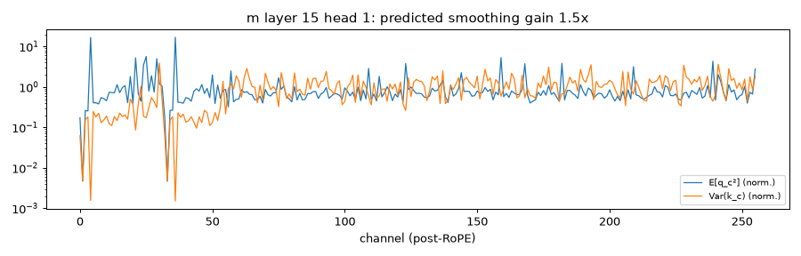
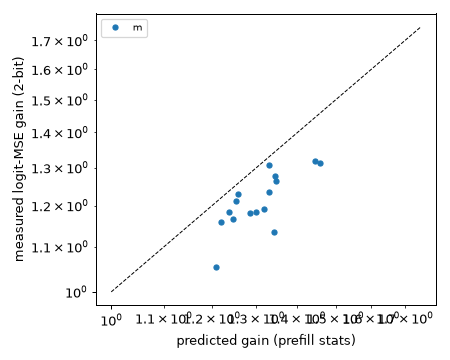

# E19 Why key smoothing matters on some models (pipeline check + characterization)

**TL;DR:** pipeline check (offline exact attention vs the model's own o_proj input), max rel. error: m 0.011.
Median predicted smoothing gain (Σq²·Σk²/(Σ√(q²k²))², from prefill stats): m 1.31x;
measured 2-bit logit-MSE gain: m 1.20x (Spearman predicted vs measured over heads 0.74).

## Config
Reference per model: {'m': 'int8'}. Corpora ['prose', 'code']; up to 4 attention layers per model; all KV heads; 2-bit (coarse) gain-shape keys with 128-token block means.
Logit error is measured on every 4th decode query over all causal positions. k² = per-channel variance of post-RoPE prefill keys,
q² = per-channel mean square of post-RoPE prefill queries (averaged over the GQA group). runtime 25s.

## (A) Pipeline check
| model | corpus | layer | rel err vs model |
|---|---|---|---|
| m | prose | 3 | 0.0061 |
| m | prose | 11 | 0.0107 |
| m | prose | 15 | 0.0104 |
| m | prose | 23 | 0.0105 |
| m | code | 3 | 0.0058 |
| m | code | 11 | 0.0087 |
| m | code | 15 | 0.0105 |
| m | code | 23 | 0.0086 |

## (B) Summary per model (medians over layer × head × corpus)
| model | n heads | Gpred median | Gpred max | measured gain median | measured max | logit err/spread (no smooth) | logit err/spread (smooth) | k² max/median | q² max/median | Spearman(q², k²) | outlier: max/median mean|k| (median) | (max) |
|---|---|---|---|---|---|---|---|---|---|---|---|---|
| m | 16 | 1.309 | 1.458 | 1.201 | 1.317 | 0.179 | 0.163 | 7.689 | 20.492 | 0.325 | 4.382 | 9.328 |

## (B) Per head
| model | corpus | layer | head | Gpred | measured gain | err/spread no smooth | err/spread smooth | k² max/med | q² max/med | ρ(q²,k²) | max/med mean|k| |
|---|---|---|---|---|---|---|---|---|---|---|---|
| m | prose | 3 | 0 | 1.446 | 1.317 | 0.200 | 0.174 | 13.153 | 44.177 | 0.341 | 9.328 |
| m | prose | 3 | 1 | 1.348 | 1.263 | 0.182 | 0.162 | 7.812 | 21.243 | 0.233 | 6.200 |
| m | prose | 11 | 0 | 1.317 | 1.190 | 0.178 | 0.163 | 6.552 | 14.795 | 0.218 | 3.044 |
| m | prose | 11 | 1 | 1.341 | 1.136 | 0.135 | 0.127 | 15.394 | 15.215 | 0.165 | 4.201 |
| m | prose | 15 | 0 | 1.209 | 1.054 | 0.123 | 0.120 | 14.322 | 11.799 | 0.462 | 5.440 |
| m | prose | 15 | 1 | 1.458 | 1.313 | 0.171 | 0.149 | 4.387 | 24.921 | 0.332 | 4.496 |
| m | prose | 23 | 0 | 1.246 | 1.168 | 0.186 | 0.172 | 3.634 | 15.421 | 0.102 | 3.134 |
| m | prose | 23 | 1 | 1.284 | 1.182 | 0.180 | 0.166 | 4.994 | 21.035 | 0.384 | 3.854 |
| m | code | 3 | 0 | 1.329 | 1.234 | 0.205 | 0.185 | 9.726 | 35.855 | 0.242 | 7.993 |
| m | code | 3 | 1 | 1.331 | 1.307 | 0.172 | 0.150 | 7.566 | 25.763 | 0.318 | 6.716 |
| m | code | 11 | 0 | 1.219 | 1.158 | 0.185 | 0.172 | 8.106 | 21.428 | 0.311 | 3.693 |
| m | code | 11 | 1 | 1.300 | 1.183 | 0.169 | 0.155 | 12.344 | 28.893 | 0.422 | 4.295 |
| m | code | 15 | 0 | 1.237 | 1.184 | 0.170 | 0.156 | 11.305 | 19.949 | 0.468 | 5.456 |
| m | code | 15 | 1 | 1.344 | 1.276 | 0.173 | 0.153 | 5.772 | 16.090 | 0.281 | 4.444 |
| m | code | 23 | 0 | 1.257 | 1.230 | 0.183 | 0.165 | 4.290 | 18.413 | 0.355 | 4.320 |
| m | code | 23 | 1 | 1.253 | 1.212 | 0.184 | 0.167 | 4.157 | 18.847 | 0.351 | 3.882 |

## Plots
 — per-channel query energy and key variance for the head with the largest predicted gain.

