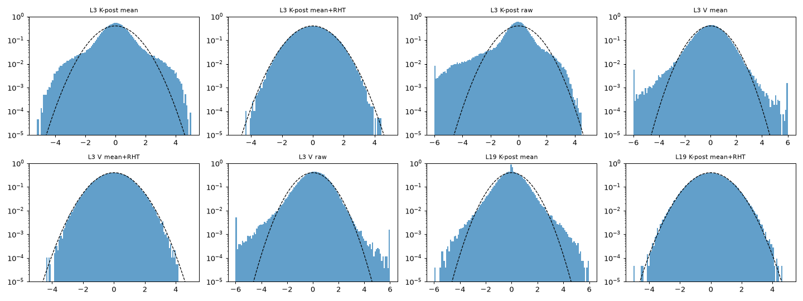

# E1 Gaussianization (Qwen3.5-0.8B, int8 reference cache, corpora prose+code, 6 attn layers × 2 KV heads)

**TL;DR:** mean removal + RHT brings key-shape kurtosis from median 5.8 (raw, max 10.4) to 2.97 (max 3.01; Gaussian = 3).
Empirical shape-MSE gap vs the Gaussian table after mean+RHT: keys post-RoPE median -0.03 dB (2b) / -0.06 dB (4b), worst +0.01 / +0.02 dB; values -0.04 / -0.08 dB.
0 (corpus, layer, tensor, head) cases exceed the 0.5 dB gap after mean+RHT.

## Config
- z = u·sqrt(d), u = y/||y||; y = x − mu (mu from prefill tokens [0, T−512)) then optionally RHT (seed 0). d = head_dim.
- Table: 2b nested-coarse MSE 0.1203, 4b Lloyd-Max 0.0095. gap dB = 10·log10(empirical/table) (positive = worse than Gaussian).
- Data: all 8192 tokens per corpus.

## Aggregate (median / max over corpus × layer × head)
| tensor | variant | kurt med | kurt max | gap2b med dB | gap2b max dB | gap4b med dB | gap4b max dB |
|---|---|---|---|---|---|---|---|
| K-post | raw | 5.78 | 10.45 | 1.78 | 2.83 | 5.31 | 8.56 |
| K-post | mean | 4.27 | 6.65 | 1.02 | 2.15 | 2.54 | 5.96 |
| K-post | mean+RHT | 2.97 | 3.01 | -0.03 | 0.01 | -0.06 | 0.02 |
| K-pre | raw | 5.86 | 10.47 | 1.82 | 2.88 | 5.37 | 8.53 |
| K-pre | mean | 4.52 | 7.52 | 1.14 | 2.46 | 3.31 | 6.73 |
| K-pre | mean+RHT | 2.97 | 3.00 | -0.03 | -0.01 | -0.06 | -0.01 |
| V | raw | 4.71 | 101.43 | 1.19 | 6.89 | 3.49 | 16.14 |
| V | mean | 4.52 | 11.68 | 1.09 | 2.88 | 3.22 | 8.76 |
| V | mean+RHT | 2.96 | 2.99 | -0.04 | -0.01 | -0.08 | -0.00 |

## Heads exceeding 0.5 dB after mean+RHT
None.

## Per layer (mean+RHT, keys post-RoPE / values, prose)
| corpus | layer | tensor | head | variant | kurt | mse2 | gap2 dB | mse4 | gap4 dB |
|---|---|---|---|---|---|---|---|---|---|
| prose | 3 | K-post | 0 | mean+RHT | 2.9410 | 0.1185 | -0.0665 | 0.0093 | -0.1021 |
| prose | 3 | K-post | 1 | mean+RHT | 2.9740 | 0.1195 | -0.0280 | 0.0094 | -0.0493 |
| prose | 3 | K-post | 2 | mean+RHT | 2.9655 | 0.1193 | -0.0354 | 0.0093 | -0.0734 |
| prose | 3 | K-post | 3 | mean+RHT | 2.9799 | 0.1198 | -0.0165 | 0.0094 | -0.0283 |
| prose | 3 | V | 0 | mean+RHT | 2.9414 | 0.1187 | -0.0590 | 0.0093 | -0.0950 |
| prose | 3 | V | 1 | mean+RHT | 2.9747 | 0.1196 | -0.0267 | 0.0094 | -0.0576 |
| prose | 3 | V | 2 | mean+RHT | 2.9545 | 0.1189 | -0.0497 | 0.0093 | -0.0754 |
| prose | 3 | V | 3 | mean+RHT | 2.9732 | 0.1194 | -0.0322 | 0.0094 | -0.0437 |
| prose | 11 | K-post | 0 | mean+RHT | 2.9433 | 0.1187 | -0.0592 | 0.0093 | -0.0786 |
| prose | 11 | K-post | 1 | mean+RHT | 2.9396 | 0.1186 | -0.0630 | 0.0093 | -0.0866 |
| prose | 11 | K-post | 2 | mean+RHT | 2.9812 | 0.1198 | -0.0187 | 0.0094 | -0.0387 |
| prose | 11 | K-post | 3 | mean+RHT | 2.9581 | 0.1189 | -0.0493 | 0.0094 | -0.0692 |
| prose | 11 | V | 0 | mean+RHT | 2.9752 | 0.1197 | -0.0224 | 0.0094 | -0.0425 |
| prose | 11 | V | 1 | mean+RHT | 2.9585 | 0.1191 | -0.0440 | 0.0094 | -0.0613 |
| prose | 11 | V | 2 | mean+RHT | 2.9621 | 0.1192 | -0.0384 | 0.0094 | -0.0550 |
| prose | 11 | V | 3 | mean+RHT | 2.9625 | 0.1192 | -0.0404 | 0.0094 | -0.0578 |
| prose | 19 | K-post | 0 | mean+RHT | 2.9746 | 0.1195 | -0.0283 | 0.0094 | -0.0504 |
| prose | 19 | K-post | 1 | mean+RHT | 2.9625 | 0.1192 | -0.0404 | 0.0094 | -0.0662 |
| prose | 19 | K-post | 2 | mean+RHT | 2.9513 | 0.1189 | -0.0508 | 0.0093 | -0.0743 |
| prose | 19 | K-post | 3 | mean+RHT | 2.9651 | 0.1193 | -0.0359 | 0.0094 | -0.0556 |
| prose | 19 | V | 0 | mean+RHT | 2.9633 | 0.1192 | -0.0399 | 0.0094 | -0.0568 |
| prose | 19 | V | 1 | mean+RHT | 2.9200 | 0.1179 | -0.0863 | 0.0092 | -0.1228 |
| prose | 19 | V | 2 | mean+RHT | 2.9596 | 0.1191 | -0.0423 | 0.0093 | -0.0719 |
| prose | 19 | V | 3 | mean+RHT | 2.9254 | 0.1183 | -0.0740 | 0.0093 | -0.1134 |
| prose | 27 | K-post | 0 | mean+RHT | 2.9872 | 0.1200 | -0.0094 | 0.0095 | -0.0206 |
| prose | 27 | K-post | 1 | mean+RHT | 2.9672 | 0.1195 | -0.0287 | 0.0094 | -0.0505 |
| prose | 27 | K-post | 2 | mean+RHT | 2.9663 | 0.1194 | -0.0312 | 0.0094 | -0.0667 |
| prose | 27 | K-post | 3 | mean+RHT | 2.9719 | 0.1196 | -0.0267 | 0.0094 | -0.0371 |
| prose | 27 | V | 0 | mean+RHT | 2.9197 | 0.1179 | -0.0855 | 0.0092 | -0.1445 |
| prose | 27 | V | 1 | mean+RHT | 2.9028 | 0.1177 | -0.0965 | 0.0093 | -0.1150 |
| prose | 27 | V | 2 | mean+RHT | 2.9104 | 0.1179 | -0.0879 | 0.0092 | -0.1380 |
| prose | 27 | V | 3 | mean+RHT | 2.9276 | 0.1182 | -0.0770 | 0.0092 | -0.1187 |

## Plots
 — log-density of z (prose, head 0, layers 3/19) with N(0,1) dashed.

## Caveats
- The reference is the int8 cache (user decision); int8 noise (~1% rel) is far below 4-bit shape error, so it does not affect these gaps.
- Note that a negative gap means *better* than the Gaussian table (lighter tails / sub-Gaussian shape).

runtime 76s
