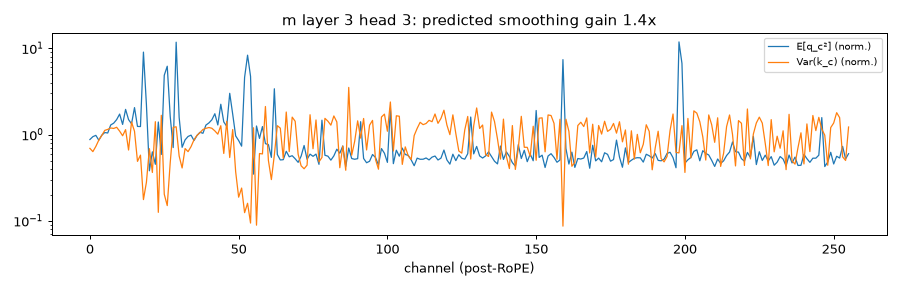
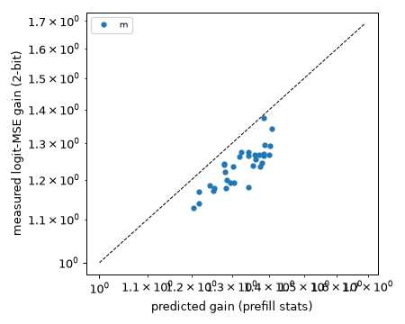

# E19 Why key smoothing matters on some models (pipeline check + characterization)

**TL;DR:** pipeline check (offline exact attention vs the model's own o_proj input), max rel. error: m 0.012.
Median predicted smoothing gain (Σq²·Σk²/(Σ√(q²k²))², from prefill stats): m 1.33x;
measured 2-bit logit-MSE gain: m 1.24x (Spearman predicted vs measured over heads 0.82).

## Config
Reference per model: {'m': 'int8'}. Corpora ['prose', 'code']; up to 4 attention layers per model; all KV heads; 2-bit (coarse) gain-shape keys with 128-token block means.
Logit error is measured on every 4th decode query over all causal positions. k² = per-channel variance of post-RoPE prefill keys,
q² = per-channel mean square of post-RoPE prefill queries (averaged over the GQA group). runtime 47s.

## (A) Pipeline check
| model | corpus | layer | rel err vs model |
|---|---|---|---|
| m | prose | 3 | 0.0059 |
| m | prose | 11 | 0.0108 |
| m | prose | 19 | 0.0123 |
| m | prose | 27 | 0.0124 |
| m | code | 3 | 0.0060 |
| m | code | 11 | 0.0086 |
| m | code | 19 | 0.0103 |
| m | code | 27 | 0.0120 |

## (B) Summary per model (medians over layer × head × corpus)
| model | n heads | Gpred median | Gpred max | measured gain median | measured max | logit err/spread (no smooth) | logit err/spread (smooth) | k² max/median | q² max/median | Spearman(q², k²) | outlier: max/median mean|k| (median) | (max) |
|---|---|---|---|---|---|---|---|---|---|---|---|---|
| m | 32 | 1.332 | 1.407 | 1.242 | 1.375 | 0.181 | 0.164 | 6.858 | 25.656 | 0.413 | 6.058 | 10.614 |

## (B) Per head
| model | corpus | layer | head | Gpred | measured gain | err/spread no smooth | err/spread smooth | k² max/med | q² max/med | ρ(q²,k²) | max/med mean|k| |
|---|---|---|---|---|---|---|---|---|---|---|---|
| m | prose | 3 | 0 | 1.385 | 1.264 | 0.179 | 0.159 | 17.435 | 47.062 | 0.590 | 9.391 |
| m | prose | 3 | 1 | 1.296 | 1.191 | 0.178 | 0.163 | 11.666 | 19.086 | 0.338 | 8.530 |
| m | prose | 3 | 2 | 1.398 | 1.267 | 0.201 | 0.178 | 11.540 | 65.609 | 0.359 | 7.405 |
| m | prose | 3 | 3 | 1.407 | 1.343 | 0.155 | 0.134 | 3.412 | 20.593 | -0.049 | 4.129 |
| m | prose | 11 | 0 | 1.387 | 1.296 | 0.177 | 0.155 | 13.995 | 37.721 | 0.448 | 6.250 |
| m | prose | 11 | 1 | 1.374 | 1.235 | 0.172 | 0.155 | 14.244 | 42.669 | 0.488 | 5.910 |
| m | prose | 11 | 2 | 1.320 | 1.264 | 0.204 | 0.182 | 6.294 | 18.896 | 0.456 | 2.905 |
| m | prose | 11 | 3 | 1.402 | 1.292 | 0.191 | 0.168 | 12.653 | 50.293 | 0.580 | 5.874 |
| m | prose | 19 | 0 | 1.217 | 1.139 | 0.157 | 0.147 | 8.031 | 21.393 | 0.540 | 3.200 |
| m | prose | 19 | 1 | 1.304 | 1.236 | 0.195 | 0.175 | 4.739 | 18.039 | 0.190 | 3.708 |
| m | prose | 19 | 2 | 1.306 | 1.193 | 0.168 | 0.154 | 10.443 | 22.956 | 0.440 | 4.644 |
| m | prose | 19 | 3 | 1.245 | 1.185 | 0.164 | 0.151 | 4.517 | 16.127 | 0.244 | 6.225 |
| m | prose | 27 | 0 | 1.283 | 1.221 | 0.198 | 0.180 | 4.516 | 36.216 | 0.486 | 8.477 |
| m | prose | 27 | 1 | 1.355 | 1.239 | 0.174 | 0.157 | 4.624 | 38.291 | 0.368 | 7.088 |
| m | prose | 27 | 2 | 1.362 | 1.256 | 0.187 | 0.167 | 4.725 | 21.696 | 0.258 | 3.534 |
| m | prose | 27 | 3 | 1.343 | 1.264 | 0.198 | 0.176 | 3.892 | 27.599 | 0.265 | 6.620 |
| m | code | 3 | 0 | 1.285 | 1.177 | 0.184 | 0.170 | 18.419 | 28.709 | 0.514 | 9.991 |
| m | code | 3 | 1 | 1.254 | 1.178 | 0.197 | 0.182 | 7.978 | 14.818 | 0.184 | 10.614 |
| m | code | 3 | 2 | 1.287 | 1.200 | 0.183 | 0.167 | 6.759 | 37.036 | 0.352 | 6.576 |
| m | code | 3 | 3 | 1.383 | 1.375 | 0.138 | 0.118 | 2.456 | 23.713 | 0.037 | 4.461 |
| m | code | 11 | 0 | 1.385 | 1.269 | 0.168 | 0.149 | 16.870 | 44.763 | 0.429 | 6.177 |
| m | code | 11 | 1 | 1.342 | 1.180 | 0.160 | 0.148 | 16.877 | 44.603 | 0.559 | 6.077 |
| m | code | 11 | 2 | 1.343 | 1.274 | 0.189 | 0.168 | 6.956 | 20.972 | 0.514 | 3.081 |
| m | code | 11 | 3 | 1.379 | 1.246 | 0.184 | 0.165 | 15.642 | 56.899 | 0.591 | 5.841 |
| m | code | 19 | 0 | 1.204 | 1.127 | 0.166 | 0.156 | 10.415 | 18.398 | 0.570 | 3.934 |
| m | code | 19 | 1 | 1.279 | 1.244 | 0.184 | 0.165 | 5.612 | 19.973 | 0.346 | 3.579 |
| m | code | 19 | 2 | 1.253 | 1.171 | 0.175 | 0.162 | 15.428 | 21.346 | 0.477 | 5.210 |
| m | code | 19 | 3 | 1.217 | 1.169 | 0.160 | 0.148 | 4.164 | 15.468 | 0.397 | 6.039 |
| m | code | 27 | 0 | 1.281 | 1.241 | 0.190 | 0.170 | 5.578 | 36.900 | 0.519 | 9.024 |
| m | code | 27 | 1 | 1.372 | 1.267 | 0.178 | 0.158 | 4.260 | 39.897 | 0.148 | 6.905 |
| m | code | 27 | 2 | 1.359 | 1.267 | 0.192 | 0.171 | 5.484 | 22.460 | 0.210 | 3.985 |
| m | code | 27 | 3 | 1.323 | 1.276 | 0.191 | 0.169 | 6.556 | 31.285 | 0.363 | 6.705 |

## Plots
 — per-channel query energy and key variance for the head with the largest predicted gain.

