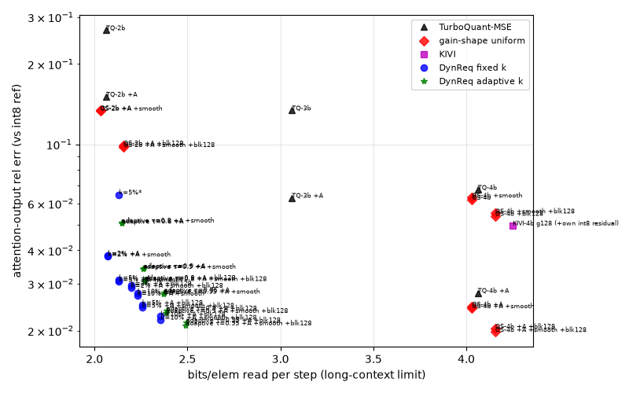

# E11 Low-hanging improvements + TurboQuant-MSE baseline (offline, int8 reference, 5 corpora × 4 layers)

**TL;DR:** E8 config DYN k=5%: attn err 0.0648. Adding (A) an exact sink+recent set outside the budget → 0.0310;
plus (C) block-local centering (128-token fp16 means) → 0.0250 at 2.26 bits (long-context limit); (B) key smoothing alone: 0.0305. References: GS-4b +A 0.0246 (4.03 b),
TurboQuant-MSE 2/3/4b (+A): 0.1509 / 0.0630 / 0.0277, KIVI-4b 0.0496 (4.25 b).
Adaptive k (τ=0.9, +A, +blk128): 0.0238 at 2.39 bits. GS-4b +A +blk128: 0.0204.

## Config
- A = first 4 tokens + last 128 tokens at reference (int8) precision, not counted in k. bits@8K include A (8.06 b for ~132 of ~8K tokens);
  the long-context limit drops A (→ coarse + 2·hot fraction).
- Smoothing: s_c = (E[(k_c−μ_c)²]/E[q_c²])^(1/4) per KV head from prefill keys and prefill queries (group-averaged); keys stored as (k−μ)/s, queries scaled by s.
- TurboQuant-MSE: RHT + Lloyd-Max N(0,1/d) codebook + fp16 norm, no mean removal, no QJL; b + 16/256 bits.
- Block centering: per-channel mean of each complete 128-token block (fp16), subtracted from K and V before RHT; +0.125 bits/elem.
- Adaptive: per query head smallest k s.t. estimated mass (coarse logits; exact for A) ≥ τ, capped at 20%; union over the query heads of a group.

| scheme | bits @8K | bits (long ctx) | attn err | attn err worst | resid err | layer-3 attn err |
|---|---|---|---|---|---|---|
| GS-2b +A | 2.1316 | 2.0312 | 0.1341 | 0.1874 | 0.1836 | 0.0893 |
| GS-2b +A +smooth | 2.1316 | 2.0312 | 0.1338 | 0.1938 | 0.1853 | 0.0905 |
| TQ-2b | 2.0625 | 2.0625 | 0.2679 | 0.3632 | 0.3330 | 0.2385 |
| TQ-2b +A | 2.1623 | 2.0625 | 0.1509 | 0.2029 | 0.2078 | 0.1083 |
| DYN k=2% +A | 2.1717 | 2.0714 | 0.0382 | 0.0480 | 0.0501 | 0.0390 |
| DYN k=2% +A +smooth | 2.1717 | 2.0714 | 0.0379 | 0.0474 | 0.0489 | 0.0388 |
| DYN k=5% (E8 config) | 2.1314 | 2.1314 | 0.0648 | 0.0964 | 0.0826 | 0.0565 |
| DYN k=5% +A | 2.2317 | 2.1314 | 0.0310 | 0.0385 | 0.0428 | 0.0294 |
| DYN k=5% +A +smooth | 2.2317 | 2.1314 | 0.0305 | 0.0375 | 0.0416 | 0.0289 |
| DYN adaptive τ=0.8 +A +smooth | 2.2456 | 2.1453 | 0.0509 | 0.0802 | 0.0693 | 0.0269 |
| DYN adaptive τ=0.8 +A | 2.2483 | 2.1480 | 0.0504 | 0.0793 | 0.0690 | 0.0272 |
| GS-2b +A +blk128 | 2.2545 | 2.1562 | 0.0991 | 0.1251 | 0.1424 | 0.0744 |
| GS-2b +A +smooth +blk128 | 2.2545 | 2.1562 | 0.0977 | 0.1264 | 0.1409 | 0.0750 |
| DYN k=2% +A +blk128 | 2.2946 | 2.1964 | 0.0295 | 0.0370 | 0.0402 | 0.0332 |
| DYN k=2% +A +smooth +blk128 | 2.2946 | 2.1964 | 0.0290 | 0.0359 | 0.0389 | 0.0327 |
| DYN k=10% +A +smooth | 2.3317 | 2.2314 | 0.0271 | 0.0337 | 0.0388 | 0.0225 |
| DYN k=10% +A | 2.3317 | 2.2314 | 0.0275 | 0.0348 | 0.0399 | 0.0231 |
| DYN k=5% +A +blk128 | 2.3546 | 2.2564 | 0.0250 | 0.0309 | 0.0354 | 0.0256 |
| DYN k=5% +A +smooth +blk128 | 2.3546 | 2.2564 | 0.0244 | 0.0297 | 0.0342 | 0.0250 |
| DYN adaptive τ=0.9 +A +smooth | 2.3614 | 2.2611 | 0.0341 | 0.0501 | 0.0485 | 0.0195 |
| DYN adaptive τ=0.9 +A | 2.3660 | 2.2657 | 0.0343 | 0.0506 | 0.0490 | 0.0200 |
| DYN adaptive τ=0.8 +A +smooth +blk128 | 2.3691 | 2.2709 | 0.0307 | 0.0443 | 0.0435 | 0.0213 |
| DYN adaptive τ=0.8 +A +blk128 | 2.3698 | 2.2715 | 0.0310 | 0.0450 | 0.0444 | 0.0219 |
| DYN k=10% +A +blk128 | 2.4546 | 2.3564 | 0.0226 | 0.0285 | 0.0334 | 0.0206 |
| DYN k=10% +A +smooth +blk128 | 2.4546 | 2.3564 | 0.0220 | 0.0272 | 0.0322 | 0.0198 |
| DYN adaptive τ=0.95 +A +smooth | 2.4709 | 2.3706 | 0.0275 | 0.0382 | 0.0406 | 0.0171 |
| DYN adaptive τ=0.95 +A | 2.4746 | 2.3743 | 0.0279 | 0.0389 | 0.0414 | 0.0177 |
| DYN adaptive τ=0.9 +A +smooth +blk128 | 2.4837 | 2.3855 | 0.0233 | 0.0323 | 0.0344 | 0.0164 |
| DYN adaptive τ=0.9 +A +blk128 | 2.4851 | 2.3869 | 0.0238 | 0.0335 | 0.0354 | 0.0171 |
| DYN adaptive τ=0.95 +A +smooth +blk128 | 2.5898 | 2.4916 | 0.0209 | 0.0281 | 0.0318 | 0.0150 |
| DYN adaptive τ=0.95 +A +blk128 | 2.5913 | 2.4930 | 0.0215 | 0.0293 | 0.0329 | 0.0156 |
| TQ-3b | 3.0625 | 3.0625 | 0.1341 | 0.1919 | 0.1719 | 0.1113 |
| TQ-3b +A | 3.1457 | 3.0625 | 0.0630 | 0.0805 | 0.0917 | 0.0436 |
| GS-4b | 4.0312 | 4.0312 | 0.0620 | 0.0933 | 0.0806 | 0.0496 |
| GS-4b +A | 4.0983 | 4.0312 | 0.0246 | 0.0327 | 0.0380 | 0.0164 |
| GS-4b +smooth | 4.0312 | 4.0312 | 0.0631 | 0.0966 | 0.0795 | 0.0482 |
| GS-4b +A +smooth | 4.0983 | 4.0312 | 0.0243 | 0.0316 | 0.0371 | 0.0159 |
| TQ-4b | 4.0625 | 4.0625 | 0.0675 | 0.1010 | 0.0881 | 0.0546 |
| TQ-4b +A | 4.1290 | 4.0625 | 0.0277 | 0.0363 | 0.0431 | 0.0189 |
| GS-4b +blk128 | 4.1562 | 4.1562 | 0.0539 | 0.0855 | 0.0687 | 0.0431 |
| GS-4b +A +blk128 | 4.2212 | 4.1562 | 0.0204 | 0.0273 | 0.0319 | 0.0146 |
| GS-4b +smooth +blk128 | 4.1562 | 4.1562 | 0.0550 | 0.0923 | 0.0680 | 0.0411 |
| GS-4b +A +smooth +blk128 | 4.2212 | 4.1562 | 0.0198 | 0.0259 | 0.0308 | 0.0139 |
| KIVI-4b g128 (+own int8 residual) | 4.2500 | 4.2500 | 0.0496 | 0.0892 | 0.0779 | 0.0204 |

## Per layer
| layer | scheme | attn err | resid err |
|---|---|---|---|
| 3 | GS-4b +A | 0.0164 | 0.0146 |
| 3 | DYN k=5% +A | 0.0294 | 0.0223 |
| 3 | DYN k=5% +A +blk128 | 0.0256 | 0.0199 |
| 3 | DYN adaptive τ=0.9 +A +blk128 | 0.0171 | 0.0148 |
| 3 | TQ-4b +A | 0.0189 | 0.0181 |
| 3 | TQ-2b +A | 0.1083 | 0.1176 |
| 11 | GS-4b +A | 0.0280 | 0.0491 |
| 11 | DYN k=5% +A | 0.0310 | 0.0529 |
| 11 | DYN k=5% +A +blk128 | 0.0238 | 0.0420 |
| 11 | DYN adaptive τ=0.9 +A +blk128 | 0.0270 | 0.0462 |
| 11 | TQ-4b +A | 0.0298 | 0.0526 |
| 11 | TQ-2b +A | 0.1585 | 0.2623 |
| 19 | GS-4b +A | 0.0309 | 0.0418 |
| 19 | DYN k=5% +A | 0.0365 | 0.0447 |
| 19 | DYN k=5% +A +blk128 | 0.0277 | 0.0361 |
| 19 | DYN adaptive τ=0.9 +A +blk128 | 0.0297 | 0.0389 |
| 19 | TQ-4b +A | 0.0338 | 0.0450 |
| 19 | TQ-2b +A | 0.1953 | 0.2112 |
| 27 | GS-4b +A | 0.0233 | 0.0466 |
| 27 | DYN k=5% +A | 0.0270 | 0.0512 |
| 27 | DYN k=5% +A +blk128 | 0.0227 | 0.0439 |
| 27 | DYN adaptive τ=0.9 +A +blk128 | 0.0215 | 0.0418 |
| 27 | TQ-4b +A | 0.0283 | 0.0568 |
| 27 | TQ-2b +A | 0.1416 | 0.2402 |

runtime 1371s
