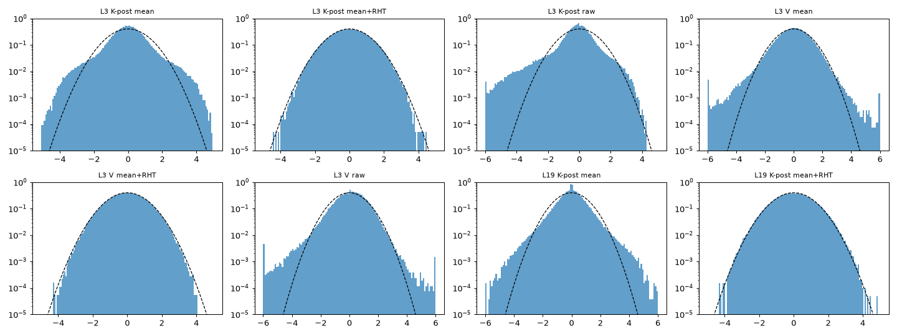

# E1 Gaussianization (Qwen3.5-0.8B, int8 reference cache, corpora prose+code, 6 attn layers × 2 KV heads)

**TL;DR:** mean removal + RHT brings key-shape kurtosis from median 5.6 (raw, max 9.0) to 2.97 (max 3.01; Gaussian = 3).
Empirical shape-MSE gap vs the Gaussian table after mean+RHT: keys post-RoPE median -0.03 dB (2b) / -0.06 dB (4b), worst +0.01 / +0.01 dB; values -0.04 / -0.08 dB.
0 (corpus, layer, tensor, head) cases exceed the 0.5 dB gap after mean+RHT.

## Config
- z = u·sqrt(d), u = y/||y||; y = x − mu (mu from prefill tokens [0, T−512)) then optionally RHT (seed 0). d = head_dim.
- Table: 2b nested-coarse MSE 0.1203, 4b Lloyd-Max 0.0095. gap dB = 10·log10(empirical/table) (positive = worse than Gaussian).
- Data: all 8192 tokens per corpus.

## Aggregate (median / max over corpus × layer × head)
| tensor | variant | kurt med | kurt max | gap2b med dB | gap2b max dB | gap4b med dB | gap4b max dB |
|---|---|---|---|---|---|---|---|
| K-post | raw | 5.62 | 8.96 | 1.64 | 2.52 | 4.80 | 7.78 |
| K-post | mean | 4.33 | 7.15 | 1.09 | 2.44 | 2.56 | 6.43 |
| K-post | mean+RHT | 2.97 | 3.01 | -0.03 | 0.01 | -0.06 | 0.01 |
| K-pre | raw | 5.74 | 8.99 | 1.73 | 2.56 | 4.87 | 7.74 |
| K-pre | mean | 4.63 | 7.91 | 1.27 | 2.57 | 3.29 | 7.01 |
| K-pre | mean+RHT | 2.97 | 3.00 | -0.03 | 0.00 | -0.06 | -0.01 |
| V | raw | 4.76 | 92.11 | 1.22 | 6.74 | 3.67 | 15.91 |
| V | mean | 4.59 | 14.27 | 1.16 | 3.10 | 3.35 | 9.20 |
| V | mean+RHT | 2.96 | 2.99 | -0.04 | -0.01 | -0.08 | -0.01 |

## Heads exceeding 0.5 dB after mean+RHT
None.

## Per layer (mean+RHT, keys post-RoPE / values, prose)
| corpus | layer | tensor | head | variant | kurt | mse2 | gap2 dB | mse4 | gap4 dB |
|---|---|---|---|---|---|---|---|---|---|
| prose | 3 | K-post | 0 | mean+RHT | 2.9451 | 0.1187 | -0.0589 | 0.0093 | -0.0979 |
| prose | 3 | K-post | 1 | mean+RHT | 2.9744 | 0.1196 | -0.0251 | 0.0094 | -0.0464 |
| prose | 3 | K-post | 2 | mean+RHT | 2.9685 | 0.1193 | -0.0348 | 0.0093 | -0.0736 |
| prose | 3 | K-post | 3 | mean+RHT | 2.9768 | 0.1197 | -0.0206 | 0.0094 | -0.0416 |
| prose | 3 | V | 0 | mean+RHT | 2.9436 | 0.1186 | -0.0598 | 0.0093 | -0.0857 |
| prose | 3 | V | 1 | mean+RHT | 2.9726 | 0.1195 | -0.0296 | 0.0094 | -0.0441 |
| prose | 3 | V | 2 | mean+RHT | 2.9495 | 0.1188 | -0.0556 | 0.0093 | -0.0811 |
| prose | 3 | V | 3 | mean+RHT | 2.9736 | 0.1195 | -0.0305 | 0.0094 | -0.0252 |
| prose | 11 | K-post | 0 | mean+RHT | 2.9379 | 0.1185 | -0.0638 | 0.0093 | -0.0840 |
| prose | 11 | K-post | 1 | mean+RHT | 2.9257 | 0.1181 | -0.0801 | 0.0092 | -0.1254 |
| prose | 11 | K-post | 2 | mean+RHT | 2.9743 | 0.1196 | -0.0249 | 0.0094 | -0.0475 |
| prose | 11 | K-post | 3 | mean+RHT | 2.9476 | 0.1189 | -0.0518 | 0.0093 | -0.0915 |
| prose | 11 | V | 0 | mean+RHT | 2.9824 | 0.1199 | -0.0155 | 0.0094 | -0.0304 |
| prose | 11 | V | 1 | mean+RHT | 2.9541 | 0.1189 | -0.0516 | 0.0093 | -0.0858 |
| prose | 11 | V | 2 | mean+RHT | 2.9615 | 0.1193 | -0.0356 | 0.0093 | -0.0747 |
| prose | 11 | V | 3 | mean+RHT | 2.9690 | 0.1195 | -0.0294 | 0.0094 | -0.0512 |
| prose | 19 | K-post | 0 | mean+RHT | 2.9715 | 0.1195 | -0.0290 | 0.0094 | -0.0531 |
| prose | 19 | K-post | 1 | mean+RHT | 2.9703 | 0.1196 | -0.0266 | 0.0094 | -0.0680 |
| prose | 19 | K-post | 2 | mean+RHT | 2.9569 | 0.1191 | -0.0428 | 0.0093 | -0.0885 |
| prose | 19 | K-post | 3 | mean+RHT | 2.9623 | 0.1193 | -0.0350 | 0.0094 | -0.0693 |
| prose | 19 | V | 0 | mean+RHT | 2.9640 | 0.1192 | -0.0384 | 0.0094 | -0.0662 |
| prose | 19 | V | 1 | mean+RHT | 2.9220 | 0.1181 | -0.0784 | 0.0092 | -0.1212 |
| prose | 19 | V | 2 | mean+RHT | 2.9593 | 0.1191 | -0.0430 | 0.0093 | -0.0779 |
| prose | 19 | V | 3 | mean+RHT | 2.9351 | 0.1184 | -0.0689 | 0.0093 | -0.0952 |
| prose | 27 | K-post | 0 | mean+RHT | 2.9840 | 0.1199 | -0.0156 | 0.0094 | -0.0299 |
| prose | 27 | K-post | 1 | mean+RHT | 2.9585 | 0.1193 | -0.0376 | 0.0093 | -0.0721 |
| prose | 27 | K-post | 2 | mean+RHT | 2.9627 | 0.1193 | -0.0357 | 0.0094 | -0.0686 |
| prose | 27 | K-post | 3 | mean+RHT | 2.9668 | 0.1193 | -0.0362 | 0.0094 | -0.0526 |
| prose | 27 | V | 0 | mean+RHT | 2.9182 | 0.1180 | -0.0824 | 0.0092 | -0.1386 |
| prose | 27 | V | 1 | mean+RHT | 2.8766 | 0.1170 | -0.1191 | 0.0092 | -0.1476 |
| prose | 27 | V | 2 | mean+RHT | 2.8988 | 0.1177 | -0.0945 | 0.0092 | -0.1403 |
| prose | 27 | V | 3 | mean+RHT | 2.9144 | 0.1177 | -0.0932 | 0.0092 | -0.1434 |

## Plots
 — log-density of z (prose, head 0, layers 3/19) with N(0,1) dashed.

## Caveats
- The reference is the int8 cache (user decision); int8 noise (~1% rel) is far below 4-bit shape error, so it does not affect these gaps.
- Note that a negative gap means *better* than the Gaussian table (lighter tails / sub-Gaussian shape).

runtime 73s
