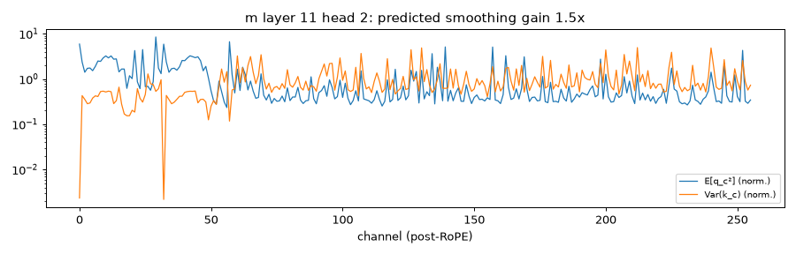
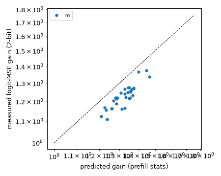

# E19 Why key smoothing matters on some models (pipeline check + characterization)

**TL;DR:** pipeline check (offline exact attention vs the model's own o_proj input), max rel. error: m 0.013.
Median predicted smoothing gain (Σq²·Σk²/(Σ√(q²k²))², from prefill stats): m 1.33x;
measured 2-bit logit-MSE gain: m 1.22x (Spearman predicted vs measured over heads 0.85).

## Config
Reference per model: {'m': 'int8'}. Corpora ['prose', 'code']; up to 4 attention layers per model; all KV heads; 2-bit (coarse) gain-shape keys with 128-token block means.
Logit error is measured on every 4th decode query over all causal positions. k² = per-channel variance of post-RoPE prefill keys,
q² = per-channel mean square of post-RoPE prefill queries (averaged over the GQA group). runtime 49s.

## (A) Pipeline check
| model | corpus | layer | rel err vs model |
|---|---|---|---|
| m | prose | 3 | 0.0059 |
| m | prose | 11 | 0.0102 |
| m | prose | 19 | 0.0123 |
| m | prose | 27 | 0.0127 |
| m | code | 3 | 0.0060 |
| m | code | 11 | 0.0086 |
| m | code | 19 | 0.0098 |
| m | code | 27 | 0.0124 |

## (B) Summary per model (medians over layer × head × corpus)
| model | n heads | Gpred median | Gpred max | measured gain median | measured max | logit err/spread (no smooth) | logit err/spread (smooth) | k² max/median | q² max/median | Spearman(q², k²) | outlier: max/median mean|k| (median) | (max) |
|---|---|---|---|---|---|---|---|---|---|---|---|---|
| m | 32 | 1.329 | 1.465 | 1.222 | 1.376 | 0.181 | 0.162 | 7.298 | 22.856 | 0.354 | 5.150 | 9.254 |

## (B) Per head
| model | corpus | layer | head | Gpred | measured gain | err/spread no smooth | err/spread smooth | k² max/med | q² max/med | ρ(q²,k²) | max/med mean|k| |
|---|---|---|---|---|---|---|---|---|---|---|---|
| m | prose | 3 | 0 | 1.361 | 1.251 | 0.189 | 0.169 | 18.815 | 44.486 | 0.590 | 8.872 |
| m | prose | 3 | 1 | 1.284 | 1.189 | 0.186 | 0.171 | 12.372 | 19.137 | 0.335 | 7.970 |
| m | prose | 3 | 2 | 1.376 | 1.272 | 0.210 | 0.187 | 11.537 | 59.511 | 0.350 | 6.449 |
| m | prose | 3 | 3 | 1.450 | 1.376 | 0.155 | 0.132 | 3.628 | 21.841 | -0.152 | 4.304 |
| m | prose | 11 | 0 | 1.344 | 1.248 | 0.160 | 0.143 | 15.878 | 28.541 | 0.417 | 4.306 |
| m | prose | 11 | 1 | 1.334 | 1.223 | 0.158 | 0.143 | 14.744 | 40.537 | 0.464 | 4.115 |
| m | prose | 11 | 2 | 1.465 | 1.339 | 0.198 | 0.171 | 7.142 | 18.267 | 0.034 | 4.208 |
| m | prose | 11 | 3 | 1.328 | 1.241 | 0.168 | 0.151 | 12.893 | 36.181 | 0.513 | 4.566 |
| m | prose | 19 | 0 | 1.238 | 1.109 | 0.134 | 0.127 | 11.277 | 17.329 | 0.475 | 4.940 |
| m | prose | 19 | 1 | 1.307 | 1.245 | 0.196 | 0.176 | 4.380 | 15.400 | 0.347 | 3.388 |
| m | prose | 19 | 2 | 1.312 | 1.161 | 0.137 | 0.127 | 14.441 | 15.456 | 0.502 | 5.326 |
| m | prose | 19 | 3 | 1.289 | 1.219 | 0.161 | 0.146 | 5.296 | 16.739 | 0.138 | 4.526 |
| m | prose | 27 | 0 | 1.280 | 1.220 | 0.180 | 0.163 | 3.373 | 26.863 | 0.205 | 7.175 |
| m | prose | 27 | 1 | 1.353 | 1.218 | 0.161 | 0.146 | 4.268 | 30.521 | 0.266 | 5.764 |
| m | prose | 27 | 2 | 1.358 | 1.255 | 0.176 | 0.157 | 3.287 | 16.421 | 0.117 | 3.105 |
| m | prose | 27 | 3 | 1.346 | 1.276 | 0.196 | 0.174 | 3.615 | 16.471 | 0.189 | 4.655 |
| m | code | 3 | 0 | 1.260 | 1.163 | 0.188 | 0.175 | 19.380 | 27.884 | 0.532 | 9.112 |
| m | code | 3 | 1 | 1.232 | 1.155 | 0.202 | 0.188 | 8.163 | 12.751 | 0.211 | 9.254 |
| m | code | 3 | 2 | 1.270 | 1.205 | 0.188 | 0.171 | 6.858 | 35.192 | 0.367 | 5.129 |
| m | code | 3 | 3 | 1.403 | 1.366 | 0.136 | 0.117 | 2.753 | 23.871 | -0.038 | 4.124 |
| m | code | 11 | 0 | 1.372 | 1.234 | 0.167 | 0.151 | 17.940 | 39.863 | 0.407 | 5.311 |
| m | code | 11 | 1 | 1.328 | 1.166 | 0.162 | 0.150 | 17.100 | 44.543 | 0.565 | 5.261 |
| m | code | 11 | 2 | 1.352 | 1.275 | 0.189 | 0.167 | 7.455 | 20.939 | 0.485 | 3.100 |
| m | code | 11 | 3 | 1.359 | 1.221 | 0.185 | 0.167 | 15.235 | 51.304 | 0.580 | 5.178 |
| m | code | 19 | 0 | 1.209 | 1.125 | 0.164 | 0.154 | 10.642 | 17.910 | 0.524 | 4.076 |
| m | code | 19 | 1 | 1.284 | 1.213 | 0.186 | 0.169 | 5.473 | 19.011 | 0.306 | 3.545 |
| m | code | 19 | 2 | 1.261 | 1.163 | 0.173 | 0.160 | 16.104 | 20.191 | 0.439 | 5.171 |
| m | code | 19 | 3 | 1.225 | 1.168 | 0.156 | 0.145 | 4.354 | 14.797 | 0.359 | 6.030 |
| m | code | 27 | 0 | 1.285 | 1.221 | 0.191 | 0.173 | 4.938 | 32.694 | 0.463 | 8.305 |
| m | code | 27 | 1 | 1.377 | 1.273 | 0.182 | 0.161 | 4.048 | 36.219 | 0.073 | 6.524 |
| m | code | 27 | 2 | 1.364 | 1.264 | 0.192 | 0.171 | 5.275 | 20.173 | 0.108 | 3.746 |
| m | code | 27 | 3 | 1.329 | 1.267 | 0.194 | 0.173 | 6.039 | 29.380 | 0.277 | 6.219 |

## Plots
 — per-channel query energy and key variance for the head with the largest predicted gain.

