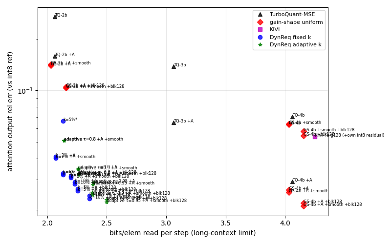

# E11 Low-hanging improvements + TurboQuant-MSE baseline (offline, int8 reference, 5 corpora × 4 layers)

**TL;DR:** E8 config DYN k=5%: attn err 0.0664. Adding (A) an exact sink+recent set outside the budget → 0.0328;
plus (C) block-local centering (128-token fp16 means) → 0.0266 at 2.26 bits (long-context limit); (B) key smoothing alone: 0.0320. References: GS-4b +A 0.0262 (4.03 b),
TurboQuant-MSE 2/3/4b (+A): 0.1586 / 0.0651 / 0.0294, KIVI-4b 0.0536 (4.25 b).
Adaptive k (τ=0.9, +A, +blk128): 0.0253 at 2.38 bits. GS-4b +A +blk128: 0.0219.

## Config
- A = first 4 tokens + last 128 tokens at reference (int8) precision, not counted in k. bits@8K include A (8.06 b for ~132 of ~8K tokens);
  the long-context limit drops A (→ coarse + 2·hot fraction).
- Smoothing: s_c = (E[(k_c−μ_c)²]/E[q_c²])^(1/4) per KV head from prefill keys and prefill queries (group-averaged); keys stored as (k−μ)/s, queries scaled by s.
- TurboQuant-MSE: RHT + Lloyd-Max N(0,1/d) codebook + fp16 norm, no mean removal, no QJL; b + 16/256 bits.
- Block centering: per-channel mean of each complete 128-token block (fp16), subtracted from K and V before RHT; +0.125 bits/elem.
- Adaptive: per query head smallest k s.t. estimated mass (coarse logits; exact for A) ≥ τ, capped at 20%; union over the query heads of a group.

| scheme | bits @8K | bits (long ctx) | attn err | attn err worst | resid err | layer-3 attn err |
|---|---|---|---|---|---|---|
| GS-2b +A | 2.1316 | 2.0312 | 0.1404 | 0.2272 | 0.1905 | 0.0883 |
| GS-2b +A +smooth | 2.1316 | 2.0312 | 0.1421 | 0.2321 | 0.1908 | 0.0888 |
| TQ-2b | 2.0625 | 2.0625 | 0.2696 | 0.3552 | 0.3251 | 0.2425 |
| TQ-2b +A | 2.1623 | 2.0625 | 0.1586 | 0.2497 | 0.2146 | 0.1069 |
| DYN k=2% +A | 2.1717 | 2.0714 | 0.0409 | 0.0604 | 0.0524 | 0.0379 |
| DYN k=2% +A +smooth | 2.1717 | 2.0714 | 0.0403 | 0.0602 | 0.0509 | 0.0376 |
| DYN k=5% +A +smooth | 2.2317 | 2.1314 | 0.0320 | 0.0458 | 0.0428 | 0.0278 |
| DYN k=5% +A | 2.2317 | 2.1314 | 0.0328 | 0.0461 | 0.0444 | 0.0285 |
| DYN k=5% (E8 config) | 2.1314 | 2.1314 | 0.0664 | 0.0988 | 0.0800 | 0.0573 |
| DYN adaptive τ=0.8 +A +smooth | 2.2411 | 2.1407 | 0.0509 | 0.0814 | 0.0666 | 0.0274 |
| DYN adaptive τ=0.8 +A | 2.2415 | 2.1412 | 0.0508 | 0.0804 | 0.0669 | 0.0280 |
| GS-2b +A +blk128 | 2.2545 | 2.1562 | 0.1050 | 0.1577 | 0.1525 | 0.0721 |
| GS-2b +A +smooth +blk128 | 2.2545 | 2.1562 | 0.1034 | 0.1581 | 0.1503 | 0.0722 |
| DYN k=2% +A +smooth +blk128 | 2.2946 | 2.1964 | 0.0309 | 0.0471 | 0.0410 | 0.0313 |
| DYN k=2% +A +blk128 | 2.2946 | 2.1964 | 0.0316 | 0.0481 | 0.0425 | 0.0316 |
| DYN k=10% +A | 2.3317 | 2.2314 | 0.0291 | 0.0411 | 0.0414 | 0.0225 |
| DYN k=10% +A +smooth | 2.3317 | 2.2314 | 0.0283 | 0.0398 | 0.0398 | 0.0217 |
| DYN k=5% +A +blk128 | 2.3546 | 2.2564 | 0.0266 | 0.0384 | 0.0373 | 0.0245 |
| DYN k=5% +A +smooth +blk128 | 2.3546 | 2.2564 | 0.0258 | 0.0368 | 0.0358 | 0.0239 |
| DYN adaptive τ=0.9 +A +smooth | 2.3585 | 2.2582 | 0.0345 | 0.0528 | 0.0476 | 0.0195 |
| DYN adaptive τ=0.9 +A | 2.3602 | 2.2599 | 0.0349 | 0.0525 | 0.0487 | 0.0203 |
| DYN adaptive τ=0.8 +A +smooth +blk128 | 2.3624 | 2.2642 | 0.0320 | 0.0459 | 0.0445 | 0.0211 |
| DYN adaptive τ=0.8 +A +blk128 | 2.3631 | 2.2648 | 0.0325 | 0.0466 | 0.0456 | 0.0216 |
| DYN k=10% +A +blk128 | 2.4546 | 2.3564 | 0.0242 | 0.0343 | 0.0353 | 0.0197 |
| DYN k=10% +A +smooth +blk128 | 2.4546 | 2.3564 | 0.0233 | 0.0324 | 0.0338 | 0.0190 |
| DYN adaptive τ=0.9 +A +smooth +blk128 | 2.4760 | 2.3777 | 0.0245 | 0.0349 | 0.0358 | 0.0161 |
| DYN adaptive τ=0.9 +A +blk128 | 2.4777 | 2.3795 | 0.0253 | 0.0365 | 0.0371 | 0.0167 |
| DYN adaptive τ=0.95 +A +smooth | 2.4837 | 2.3834 | 0.0282 | 0.0416 | 0.0408 | 0.0168 |
| DYN adaptive τ=0.95 +A | 2.4862 | 2.3859 | 0.0289 | 0.0429 | 0.0423 | 0.0177 |
| DYN adaptive τ=0.95 +A +smooth +blk128 | 2.5962 | 2.4979 | 0.0222 | 0.0318 | 0.0334 | 0.0145 |
| DYN adaptive τ=0.95 +A +blk128 | 2.5984 | 2.5001 | 0.0230 | 0.0334 | 0.0348 | 0.0152 |
| TQ-3b | 3.0625 | 3.0625 | 0.1380 | 0.1932 | 0.1681 | 0.1150 |
| TQ-3b +A | 3.1457 | 3.0625 | 0.0651 | 0.0950 | 0.0942 | 0.0432 |
| GS-4b | 4.0312 | 4.0312 | 0.0631 | 0.0953 | 0.0777 | 0.0510 |
| GS-4b +A | 4.0983 | 4.0312 | 0.0262 | 0.0387 | 0.0398 | 0.0163 |
| GS-4b +smooth | 4.0312 | 4.0312 | 0.0637 | 0.1031 | 0.0763 | 0.0484 |
| GS-4b +A +smooth | 4.0983 | 4.0312 | 0.0254 | 0.0374 | 0.0382 | 0.0154 |
| TQ-4b | 4.0625 | 4.0625 | 0.0703 | 0.1100 | 0.0841 | 0.0563 |
| TQ-4b +A | 4.1290 | 4.0625 | 0.0294 | 0.0429 | 0.0447 | 0.0189 |
| GS-4b +blk128 | 4.1562 | 4.1562 | 0.0543 | 0.0810 | 0.0668 | 0.0440 |
| GS-4b +A +blk128 | 4.2212 | 4.1562 | 0.0219 | 0.0320 | 0.0340 | 0.0142 |
| GS-4b +smooth +blk128 | 4.1562 | 4.1562 | 0.0576 | 0.0997 | 0.0664 | 0.0420 |
| GS-4b +A +smooth +blk128 | 4.2212 | 4.1562 | 0.0210 | 0.0305 | 0.0327 | 0.0135 |
| KIVI-4b g128 (+own int8 residual) | 4.2500 | 4.2500 | 0.0536 | 0.0945 | 0.0755 | 0.0203 |

## Per layer
| layer | scheme | attn err | resid err |
|---|---|---|---|
| 3 | GS-4b +A | 0.0163 | 0.0142 |
| 3 | DYN k=5% +A | 0.0285 | 0.0211 |
| 3 | DYN k=5% +A +blk128 | 0.0245 | 0.0187 |
| 3 | DYN adaptive τ=0.9 +A +blk128 | 0.0167 | 0.0141 |
| 3 | TQ-4b +A | 0.0189 | 0.0178 |
| 3 | TQ-2b +A | 0.1069 | 0.1129 |
| 11 | GS-4b +A | 0.0295 | 0.0488 |
| 11 | DYN k=5% +A | 0.0333 | 0.0529 |
| 11 | DYN k=5% +A +blk128 | 0.0255 | 0.0415 |
| 11 | DYN adaptive τ=0.9 +A +blk128 | 0.0282 | 0.0448 |
| 11 | TQ-4b +A | 0.0309 | 0.0509 |
| 11 | TQ-2b +A | 0.1646 | 0.2569 |
| 19 | GS-4b +A | 0.0351 | 0.0445 |
| 19 | DYN k=5% +A | 0.0418 | 0.0479 |
| 19 | DYN k=5% +A +blk128 | 0.0322 | 0.0391 |
| 19 | DYN adaptive τ=0.9 +A +blk128 | 0.0333 | 0.0412 |
| 19 | TQ-4b +A | 0.0383 | 0.0480 |
| 19 | TQ-2b +A | 0.2210 | 0.2287 |
| 27 | GS-4b +A | 0.0239 | 0.0516 |
| 27 | DYN k=5% +A | 0.0275 | 0.0557 |
| 27 | DYN k=5% +A +blk128 | 0.0244 | 0.0501 |
| 27 | DYN adaptive τ=0.9 +A +blk128 | 0.0230 | 0.0483 |
| 27 | TQ-4b +A | 0.0295 | 0.0620 |
| 27 | TQ-2b +A | 0.1419 | 0.2600 |

runtime 839s
