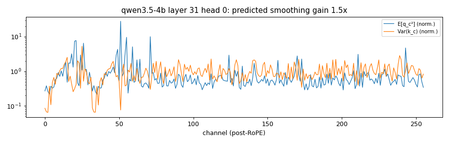
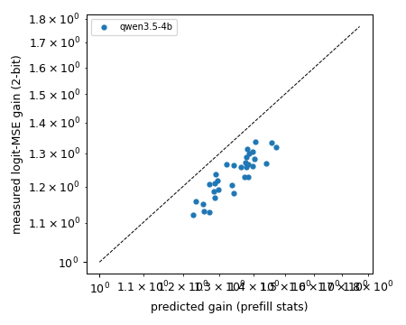

# E19 Why key smoothing matters on some models (pipeline check + characterization)

**TL;DR:** pipeline check (offline exact attention vs the model's own o_proj input), max rel. error: qwen3.5-4b 0.012.
Median predicted smoothing gain (Σq²·Σk²/(Σ√(q²k²))², from prefill stats): qwen3.5-4b 1.35x;
measured 2-bit logit-MSE gain: qwen3.5-4b 1.25x (Spearman predicted vs measured over heads 0.88).

## Config
Reference per model: {'qwen3.5-4b': 'int8'}. Corpora ['prose', 'code']; up to 4 attention layers per model; all KV heads; 2-bit (coarse) gain-shape keys with 128-token block means.
Logit error is measured on every 4th decode query over all causal positions. k² = per-channel variance of post-RoPE prefill keys,
q² = per-channel mean square of post-RoPE prefill queries (averaged over the GQA group). runtime 35s.

## (A) Pipeline check
| model | corpus | layer | rel err vs model |
|---|---|---|---|
| qwen3.5-4b | prose | 3 | 0.0058 |
| qwen3.5-4b | prose | 11 | 0.0109 |
| qwen3.5-4b | prose | 23 | 0.0084 |
| qwen3.5-4b | prose | 31 | 0.0124 |
| qwen3.5-4b | code | 3 | 0.0066 |
| qwen3.5-4b | code | 11 | 0.0099 |
| qwen3.5-4b | code | 23 | 0.0095 |
| qwen3.5-4b | code | 31 | 0.0121 |

## (B) Summary per model (medians over layer × head × corpus)
| model | n heads | Gpred median | Gpred max | measured gain median | measured max | logit err/spread (no smooth) | logit err/spread (smooth) | k² max/median | q² max/median | Spearman(q², k²) | outlier: max/median mean|k| (median) | (max) |
|---|---|---|---|---|---|---|---|---|---|---|---|---|
| qwen3.5-4b | 32 | 1.351 | 1.472 | 1.247 | 1.336 | 0.182 | 0.167 | 6.059 | 28.810 | 0.397 | 5.376 | 10.479 |

## (B) Per head
| model | corpus | layer | head | Gpred | measured gain | err/spread no smooth | err/spread smooth | k² max/med | q² max/med | ρ(q²,k²) | max/med mean|k| |
|---|---|---|---|---|---|---|---|---|---|---|---|
| qwen3.5-4b | prose | 3 | 0 | 1.385 | 1.267 | 0.179 | 0.159 | 17.447 | 47.080 | 0.590 | 9.392 |
| qwen3.5-4b | prose | 3 | 1 | 1.297 | 1.192 | 0.178 | 0.163 | 11.672 | 19.096 | 0.338 | 8.521 |
| qwen3.5-4b | prose | 3 | 2 | 1.398 | 1.261 | 0.200 | 0.178 | 11.535 | 65.623 | 0.359 | 7.406 |
| qwen3.5-4b | prose | 3 | 3 | 1.407 | 1.336 | 0.155 | 0.134 | 3.412 | 20.594 | -0.049 | 4.129 |
| qwen3.5-4b | prose | 11 | 0 | 1.387 | 1.299 | 0.177 | 0.155 | 14.000 | 37.713 | 0.448 | 6.257 |
| qwen3.5-4b | prose | 11 | 1 | 1.374 | 1.229 | 0.172 | 0.155 | 14.252 | 42.677 | 0.488 | 5.914 |
| qwen3.5-4b | prose | 11 | 2 | 1.320 | 1.267 | 0.204 | 0.182 | 6.291 | 18.895 | 0.456 | 2.909 |
| qwen3.5-4b | prose | 11 | 3 | 1.402 | 1.282 | 0.191 | 0.168 | 12.657 | 50.290 | 0.579 | 5.876 |
| qwen3.5-4b | prose | 23 | 0 | 1.362 | 1.258 | 0.191 | 0.170 | 5.251 | 25.836 | 0.372 | 6.467 |
| qwen3.5-4b | prose | 23 | 1 | 1.287 | 1.168 | 0.184 | 0.171 | 3.528 | 27.983 | 0.323 | 5.212 |
| qwen3.5-4b | prose | 23 | 2 | 1.234 | 1.157 | 0.177 | 0.165 | 4.042 | 27.228 | 0.435 | 5.072 |
| qwen3.5-4b | prose | 23 | 3 | 1.294 | 1.219 | 0.191 | 0.173 | 4.084 | 27.098 | 0.421 | 4.096 |
| qwen3.5-4b | prose | 31 | 0 | 1.472 | 1.319 | 0.193 | 0.168 | 6.119 | 50.125 | 0.352 | 4.920 |
| qwen3.5-4b | prose | 31 | 1 | 1.458 | 1.333 | 0.176 | 0.153 | 4.511 | 42.166 | 0.008 | 4.974 |
| qwen3.5-4b | prose | 31 | 2 | 1.288 | 1.236 | 0.216 | 0.194 | 4.048 | 26.814 | 0.189 | 4.353 |
| qwen3.5-4b | prose | 31 | 3 | 1.380 | 1.288 | 0.201 | 0.177 | 5.998 | 28.814 | 0.186 | 4.989 |
| qwen3.5-4b | code | 3 | 0 | 1.284 | 1.186 | 0.186 | 0.171 | 18.425 | 28.805 | 0.512 | 9.852 |
| qwen3.5-4b | code | 3 | 1 | 1.254 | 1.150 | 0.189 | 0.176 | 8.064 | 14.725 | 0.183 | 10.479 |
| qwen3.5-4b | code | 3 | 2 | 1.287 | 1.209 | 0.196 | 0.178 | 6.838 | 36.902 | 0.352 | 6.551 |
| qwen3.5-4b | code | 3 | 3 | 1.382 | 1.314 | 0.141 | 0.123 | 2.507 | 23.816 | 0.044 | 4.483 |
| qwen3.5-4b | code | 11 | 0 | 1.385 | 1.228 | 0.163 | 0.147 | 16.903 | 44.884 | 0.432 | 6.172 |
| qwen3.5-4b | code | 11 | 1 | 1.341 | 1.181 | 0.163 | 0.150 | 16.887 | 44.283 | 0.560 | 6.089 |
| qwen3.5-4b | code | 11 | 2 | 1.341 | 1.263 | 0.193 | 0.172 | 6.972 | 21.213 | 0.518 | 3.052 |
| qwen3.5-4b | code | 11 | 3 | 1.379 | 1.259 | 0.190 | 0.169 | 15.704 | 57.177 | 0.592 | 5.801 |
| qwen3.5-4b | code | 23 | 0 | 1.336 | 1.205 | 0.180 | 0.164 | 5.261 | 23.409 | 0.435 | 6.130 |
| qwen3.5-4b | code | 23 | 1 | 1.270 | 1.127 | 0.178 | 0.168 | 3.779 | 29.607 | 0.395 | 5.539 |
| qwen3.5-4b | code | 23 | 2 | 1.226 | 1.122 | 0.172 | 0.162 | 4.111 | 28.333 | 0.551 | 5.690 |
| qwen3.5-4b | code | 23 | 3 | 1.256 | 1.131 | 0.171 | 0.161 | 5.108 | 25.277 | 0.574 | 4.579 |
| qwen3.5-4b | code | 31 | 0 | 1.439 | 1.268 | 0.176 | 0.156 | 6.756 | 39.849 | 0.399 | 5.198 |
| qwen3.5-4b | code | 31 | 1 | 1.398 | 1.306 | 0.173 | 0.151 | 3.239 | 34.819 | 0.160 | 4.736 |
| qwen3.5-4b | code | 31 | 2 | 1.272 | 1.206 | 0.210 | 0.191 | 4.446 | 25.364 | 0.238 | 3.951 |
| qwen3.5-4b | code | 31 | 3 | 1.375 | 1.273 | 0.187 | 0.166 | 4.415 | 30.445 | 0.241 | 4.975 |

## Plots
 — per-channel query energy and key variance for the head with the largest predicted gain.

