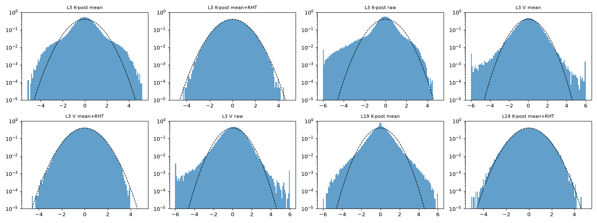

# E1 Gaussianization (Qwen3.5-0.8B, int8 reference cache, corpora prose+code, 6 attn layers × 2 KV heads)

**TL;DR:** mean removal + RHT brings key-shape kurtosis from median 5.7 (raw, max 10.0) to 2.96 (max 2.99; Gaussian = 3).
Empirical shape-MSE gap vs the Gaussian table after mean+RHT: keys post-RoPE median -0.04 dB (2b) / -0.06 dB (4b), worst -0.01 / -0.03 dB; values -0.05 / -0.08 dB.
0 (corpus, layer, tensor, head) cases exceed the 0.5 dB gap after mean+RHT.

## Config
- z = u·sqrt(d), u = y/||y||; y = x − mu (mu from prefill tokens [0, T−512)) then optionally RHT (seed 0). d = head_dim.
- Table: 2b nested-coarse MSE 0.1203, 4b Lloyd-Max 0.0095. gap dB = 10·log10(empirical/table) (positive = worse than Gaussian).
- Data: all 8192 tokens per corpus.

## Aggregate (median / max over corpus × layer × head)
| tensor | variant | kurt med | kurt max | gap2b med dB | gap2b max dB | gap4b med dB | gap4b max dB |
|---|---|---|---|---|---|---|---|
| K-post | raw | 5.73 | 10.05 | 1.70 | 2.85 | 5.05 | 8.48 |
| K-post | mean | 4.40 | 7.18 | 1.09 | 2.35 | 2.68 | 6.41 |
| K-post | mean+RHT | 2.96 | 2.99 | -0.04 | -0.01 | -0.06 | -0.03 |
| K-pre | raw | 5.79 | 10.07 | 1.71 | 2.89 | 5.13 | 8.45 |
| K-pre | mean | 4.73 | 7.96 | 1.26 | 2.62 | 3.44 | 7.00 |
| K-pre | mean+RHT | 2.96 | 3.00 | -0.04 | 0.00 | -0.07 | 0.01 |
| V | raw | 4.86 | 163.90 | 1.25 | 7.85 | 3.27 | 17.45 |
| V | mean | 4.86 | 15.12 | 1.19 | 2.98 | 3.55 | 9.51 |
| V | mean+RHT | 2.96 | 2.98 | -0.05 | -0.01 | -0.08 | -0.02 |

## Heads exceeding 0.5 dB after mean+RHT
None.

## Per layer (mean+RHT, keys post-RoPE / values, prose)
| corpus | layer | tensor | head | variant | kurt | mse2 | gap2 dB | mse4 | gap4 dB |
|---|---|---|---|---|---|---|---|---|---|
| prose | 3 | K-post | 0 | mean+RHT | 2.9529 | 0.1189 | -0.0511 | 0.0093 | -0.0873 |
| prose | 3 | K-post | 1 | mean+RHT | 2.9645 | 0.1194 | -0.0333 | 0.0094 | -0.0568 |
| prose | 3 | K-post | 2 | mean+RHT | 2.9617 | 0.1192 | -0.0396 | 0.0093 | -0.0734 |
| prose | 3 | K-post | 3 | mean+RHT | 2.9675 | 0.1193 | -0.0361 | 0.0094 | -0.0617 |
| prose | 3 | V | 0 | mean+RHT | 2.9547 | 0.1190 | -0.0484 | 0.0094 | -0.0686 |
| prose | 3 | V | 1 | mean+RHT | 2.9805 | 0.1200 | -0.0121 | 0.0094 | -0.0332 |
| prose | 3 | V | 2 | mean+RHT | 2.9647 | 0.1192 | -0.0402 | 0.0094 | -0.0596 |
| prose | 3 | V | 3 | mean+RHT | 2.9524 | 0.1188 | -0.0531 | 0.0093 | -0.0760 |
| prose | 11 | K-post | 0 | mean+RHT | 2.9479 | 0.1188 | -0.0553 | 0.0093 | -0.0970 |
| prose | 11 | K-post | 1 | mean+RHT | 2.9369 | 0.1185 | -0.0653 | 0.0093 | -0.1082 |
| prose | 11 | K-post | 2 | mean+RHT | 2.9631 | 0.1191 | -0.0426 | 0.0094 | -0.0654 |
| prose | 11 | K-post | 3 | mean+RHT | 2.9634 | 0.1193 | -0.0364 | 0.0094 | -0.0633 |
| prose | 11 | V | 0 | mean+RHT | 2.9704 | 0.1194 | -0.0328 | 0.0094 | -0.0470 |
| prose | 11 | V | 1 | mean+RHT | 2.9576 | 0.1191 | -0.0443 | 0.0094 | -0.0683 |
| prose | 11 | V | 2 | mean+RHT | 2.9527 | 0.1190 | -0.0468 | 0.0093 | -0.0838 |
| prose | 11 | V | 3 | mean+RHT | 2.9575 | 0.1191 | -0.0434 | 0.0094 | -0.0643 |
| prose | 19 | K-post | 0 | mean+RHT | 2.9684 | 0.1191 | -0.0421 | 0.0094 | -0.0515 |
| prose | 19 | K-post | 1 | mean+RHT | 2.9676 | 0.1193 | -0.0342 | 0.0094 | -0.0615 |
| prose | 19 | K-post | 2 | mean+RHT | 2.9518 | 0.1188 | -0.0560 | 0.0093 | -0.0827 |
| prose | 19 | K-post | 3 | mean+RHT | 2.9659 | 0.1194 | -0.0326 | 0.0093 | -0.0702 |
| prose | 19 | V | 0 | mean+RHT | 2.9590 | 0.1192 | -0.0403 | 0.0093 | -0.0733 |
| prose | 19 | V | 1 | mean+RHT | 2.9206 | 0.1180 | -0.0822 | 0.0093 | -0.1157 |
| prose | 19 | V | 2 | mean+RHT | 2.9518 | 0.1190 | -0.0482 | 0.0093 | -0.0816 |
| prose | 19 | V | 3 | mean+RHT | 2.9234 | 0.1183 | -0.0740 | 0.0093 | -0.1158 |
| prose | 27 | K-post | 0 | mean+RHT | 2.9583 | 0.1191 | -0.0437 | 0.0094 | -0.0666 |
| prose | 27 | K-post | 1 | mean+RHT | 2.9583 | 0.1191 | -0.0423 | 0.0093 | -0.0780 |
| prose | 27 | K-post | 2 | mean+RHT | 2.9653 | 0.1193 | -0.0371 | 0.0094 | -0.0577 |
| prose | 27 | K-post | 3 | mean+RHT | 2.9730 | 0.1195 | -0.0295 | 0.0094 | -0.0642 |
| prose | 27 | V | 0 | mean+RHT | 2.9235 | 0.1181 | -0.0791 | 0.0092 | -0.1169 |
| prose | 27 | V | 1 | mean+RHT | 2.8814 | 0.1172 | -0.1144 | 0.0092 | -0.1447 |
| prose | 27 | V | 2 | mean+RHT | 2.9206 | 0.1182 | -0.0772 | 0.0093 | -0.0944 |
| prose | 27 | V | 3 | mean+RHT | 2.9240 | 0.1181 | -0.0787 | 0.0092 | -0.1278 |

## Plots
 — log-density of z (prose, head 0, layers 3/19) with N(0,1) dashed.

## Caveats
- The reference is the int8 cache (user decision); int8 noise (~1% rel) is far below 4-bit shape error, so it does not affect these gaps.
- Note that a negative gap means *better* than the Gaussian table (lighter tails / sub-Gaussian shape).

runtime 72s
