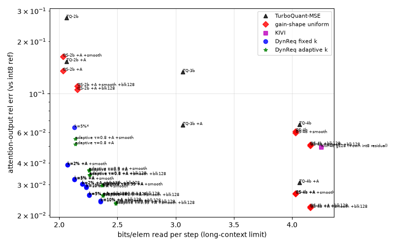

# E11 Low-hanging improvements + TurboQuant-MSE baseline (offline, int8 reference, 5 corpora × 4 layers)

**TL;DR:** E8 config DYN k=5%: attn err 0.0639. Adding (A) an exact sink+recent set outside the budget → 0.0323;
plus (C) block-local centering (128-token fp16 means) → 0.0262 at 2.26 bits (long-context limit); (B) key smoothing alone: 0.0320. References: GS-4b +A 0.0267 (4.03 b),
TurboQuant-MSE 2/3/4b (+A): 0.1537 / 0.0661 / 0.0308, KIVI-4b 0.0493 (4.25 b).
Adaptive k (τ=0.9, +A, +blk128): 0.0262 at 2.38 bits. GS-4b +A +blk128: 0.0224.

## Config
- A = first 4 tokens + last 128 tokens at reference (int8) precision, not counted in k. bits@8K include A (8.06 b for ~132 of ~8K tokens);
  the long-context limit drops A (→ coarse + 2·hot fraction).
- Smoothing: s_c = (E[(k_c−μ_c)²]/E[q_c²])^(1/4) per KV head from prefill keys and prefill queries (group-averaged); keys stored as (k−μ)/s, queries scaled by s.
- TurboQuant-MSE: RHT + Lloyd-Max N(0,1/d) codebook + fp16 norm, no mean removal, no QJL; b + 16/256 bits.
- Block centering: per-channel mean of each complete 128-token block (fp16), subtracted from K and V before RHT; +0.125 bits/elem.
- Adaptive: per query head smallest k s.t. estimated mass (coarse logits; exact for A) ≥ τ, capped at 20%; union over the query heads of a group.

| scheme | bits @8K | bits (long ctx) | attn err | attn err worst | resid err | layer-3 attn err |
|---|---|---|---|---|---|---|
| GS-2b +A | 2.1316 | 2.0312 | 0.1357 | 0.1856 | 0.1738 | 0.0895 |
| GS-2b +A +smooth | 2.1316 | 2.0312 | 0.1636 | 0.2602 | 0.2023 | 0.0913 |
| TQ-2b | 2.0625 | 2.0625 | 0.2733 | 0.3384 | 0.3230 | 0.2453 |
| TQ-2b +A | 2.1623 | 2.0625 | 0.1537 | 0.2022 | 0.2034 | 0.1076 |
| DYN k=2% +A | 2.1717 | 2.0714 | 0.0390 | 0.0512 | 0.0458 | 0.0379 |
| DYN k=2% +A +smooth | 2.1717 | 2.0714 | 0.0389 | 0.0543 | 0.0450 | 0.0370 |
| DYN k=5% (E8 config) | 2.1314 | 2.1314 | 0.0639 | 0.0857 | 0.0738 | 0.0593 |
| DYN k=5% +A | 2.2317 | 2.1314 | 0.0323 | 0.0417 | 0.0400 | 0.0287 |
| DYN k=5% +A +smooth | 2.2317 | 2.1314 | 0.0320 | 0.0444 | 0.0391 | 0.0277 |
| DYN adaptive τ=0.8 +A | 2.2382 | 2.1379 | 0.0513 | 0.0775 | 0.0639 | 0.0288 |
| DYN adaptive τ=0.8 +A +smooth | 2.2399 | 2.1396 | 0.0549 | 0.0859 | 0.0686 | 0.0280 |
| GS-2b +A +blk128 | 2.2545 | 2.1562 | 0.1056 | 0.1352 | 0.1369 | 0.0733 |
| GS-2b +A +smooth +blk128 | 2.2545 | 2.1562 | 0.1108 | 0.1580 | 0.1426 | 0.0741 |
| DYN k=2% +A +blk128 | 2.2946 | 2.1964 | 0.0302 | 0.0375 | 0.0368 | 0.0315 |
| DYN k=2% +A +smooth +blk128 | 2.2946 | 2.1964 | 0.0302 | 0.0381 | 0.0358 | 0.0312 |
| DYN k=10% +A | 2.3317 | 2.2314 | 0.0293 | 0.0380 | 0.0380 | 0.0230 |
| DYN k=10% +A +smooth | 2.3317 | 2.2314 | 0.0289 | 0.0408 | 0.0369 | 0.0218 |
| DYN adaptive τ=0.9 +A | 2.3556 | 2.2553 | 0.0359 | 0.0536 | 0.0467 | 0.0206 |
| DYN adaptive τ=0.9 +A +smooth | 2.3565 | 2.2562 | 0.0365 | 0.0554 | 0.0470 | 0.0197 |
| DYN k=5% +A +blk128 | 2.3546 | 2.2564 | 0.0262 | 0.0325 | 0.0331 | 0.0247 |
| DYN k=5% +A +smooth +blk128 | 2.3546 | 2.2564 | 0.0261 | 0.0335 | 0.0321 | 0.0241 |
| DYN adaptive τ=0.8 +A +blk128 | 2.3592 | 2.2610 | 0.0343 | 0.0484 | 0.0432 | 0.0221 |
| DYN adaptive τ=0.8 +A +smooth +blk128 | 2.3598 | 2.2616 | 0.0340 | 0.0476 | 0.0427 | 0.0217 |
| DYN k=10% +A +blk128 | 2.4546 | 2.3564 | 0.0242 | 0.0309 | 0.0317 | 0.0202 |
| DYN k=10% +A +smooth +blk128 | 2.4546 | 2.3564 | 0.0240 | 0.0317 | 0.0307 | 0.0195 |
| DYN adaptive τ=0.95 +A +smooth | 2.4686 | 2.3682 | 0.0297 | 0.0434 | 0.0391 | 0.0171 |
| DYN adaptive τ=0.95 +A | 2.4705 | 2.3702 | 0.0298 | 0.0421 | 0.0399 | 0.0181 |
| DYN adaptive τ=0.9 +A +blk128 | 2.4734 | 2.3752 | 0.0262 | 0.0360 | 0.0342 | 0.0172 |
| DYN adaptive τ=0.9 +A +smooth +blk128 | 2.4735 | 2.3753 | 0.0258 | 0.0350 | 0.0333 | 0.0165 |
| DYN adaptive τ=0.95 +A +smooth +blk128 | 2.5843 | 2.4860 | 0.0232 | 0.0318 | 0.0307 | 0.0151 |
| DYN adaptive τ=0.95 +A +blk128 | 2.5855 | 2.4872 | 0.0236 | 0.0311 | 0.0317 | 0.0158 |
| TQ-3b | 3.0625 | 3.0625 | 0.1333 | 0.1678 | 0.1645 | 0.1162 |
| TQ-3b +A | 3.1457 | 3.0625 | 0.0661 | 0.0849 | 0.0945 | 0.0429 |
| GS-4b | 4.0312 | 4.0312 | 0.0608 | 0.0827 | 0.0726 | 0.0529 |
| GS-4b +A | 4.0983 | 4.0312 | 0.0267 | 0.0361 | 0.0369 | 0.0168 |
| GS-4b +smooth | 4.0312 | 4.0312 | 0.0594 | 0.0828 | 0.0689 | 0.0499 |
| GS-4b +A +smooth | 4.0983 | 4.0312 | 0.0266 | 0.0387 | 0.0358 | 0.0159 |
| TQ-4b | 4.0625 | 4.0625 | 0.0666 | 0.0873 | 0.0820 | 0.0573 |
| TQ-4b +A | 4.1290 | 4.0625 | 0.0308 | 0.0398 | 0.0454 | 0.0190 |
| GS-4b +blk128 | 4.1562 | 4.1562 | 0.0509 | 0.0680 | 0.0604 | 0.0453 |
| GS-4b +A +blk128 | 4.2212 | 4.1562 | 0.0224 | 0.0298 | 0.0307 | 0.0148 |
| GS-4b +smooth +blk128 | 4.1562 | 4.1562 | 0.0503 | 0.0673 | 0.0593 | 0.0430 |
| GS-4b +A +smooth +blk128 | 4.2212 | 4.1562 | 0.0221 | 0.0305 | 0.0299 | 0.0142 |
| KIVI-4b g128 (+own int8 residual) | 4.2500 | 4.2500 | 0.0493 | 0.0663 | 0.0854 | 0.0216 |

## Per layer
| layer | scheme | attn err | resid err |
|---|---|---|---|
| 3 | GS-4b +A | 0.0168 | 0.0088 |
| 3 | DYN k=5% +A | 0.0287 | 0.0128 |
| 3 | DYN k=5% +A +blk128 | 0.0247 | 0.0112 |
| 3 | DYN adaptive τ=0.9 +A +blk128 | 0.0172 | 0.0086 |
| 3 | TQ-4b +A | 0.0190 | 0.0115 |
| 3 | TQ-2b +A | 0.1076 | 0.0867 |
| 11 | GS-4b +A | 0.0300 | 0.0479 |
| 11 | DYN k=5% +A | 0.0331 | 0.0513 |
| 11 | DYN k=5% +A +blk128 | 0.0258 | 0.0405 |
| 11 | DYN adaptive τ=0.9 +A +blk128 | 0.0301 | 0.0453 |
| 11 | TQ-4b +A | 0.0332 | 0.0527 |
| 11 | TQ-2b +A | 0.1632 | 0.2443 |
| 19 | GS-4b +A | 0.0350 | 0.0425 |
| 19 | DYN k=5% +A | 0.0393 | 0.0449 |
| 19 | DYN k=5% +A +blk128 | 0.0302 | 0.0358 |
| 19 | DYN adaptive τ=0.9 +A +blk128 | 0.0342 | 0.0393 |
| 19 | TQ-4b +A | 0.0376 | 0.0454 |
| 19 | TQ-2b +A | 0.1906 | 0.2077 |
| 27 | GS-4b +A | 0.0252 | 0.0484 |
| 27 | DYN k=5% +A | 0.0280 | 0.0511 |
| 27 | DYN k=5% +A +blk128 | 0.0240 | 0.0450 |
| 27 | DYN adaptive τ=0.9 +A +blk128 | 0.0233 | 0.0438 |
| 27 | TQ-4b +A | 0.0334 | 0.0721 |
| 27 | TQ-2b +A | 0.1534 | 0.2748 |

runtime 1386s
