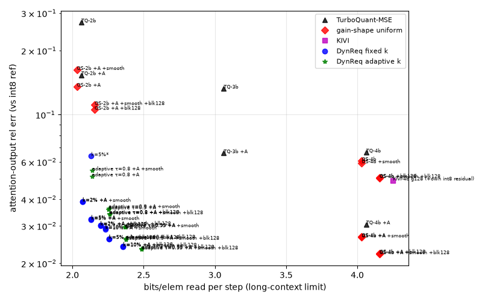

# E11 Low-hanging improvements + TurboQuant-MSE baseline (offline, int8 reference, 5 corpora × 4 layers)

**TL;DR:** E8 config DYN k=5%: attn err 0.0638. Adding (A) an exact sink+recent set outside the budget → 0.0323;
plus (C) block-local centering (128-token fp16 means) → 0.0261 at 2.26 bits (long-context limit); (B) key smoothing alone: 0.0320. References: GS-4b +A 0.0266 (4.03 b),
TurboQuant-MSE 2/3/4b (+A): 0.1536 / 0.0659 / 0.0305, KIVI-4b 0.0491 (4.25 b).
Adaptive k (τ=0.9, +A, +blk128): 0.0262 at 2.38 bits. GS-4b +A +blk128: 0.0223.

## Config
- A = first 4 tokens + last 128 tokens at reference (int8) precision, not counted in k. bits@8K include A (8.06 b for ~132 of ~8K tokens);
  the long-context limit drops A (→ coarse + 2·hot fraction).
- Smoothing: s_c = (E[(k_c−μ_c)²]/E[q_c²])^(1/4) per KV head from prefill keys and prefill queries (group-averaged); keys stored as (k−μ)/s, queries scaled by s.
- TurboQuant-MSE: RHT + Lloyd-Max N(0,1/d) codebook + fp16 norm, no mean removal, no QJL; b + 16/256 bits.
- Block centering: per-channel mean of each complete 128-token block (fp16), subtracted from K and V before RHT; +0.125 bits/elem.
- Adaptive: per query head smallest k s.t. estimated mass (coarse logits; exact for A) ≥ τ, capped at 20%; union over the query heads of a group.

| scheme | bits @8K | bits (long ctx) | attn err | attn err worst | resid err | layer-3 attn err |
|---|---|---|---|---|---|---|
| GS-2b +A | 2.1316 | 2.0312 | 0.1354 | 0.1850 | 0.1737 | 0.0895 |
| GS-2b +A +smooth | 2.1316 | 2.0312 | 0.1623 | 0.2600 | 0.2015 | 0.0912 |
| TQ-2b | 2.0625 | 2.0625 | 0.2717 | 0.3359 | 0.3220 | 0.2450 |
| TQ-2b +A | 2.1623 | 2.0625 | 0.1536 | 0.2013 | 0.2031 | 0.1077 |
| DYN k=2% +A +smooth | 2.1717 | 2.0714 | 0.0389 | 0.0528 | 0.0451 | 0.0370 |
| DYN k=2% +A | 2.1717 | 2.0714 | 0.0391 | 0.0518 | 0.0457 | 0.0378 |
| DYN k=5% (E8 config) | 2.1314 | 2.1314 | 0.0638 | 0.0830 | 0.0738 | 0.0592 |
| DYN k=5% +A +smooth | 2.2317 | 2.1314 | 0.0320 | 0.0429 | 0.0390 | 0.0277 |
| DYN k=5% +A | 2.2317 | 2.1314 | 0.0323 | 0.0421 | 0.0399 | 0.0286 |
| DYN adaptive τ=0.8 +A | 2.2380 | 2.1377 | 0.0513 | 0.0771 | 0.0638 | 0.0287 |
| DYN adaptive τ=0.8 +A +smooth | 2.2396 | 2.1392 | 0.0547 | 0.0854 | 0.0682 | 0.0280 |
| GS-2b +A +blk128 | 2.2545 | 2.1562 | 0.1055 | 0.1354 | 0.1367 | 0.0733 |
| GS-2b +A +smooth +blk128 | 2.2545 | 2.1562 | 0.1110 | 0.1570 | 0.1433 | 0.0740 |
| DYN k=2% +A +blk128 | 2.2946 | 2.1964 | 0.0301 | 0.0374 | 0.0368 | 0.0314 |
| DYN k=2% +A +smooth +blk128 | 2.2946 | 2.1964 | 0.0303 | 0.0373 | 0.0358 | 0.0311 |
| DYN k=10% +A | 2.3317 | 2.2314 | 0.0292 | 0.0383 | 0.0378 | 0.0228 |
| DYN k=10% +A +smooth | 2.3317 | 2.2314 | 0.0289 | 0.0393 | 0.0369 | 0.0218 |
| DYN adaptive τ=0.9 +A | 2.3552 | 2.2549 | 0.0359 | 0.0532 | 0.0465 | 0.0205 |
| DYN adaptive τ=0.9 +A +smooth | 2.3560 | 2.2557 | 0.0364 | 0.0555 | 0.0469 | 0.0197 |
| DYN k=5% +A +blk128 | 2.3546 | 2.2564 | 0.0261 | 0.0327 | 0.0331 | 0.0246 |
| DYN k=5% +A +smooth +blk128 | 2.3546 | 2.2564 | 0.0261 | 0.0327 | 0.0321 | 0.0240 |
| DYN adaptive τ=0.8 +A +blk128 | 2.3592 | 2.2609 | 0.0342 | 0.0480 | 0.0431 | 0.0221 |
| DYN adaptive τ=0.8 +A +smooth +blk128 | 2.3598 | 2.2615 | 0.0340 | 0.0478 | 0.0427 | 0.0216 |
| DYN k=10% +A +blk128 | 2.4546 | 2.3564 | 0.0241 | 0.0312 | 0.0316 | 0.0201 |
| DYN k=10% +A +smooth +blk128 | 2.4546 | 2.3564 | 0.0240 | 0.0310 | 0.0307 | 0.0194 |
| DYN adaptive τ=0.95 +A +smooth | 2.4683 | 2.3680 | 0.0296 | 0.0427 | 0.0390 | 0.0171 |
| DYN adaptive τ=0.95 +A | 2.4702 | 2.3699 | 0.0297 | 0.0415 | 0.0397 | 0.0179 |
| DYN adaptive τ=0.9 +A +blk128 | 2.4733 | 2.3751 | 0.0262 | 0.0359 | 0.0342 | 0.0171 |
| DYN adaptive τ=0.9 +A +smooth +blk128 | 2.4735 | 2.3752 | 0.0258 | 0.0353 | 0.0333 | 0.0164 |
| DYN adaptive τ=0.95 +A +smooth +blk128 | 2.5842 | 2.4860 | 0.0232 | 0.0311 | 0.0307 | 0.0150 |
| DYN adaptive τ=0.95 +A +blk128 | 2.5854 | 2.4871 | 0.0235 | 0.0314 | 0.0316 | 0.0157 |
| TQ-3b | 3.0625 | 3.0625 | 0.1327 | 0.1669 | 0.1631 | 0.1160 |
| TQ-3b +A | 3.1457 | 3.0625 | 0.0659 | 0.0841 | 0.0943 | 0.0430 |
| GS-4b | 4.0312 | 4.0312 | 0.0607 | 0.0799 | 0.0725 | 0.0528 |
| GS-4b +A | 4.0983 | 4.0312 | 0.0266 | 0.0362 | 0.0367 | 0.0165 |
| GS-4b +smooth | 4.0312 | 4.0312 | 0.0591 | 0.0823 | 0.0686 | 0.0496 |
| GS-4b +A +smooth | 4.0983 | 4.0312 | 0.0265 | 0.0372 | 0.0357 | 0.0159 |
| TQ-4b | 4.0625 | 4.0625 | 0.0664 | 0.0869 | 0.0816 | 0.0574 |
| TQ-4b +A | 4.1290 | 4.0625 | 0.0305 | 0.0387 | 0.0450 | 0.0191 |
| GS-4b +blk128 | 4.1562 | 4.1562 | 0.0505 | 0.0657 | 0.0599 | 0.0447 |
| GS-4b +A +blk128 | 4.2212 | 4.1562 | 0.0223 | 0.0304 | 0.0307 | 0.0148 |
| GS-4b +smooth +blk128 | 4.1562 | 4.1562 | 0.0504 | 0.0674 | 0.0591 | 0.0426 |
| GS-4b +A +smooth +blk128 | 4.2212 | 4.1562 | 0.0221 | 0.0298 | 0.0298 | 0.0141 |
| KIVI-4b g128 (+own int8 residual) | 4.2500 | 4.2500 | 0.0491 | 0.0651 | 0.0835 | 0.0218 |

## Per layer
| layer | scheme | attn err | resid err |
|---|---|---|---|
| 3 | GS-4b +A | 0.0165 | 0.0087 |
| 3 | DYN k=5% +A | 0.0286 | 0.0128 |
| 3 | DYN k=5% +A +blk128 | 0.0246 | 0.0111 |
| 3 | DYN adaptive τ=0.9 +A +blk128 | 0.0171 | 0.0086 |
| 3 | TQ-4b +A | 0.0191 | 0.0116 |
| 3 | TQ-2b +A | 0.1077 | 0.0867 |
| 11 | GS-4b +A | 0.0301 | 0.0479 |
| 11 | DYN k=5% +A | 0.0332 | 0.0514 |
| 11 | DYN k=5% +A +blk128 | 0.0256 | 0.0403 |
| 11 | DYN adaptive τ=0.9 +A +blk128 | 0.0302 | 0.0452 |
| 11 | TQ-4b +A | 0.0328 | 0.0523 |
| 11 | TQ-2b +A | 0.1631 | 0.2445 |
| 19 | GS-4b +A | 0.0349 | 0.0425 |
| 19 | DYN k=5% +A | 0.0394 | 0.0449 |
| 19 | DYN k=5% +A +blk128 | 0.0301 | 0.0358 |
| 19 | DYN adaptive τ=0.9 +A +blk128 | 0.0341 | 0.0391 |
| 19 | TQ-4b +A | 0.0371 | 0.0450 |
| 19 | TQ-2b +A | 0.1902 | 0.2075 |
| 27 | GS-4b +A | 0.0250 | 0.0478 |
| 27 | DYN k=5% +A | 0.0280 | 0.0505 |
| 27 | DYN k=5% +A +blk128 | 0.0240 | 0.0451 |
| 27 | DYN adaptive τ=0.9 +A +blk128 | 0.0232 | 0.0439 |
| 27 | TQ-4b +A | 0.0331 | 0.0710 |
| 27 | TQ-2b +A | 0.1532 | 0.2738 |

runtime 1521s
