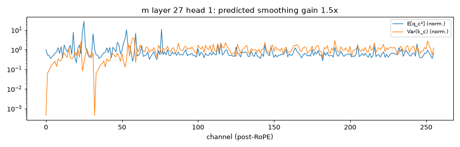
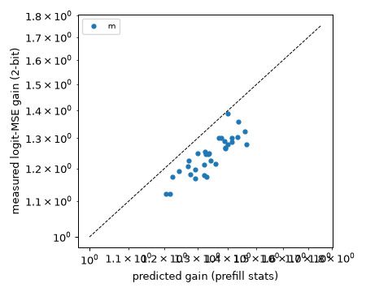

# E19 Why key smoothing matters on some models (pipeline check + characterization)

**TL;DR:** pipeline check (offline exact attention vs the model's own o_proj input), max rel. error: m 0.022.
Median predicted smoothing gain (Σq²·Σk²/(Σ√(q²k²))², from prefill stats): m 1.33x;
measured 2-bit logit-MSE gain: m 1.25x (Spearman predicted vs measured over heads 0.87).

## Config
Reference per model: {'m': 'int8'}. Corpora ['prose', 'code']; up to 4 attention layers per model; all KV heads; 2-bit (coarse) gain-shape keys with 128-token block means.
Logit error is measured on every 4th decode query over all causal positions. k² = per-channel variance of post-RoPE prefill keys,
q² = per-channel mean square of post-RoPE prefill queries (averaged over the GQA group). runtime 62s.

## (A) Pipeline check
| model | corpus | layer | rel err vs model |
|---|---|---|---|
| m | prose | 3 | 0.0060 |
| m | prose | 11 | 0.0088 |
| m | prose | 19 | 0.0092 |
| m | prose | 27 | 0.0216 |
| m | code | 3 | 0.0063 |
| m | code | 11 | 0.0089 |
| m | code | 19 | 0.0096 |
| m | code | 27 | 0.0177 |

## (B) Summary per model (medians over layer × head × corpus)
| model | n heads | Gpred median | Gpred max | measured gain median | measured max | logit err/spread (no smooth) | logit err/spread (smooth) | k² max/median | q² max/median | Spearman(q², k²) | outlier: max/median mean|k| (median) | (max) |
|---|---|---|---|---|---|---|---|---|---|---|---|---|
| m | 32 | 1.335 | 1.462 | 1.247 | 1.387 | 0.186 | 0.164 | 7.982 | 26.809 | 0.386 | 5.370 | 9.835 |

## (B) Per head
| model | corpus | layer | head | Gpred | measured gain | err/spread no smooth | err/spread smooth | k² max/med | q² max/med | ρ(q²,k²) | max/med mean|k| |
|---|---|---|---|---|---|---|---|---|---|---|---|
| m | prose | 3 | 0 | 1.388 | 1.291 | 0.192 | 0.169 | 20.178 | 51.588 | 0.658 | 8.793 |
| m | prose | 3 | 1 | 1.292 | 1.169 | 0.164 | 0.152 | 12.852 | 21.031 | 0.398 | 7.561 |
| m | prose | 3 | 2 | 1.434 | 1.303 | 0.211 | 0.185 | 11.484 | 72.247 | 0.403 | 6.605 |
| m | prose | 3 | 3 | 1.436 | 1.360 | 0.155 | 0.133 | 2.803 | 26.205 | -0.001 | 6.599 |
| m | prose | 11 | 0 | 1.398 | 1.279 | 0.166 | 0.147 | 12.396 | 38.725 | 0.441 | 4.247 |
| m | prose | 11 | 1 | 1.322 | 1.213 | 0.160 | 0.146 | 15.443 | 44.612 | 0.545 | 4.982 |
| m | prose | 11 | 2 | 1.369 | 1.300 | 0.199 | 0.175 | 9.077 | 17.148 | 0.237 | 3.212 |
| m | prose | 11 | 3 | 1.343 | 1.224 | 0.177 | 0.160 | 11.859 | 51.467 | 0.597 | 5.153 |
| m | prose | 19 | 0 | 1.216 | 1.122 | 0.143 | 0.135 | 10.098 | 14.359 | 0.489 | 3.258 |
| m | prose | 19 | 1 | 1.300 | 1.249 | 0.206 | 0.185 | 5.527 | 22.207 | 0.362 | 3.660 |
| m | prose | 19 | 2 | 1.320 | 1.179 | 0.147 | 0.136 | 12.921 | 21.379 | 0.481 | 4.466 |
| m | prose | 19 | 3 | 1.269 | 1.207 | 0.174 | 0.158 | 5.788 | 17.829 | 0.240 | 3.986 |
| m | prose | 27 | 0 | 1.327 | 1.245 | 0.189 | 0.169 | 4.390 | 29.818 | 0.211 | 6.485 |
| m | prose | 27 | 1 | 1.462 | 1.278 | 0.173 | 0.153 | 4.139 | 46.254 | 0.232 | 5.918 |
| m | prose | 27 | 2 | 1.412 | 1.288 | 0.188 | 0.165 | 3.599 | 19.713 | 0.106 | 3.856 |
| m | prose | 27 | 3 | 1.413 | 1.302 | 0.203 | 0.178 | 4.287 | 34.304 | 0.254 | 5.171 |
| m | code | 3 | 0 | 1.291 | 1.196 | 0.190 | 0.174 | 16.554 | 35.028 | 0.578 | 9.734 |
| m | code | 3 | 1 | 1.243 | 1.191 | 0.186 | 0.171 | 6.887 | 19.664 | 0.249 | 9.835 |
| m | code | 3 | 2 | 1.336 | 1.248 | 0.192 | 0.172 | 6.670 | 42.775 | 0.338 | 5.914 |
| m | code | 3 | 3 | 1.400 | 1.387 | 0.132 | 0.112 | 2.592 | 22.687 | -0.004 | 5.625 |
| m | code | 11 | 0 | 1.390 | 1.267 | 0.174 | 0.155 | 16.045 | 49.616 | 0.432 | 5.763 |
| m | code | 11 | 1 | 1.330 | 1.174 | 0.164 | 0.152 | 16.582 | 47.428 | 0.572 | 5.570 |
| m | code | 11 | 2 | 1.333 | 1.247 | 0.186 | 0.167 | 10.908 | 22.233 | 0.457 | 3.707 |
| m | code | 11 | 3 | 1.357 | 1.214 | 0.190 | 0.173 | 12.888 | 63.732 | 0.582 | 6.121 |
| m | code | 19 | 0 | 1.203 | 1.122 | 0.166 | 0.156 | 9.445 | 20.693 | 0.515 | 4.299 |
| m | code | 19 | 1 | 1.271 | 1.224 | 0.193 | 0.174 | 6.193 | 24.289 | 0.333 | 3.880 |
| m | code | 19 | 2 | 1.278 | 1.180 | 0.172 | 0.159 | 12.929 | 25.504 | 0.451 | 5.154 |
| m | code | 19 | 3 | 1.224 | 1.174 | 0.170 | 0.157 | 5.249 | 23.256 | 0.373 | 5.013 |
| m | code | 27 | 0 | 1.323 | 1.256 | 0.192 | 0.171 | 4.699 | 33.034 | 0.430 | 7.427 |
| m | code | 27 | 1 | 1.457 | 1.323 | 0.187 | 0.163 | 5.279 | 54.639 | 0.116 | 7.096 |
| m | code | 27 | 2 | 1.390 | 1.266 | 0.197 | 0.175 | 4.199 | 22.669 | 0.164 | 4.493 |
| m | code | 27 | 3 | 1.376 | 1.301 | 0.198 | 0.174 | 4.454 | 27.413 | 0.315 | 6.142 |

## Plots
 — per-channel query energy and key variance for the head with the largest predicted gain.

