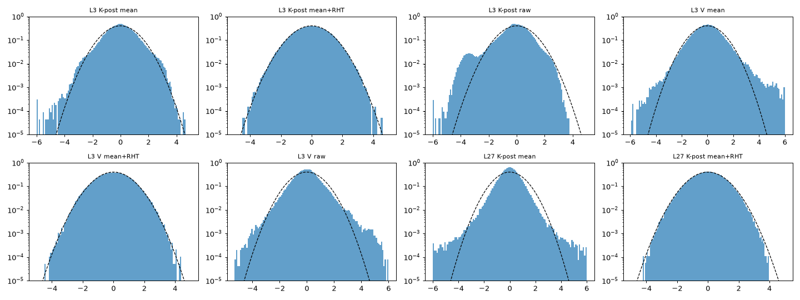

# E1 Gaussianization (Qwen3.5-0.8B, int8 reference cache, corpora prose+code, 6 attn layers × 2 KV heads)

**TL;DR:** mean removal + RHT brings key-shape kurtosis from median 6.1 (raw, max 8.3) to 2.96 (max 2.98; Gaussian = 3).
Empirical shape-MSE gap vs the Gaussian table after mean+RHT: keys post-RoPE median -0.04 dB (2b) / -0.07 dB (4b), worst -0.02 / -0.03 dB; values -0.05 / -0.09 dB.
0 (corpus, layer, tensor, head) cases exceed the 0.5 dB gap after mean+RHT.

## Config
- z = u·sqrt(d), u = y/||y||; y = x − mu (mu from prefill tokens [0, T−512)) then optionally RHT (seed 0). d = head_dim.
- Table: 2b nested-coarse MSE 0.1203, 4b Lloyd-Max 0.0095. gap dB = 10·log10(empirical/table) (positive = worse than Gaussian).
- Data: all 8192 tokens per corpus.

## Aggregate (median / max over corpus × layer × head)
| tensor | variant | kurt med | kurt max | gap2b med dB | gap2b max dB | gap4b med dB | gap4b max dB |
|---|---|---|---|---|---|---|---|
| K-post | raw | 6.05 | 8.27 | 1.83 | 2.69 | 5.42 | 7.18 |
| K-post | mean | 4.88 | 8.31 | 1.37 | 2.77 | 3.51 | 6.99 |
| K-post | mean+RHT | 2.96 | 2.98 | -0.04 | -0.02 | -0.07 | -0.03 |
| K-pre | raw | 6.13 | 8.27 | 1.84 | 2.69 | 5.39 | 7.18 |
| K-pre | mean | 5.51 | 8.65 | 1.63 | 2.90 | 4.54 | 7.22 |
| K-pre | mean+RHT | 2.95 | 2.98 | -0.05 | -0.01 | -0.07 | -0.00 |
| V | raw | 4.93 | 8.36 | 1.31 | 2.30 | 3.46 | 7.64 |
| V | mean | 5.20 | 13.12 | 1.47 | 3.58 | 4.20 | 9.49 |
| V | mean+RHT | 2.95 | 2.98 | -0.05 | -0.02 | -0.09 | -0.04 |

## Heads exceeding 0.5 dB after mean+RHT
None.

## Per layer (mean+RHT, keys post-RoPE / values, prose)
| corpus | layer | tensor | head | variant | kurt | mse2 | gap2 dB | mse4 | gap4 dB |
|---|---|---|---|---|---|---|---|---|---|
| prose | 3 | K-post | 0 | mean+RHT | 2.9722 | 0.1195 | -0.0282 | 0.0094 | -0.0475 |
| prose | 3 | K-post | 1 | mean+RHT | 2.9769 | 0.1196 | -0.0255 | 0.0094 | -0.0272 |
| prose | 3 | V | 0 | mean+RHT | 2.9492 | 0.1190 | -0.0467 | 0.0093 | -0.0766 |
| prose | 3 | V | 1 | mean+RHT | 2.9555 | 0.1190 | -0.0458 | 0.0093 | -0.0908 |
| prose | 15 | K-post | 0 | mean+RHT | 2.9659 | 0.1192 | -0.0398 | 0.0094 | -0.0547 |
| prose | 15 | K-post | 1 | mean+RHT | 2.9592 | 0.1192 | -0.0413 | 0.0093 | -0.0713 |
| prose | 15 | V | 0 | mean+RHT | 2.9785 | 0.1196 | -0.0239 | 0.0094 | -0.0446 |
| prose | 15 | V | 1 | mean+RHT | 2.9672 | 0.1193 | -0.0344 | 0.0094 | -0.0559 |
| prose | 27 | K-post | 0 | mean+RHT | 2.9391 | 0.1187 | -0.0596 | 0.0093 | -0.1043 |
| prose | 27 | K-post | 1 | mean+RHT | 2.9452 | 0.1186 | -0.0620 | 0.0093 | -0.0990 |
| prose | 27 | V | 0 | mean+RHT | 2.9527 | 0.1192 | -0.0394 | 0.0094 | -0.0656 |
| prose | 27 | V | 1 | mean+RHT | 2.9580 | 0.1192 | -0.0400 | 0.0093 | -0.0717 |
| prose | 39 | K-post | 0 | mean+RHT | 2.9637 | 0.1193 | -0.0368 | 0.0094 | -0.0651 |
| prose | 39 | K-post | 1 | mean+RHT | 2.9587 | 0.1191 | -0.0449 | 0.0094 | -0.0656 |
| prose | 39 | V | 0 | mean+RHT | 2.9269 | 0.1184 | -0.0703 | 0.0093 | -0.1145 |
| prose | 39 | V | 1 | mean+RHT | 2.9204 | 0.1180 | -0.0839 | 0.0092 | -0.1247 |

## Plots
 — log-density of z (prose, head 0, layers 3/27) with N(0,1) dashed.

## Caveats
- The reference is the int8 cache (user decision); int8 noise (~1% rel) is far below 4-bit shape error, so it does not affect these gaps.
- Note that a negative gap means *better* than the Gaussian table (lighter tails / sub-Gaussian shape).

runtime 39s
