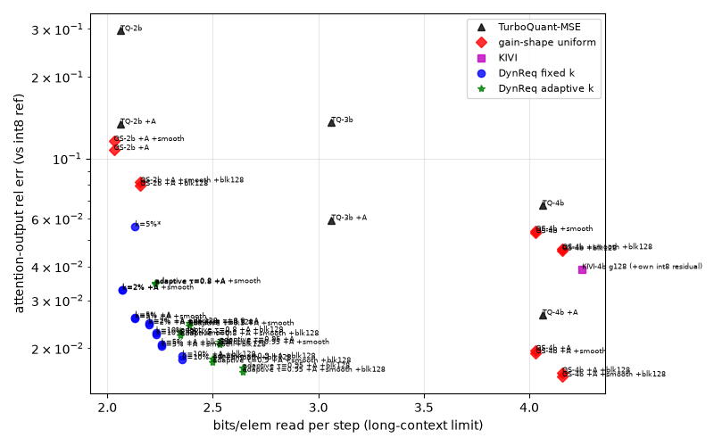

# E11 Low-hanging improvements + TurboQuant-MSE baseline (offline, int8 reference, 5 corpora × 4 layers)

**TL;DR:** E8 config DYN k=5%: attn err 0.0561. Adding (A) an exact sink+recent set outside the budget → 0.0260;
plus (C) block-local centering (128-token fp16 means) → 0.0207 at 2.26 bits (long-context limit); (B) key smoothing alone: 0.0257. References: GS-4b +A 0.0196 (4.03 b),
TurboQuant-MSE 2/3/4b (+A): 0.1341 / 0.0593 / 0.0265, KIVI-4b 0.0391 (4.25 b).
Adaptive k (τ=0.9, +A, +blk128): 0.0183 at 2.50 bits. GS-4b +A +blk128: 0.0163.

## Config
- A = first 4 tokens + last 128 tokens at reference (int8) precision, not counted in k. bits@8K include A (8.06 b for ~132 of ~8K tokens);
  the long-context limit drops A (→ coarse + 2·hot fraction).
- Smoothing: s_c = (E[(k_c−μ_c)²]/E[q_c²])^(1/4) per KV head from prefill keys and prefill queries (group-averaged); keys stored as (k−μ)/s, queries scaled by s.
- TurboQuant-MSE: RHT + Lloyd-Max N(0,1/d) codebook + fp16 norm, no mean removal, no QJL; b + 16/256 bits.
- Block centering: per-channel mean of each complete 128-token block (fp16), subtracted from K and V before RHT; +0.125 bits/elem.
- Adaptive: per query head smallest k s.t. estimated mass (coarse logits; exact for A) ≥ τ, capped at 20%; union over the query heads of a group.

| scheme | bits @8K | bits (long ctx) | attn err | attn err worst | resid err | layer-3 attn err |
|---|---|---|---|---|---|---|
| GS-2b +A | 2.1316 | 2.0312 | 0.1074 | 0.1623 | 0.1411 | 0.0967 |
| GS-2b +A +smooth | 2.1316 | 2.0312 | 0.1159 | 0.1928 | 0.1451 | 0.0980 |
| TQ-2b | 2.0625 | 2.0625 | 0.2957 | 0.4241 | 0.3936 | 0.2681 |
| TQ-2b +A | 2.1623 | 2.0625 | 0.1341 | 0.1696 | 0.1805 | 0.1151 |
| DYN k=2% +A +smooth | 2.1717 | 2.0714 | 0.0329 | 0.0480 | 0.0407 | 0.0414 |
| DYN k=2% +A | 2.1717 | 2.0714 | 0.0327 | 0.0487 | 0.0415 | 0.0411 |
| DYN k=5% +A | 2.2317 | 2.1314 | 0.0260 | 0.0370 | 0.0342 | 0.0327 |
| DYN k=5% (E8 config) | 2.1314 | 2.1314 | 0.0561 | 0.0854 | 0.0729 | 0.0636 |
| DYN k=5% +A +smooth | 2.2317 | 2.1314 | 0.0257 | 0.0361 | 0.0332 | 0.0328 |
| GS-2b +A +blk128 | 2.2545 | 2.1562 | 0.0794 | 0.1173 | 0.1123 | 0.0862 |
| GS-2b +A +smooth +blk128 | 2.2545 | 2.1562 | 0.0816 | 0.1235 | 0.1132 | 0.0863 |
| DYN k=2% +A +blk128 | 2.2946 | 2.1964 | 0.0247 | 0.0385 | 0.0331 | 0.0345 |
| DYN k=2% +A +smooth +blk128 | 2.2946 | 2.1964 | 0.0244 | 0.0386 | 0.0321 | 0.0343 |
| DYN adaptive τ=0.8 +A | 2.3274 | 2.2271 | 0.0345 | 0.0596 | 0.0420 | 0.0222 |
| DYN adaptive τ=0.8 +A +smooth | 2.3282 | 2.2279 | 0.0347 | 0.0600 | 0.0418 | 0.0220 |
| DYN k=10% +A +smooth | 2.3317 | 2.2314 | 0.0224 | 0.0301 | 0.0299 | 0.0268 |
| DYN k=10% +A | 2.3317 | 2.2314 | 0.0228 | 0.0321 | 0.0310 | 0.0269 |
| DYN k=5% +A +smooth +blk128 | 2.3546 | 2.2564 | 0.0203 | 0.0316 | 0.0272 | 0.0279 |
| DYN k=5% +A +blk128 | 2.3546 | 2.2564 | 0.0207 | 0.0317 | 0.0283 | 0.0281 |
| DYN adaptive τ=0.8 +A +smooth +blk128 | 2.4455 | 2.3473 | 0.0222 | 0.0370 | 0.0294 | 0.0190 |
| DYN adaptive τ=0.8 +A +blk128 | 2.4457 | 2.3474 | 0.0230 | 0.0380 | 0.0303 | 0.0193 |
| DYN k=10% +A +smooth +blk128 | 2.4546 | 2.3564 | 0.0181 | 0.0265 | 0.0250 | 0.0234 |
| DYN k=10% +A +blk128 | 2.4546 | 2.3564 | 0.0186 | 0.0268 | 0.0261 | 0.0237 |
| DYN adaptive τ=0.9 +A | 2.4865 | 2.3862 | 0.0247 | 0.0396 | 0.0324 | 0.0195 |
| DYN adaptive τ=0.9 +A +smooth | 2.4866 | 2.3862 | 0.0243 | 0.0387 | 0.0316 | 0.0193 |
| DYN adaptive τ=0.9 +A +smooth +blk128 | 2.5977 | 2.4994 | 0.0177 | 0.0280 | 0.0246 | 0.0173 |
| DYN adaptive τ=0.9 +A +blk128 | 2.5983 | 2.5001 | 0.0183 | 0.0294 | 0.0257 | 0.0176 |
| DYN adaptive τ=0.95 +A +smooth | 2.6322 | 2.5319 | 0.0207 | 0.0318 | 0.0284 | 0.0186 |
| DYN adaptive τ=0.95 +A | 2.6335 | 2.5332 | 0.0211 | 0.0321 | 0.0294 | 0.0188 |
| DYN adaptive τ=0.95 +A +smooth +blk128 | 2.7392 | 2.6410 | 0.0164 | 0.0248 | 0.0234 | 0.0169 |
| DYN adaptive τ=0.95 +A +blk128 | 2.7404 | 2.6422 | 0.0169 | 0.0261 | 0.0245 | 0.0172 |
| TQ-3b | 3.0625 | 3.0625 | 0.1360 | 0.1779 | 0.2011 | 0.1248 |
| TQ-3b +A | 3.1457 | 3.0625 | 0.0593 | 0.0734 | 0.0867 | 0.0468 |
| GS-4b | 4.0312 | 4.0312 | 0.0531 | 0.0806 | 0.0707 | 0.0560 |
| GS-4b +A | 4.0983 | 4.0312 | 0.0196 | 0.0293 | 0.0283 | 0.0181 |
| GS-4b +smooth | 4.0312 | 4.0312 | 0.0540 | 0.0914 | 0.0688 | 0.0540 |
| GS-4b +A +smooth | 4.0983 | 4.0312 | 0.0191 | 0.0286 | 0.0273 | 0.0180 |
| TQ-4b | 4.0625 | 4.0625 | 0.0670 | 0.0933 | 0.1026 | 0.0612 |
| TQ-4b +A | 4.1290 | 4.0625 | 0.0265 | 0.0326 | 0.0410 | 0.0207 |
| GS-4b +blk128 | 4.1562 | 4.1562 | 0.0458 | 0.0702 | 0.0616 | 0.0509 |
| GS-4b +A +blk128 | 4.2212 | 4.1562 | 0.0163 | 0.0248 | 0.0241 | 0.0166 |
| GS-4b +smooth +blk128 | 4.1562 | 4.1562 | 0.0463 | 0.0768 | 0.0603 | 0.0485 |
| GS-4b +A +smooth +blk128 | 4.2212 | 4.1562 | 0.0157 | 0.0235 | 0.0230 | 0.0163 |
| KIVI-4b g128 (+own int8 residual) | 4.2500 | 4.2500 | 0.0391 | 0.0779 | 0.0514 | 0.0237 |

## Per layer
| layer | scheme | attn err | resid err |
|---|---|---|---|
| 3 | GS-4b +A | 0.0181 | 0.0245 |
| 3 | DYN k=5% +A | 0.0327 | 0.0374 |
| 3 | DYN k=5% +A +blk128 | 0.0281 | 0.0329 |
| 3 | DYN adaptive τ=0.9 +A +blk128 | 0.0176 | 0.0231 |
| 3 | TQ-4b +A | 0.0207 | 0.0277 |
| 3 | TQ-2b +A | 0.1151 | 0.1529 |
| 15 | GS-4b +A | 0.0268 | 0.0341 |
| 15 | DYN k=5% +A | 0.0326 | 0.0388 |
| 15 | DYN k=5% +A +blk128 | 0.0247 | 0.0313 |
| 15 | DYN adaptive τ=0.9 +A +blk128 | 0.0245 | 0.0312 |
| 15 | TQ-4b +A | 0.0283 | 0.0362 |
| 15 | TQ-2b +A | 0.1540 | 0.1723 |
| 27 | GS-4b +A | 0.0262 | 0.0323 |
| 27 | DYN k=5% +A | 0.0297 | 0.0350 |
| 27 | DYN k=5% +A +blk128 | 0.0222 | 0.0269 |
| 27 | DYN adaptive τ=0.9 +A +blk128 | 0.0246 | 0.0284 |
| 27 | TQ-4b +A | 0.0276 | 0.0351 |
| 27 | TQ-2b +A | 0.1518 | 0.1684 |
| 39 | GS-4b +A | 0.0074 | 0.0223 |
| 39 | DYN k=5% +A | 0.0090 | 0.0256 |
| 39 | DYN k=5% +A +blk128 | 0.0076 | 0.0221 |
| 39 | DYN adaptive τ=0.9 +A +blk128 | 0.0067 | 0.0201 |
| 39 | TQ-4b +A | 0.0295 | 0.0651 |
| 39 | TQ-2b +A | 0.1156 | 0.2284 |

runtime 1746s
