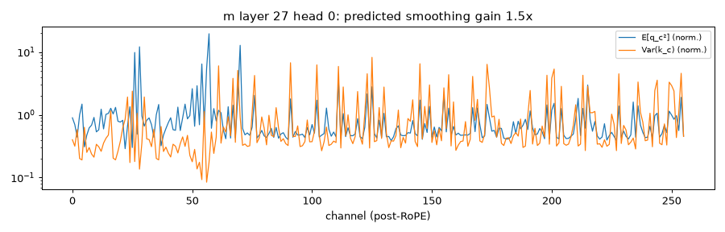
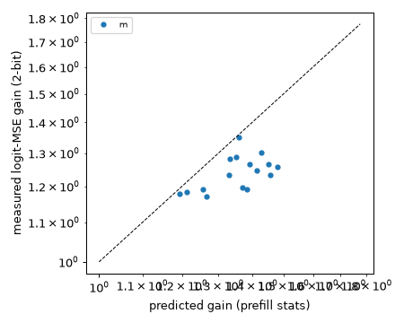

# E19 Why key smoothing matters on some models (pipeline check + characterization)

**TL;DR:** pipeline check (offline exact attention vs the model's own o_proj input), max rel. error: m 0.016.
Median predicted smoothing gain (Σq²·Σk²/(Σ√(q²k²))², from prefill stats): m 1.36x;
measured 2-bit logit-MSE gain: m 1.24x (Spearman predicted vs measured over heads 0.54).

## Config
Reference per model: {'m': 'int8'}. Corpora ['prose', 'code']; up to 4 attention layers per model; all KV heads; 2-bit (coarse) gain-shape keys with 128-token block means.
Logit error is measured on every 4th decode query over all causal positions. k² = per-channel variance of post-RoPE prefill keys,
q² = per-channel mean square of post-RoPE prefill queries (averaged over the GQA group). runtime 30s.

## (A) Pipeline check
| model | corpus | layer | rel err vs model |
|---|---|---|---|
| m | prose | 3 | 0.0080 |
| m | prose | 15 | 0.0129 |
| m | prose | 27 | 0.0084 |
| m | prose | 39 | 0.0140 |
| m | code | 3 | 0.0081 |
| m | code | 15 | 0.0109 |
| m | code | 27 | 0.0094 |
| m | code | 39 | 0.0156 |

## (B) Summary per model (medians over layer × head × corpus)
| model | n heads | Gpred median | Gpred max | measured gain median | measured max | logit err/spread (no smooth) | logit err/spread (smooth) | k² max/median | q² max/median | Spearman(q², k²) | outlier: max/median mean|k| (median) | (max) |
|---|---|---|---|---|---|---|---|---|---|---|---|---|
| m | 16 | 1.365 | 1.479 | 1.239 | 1.351 | 0.177 | 0.161 | 9.469 | 31.352 | 0.440 | 5.825 | 8.065 |

## (B) Per head
| model | corpus | layer | head | Gpred | measured gain | err/spread no smooth | err/spread smooth | k² max/med | q² max/med | ρ(q²,k²) | max/med mean|k| |
|---|---|---|---|---|---|---|---|---|---|---|---|
| m | prose | 3 | 0 | 1.213 | 1.184 | 0.187 | 0.172 | 8.831 | 17.776 | 0.458 | 5.336 |
| m | prose | 3 | 1 | 1.334 | 1.282 | 0.177 | 0.157 | 4.217 | 25.801 | 0.420 | 7.157 |
| m | prose | 15 | 0 | 1.391 | 1.265 | 0.183 | 0.162 | 11.568 | 35.505 | 0.521 | 5.373 |
| m | prose | 15 | 1 | 1.428 | 1.302 | 0.208 | 0.182 | 9.118 | 42.412 | 0.545 | 4.670 |
| m | prose | 27 | 0 | 1.479 | 1.256 | 0.161 | 0.144 | 19.430 | 34.277 | 0.244 | 5.989 |
| m | prose | 27 | 1 | 1.384 | 1.193 | 0.158 | 0.145 | 15.263 | 34.340 | 0.369 | 5.976 |
| m | prose | 39 | 0 | 1.331 | 1.232 | 0.204 | 0.184 | 4.840 | 28.426 | 0.274 | 4.453 |
| m | prose | 39 | 1 | 1.266 | 1.170 | 0.176 | 0.162 | 3.230 | 27.802 | 0.345 | 5.900 |
| m | code | 3 | 0 | 1.193 | 1.178 | 0.158 | 0.146 | 9.820 | 17.263 | 0.510 | 5.774 |
| m | code | 3 | 1 | 1.359 | 1.351 | 0.171 | 0.147 | 4.686 | 28.108 | 0.448 | 8.065 |
| m | code | 15 | 0 | 1.413 | 1.246 | 0.176 | 0.158 | 14.258 | 50.107 | 0.550 | 5.841 |
| m | code | 15 | 1 | 1.450 | 1.266 | 0.193 | 0.172 | 13.442 | 57.741 | 0.557 | 5.340 |
| m | code | 27 | 0 | 1.455 | 1.233 | 0.176 | 0.159 | 16.282 | 50.739 | 0.341 | 6.411 |
| m | code | 27 | 1 | 1.371 | 1.197 | 0.183 | 0.167 | 14.052 | 49.023 | 0.431 | 7.128 |
| m | code | 39 | 0 | 1.352 | 1.289 | 0.201 | 0.177 | 6.497 | 27.383 | 0.457 | 4.339 |
| m | code | 39 | 1 | 1.257 | 1.191 | 0.168 | 0.154 | 3.040 | 21.130 | 0.316 | 5.810 |

## Plots
 — per-channel query energy and key variance for the head with the largest predicted gain.

