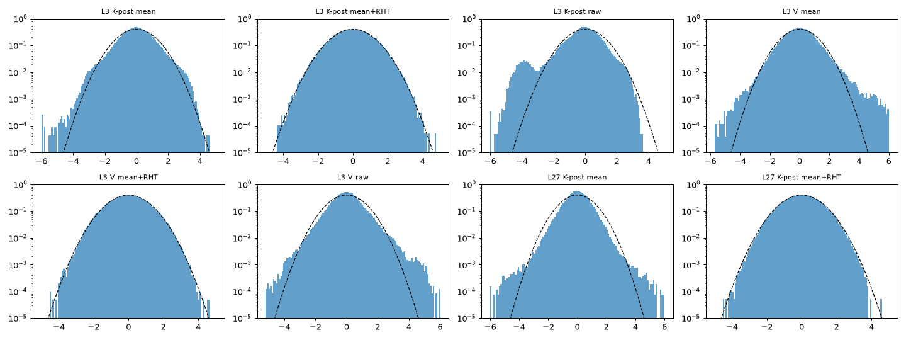

# E1 Gaussianization (Qwen3.5-0.8B, int8 reference cache, corpora prose+code, 6 attn layers × 2 KV heads)

**TL;DR:** mean removal + RHT brings key-shape kurtosis from median 6.3 (raw, max 7.6) to 2.96 (max 2.99; Gaussian = 3).
Empirical shape-MSE gap vs the Gaussian table after mean+RHT: keys post-RoPE median -0.04 dB (2b) / -0.07 dB (4b), worst -0.02 / -0.03 dB; values -0.05 / -0.08 dB.
0 (corpus, layer, tensor, head) cases exceed the 0.5 dB gap after mean+RHT.

## Config
- z = u·sqrt(d), u = y/||y||; y = x − mu (mu from prefill tokens [0, T−512)) then optionally RHT (seed 0). d = head_dim.
- Table: 2b nested-coarse MSE 0.1203, 4b Lloyd-Max 0.0095. gap dB = 10·log10(empirical/table) (positive = worse than Gaussian).
- Data: all 8192 tokens per corpus.

## Aggregate (median / max over corpus × layer × head)
| tensor | variant | kurt med | kurt max | gap2b med dB | gap2b max dB | gap4b med dB | gap4b max dB |
|---|---|---|---|---|---|---|---|
| K-post | raw | 6.25 | 7.58 | 1.90 | 2.48 | 5.65 | 6.67 |
| K-post | mean | 4.66 | 6.96 | 1.23 | 2.26 | 3.15 | 6.04 |
| K-post | mean+RHT | 2.96 | 2.99 | -0.04 | -0.02 | -0.07 | -0.03 |
| K-pre | raw | 6.31 | 7.58 | 1.93 | 2.48 | 5.65 | 6.69 |
| K-pre | mean | 5.35 | 7.56 | 1.55 | 2.52 | 4.37 | 6.46 |
| K-pre | mean+RHT | 2.96 | 2.98 | -0.04 | -0.01 | -0.07 | -0.01 |
| V | raw | 4.69 | 7.45 | 1.27 | 2.03 | 3.37 | 7.11 |
| V | mean | 5.17 | 12.77 | 1.42 | 3.49 | 4.17 | 9.37 |
| V | mean+RHT | 2.95 | 2.98 | -0.05 | -0.02 | -0.08 | -0.04 |

## Heads exceeding 0.5 dB after mean+RHT
None.

## Per layer (mean+RHT, keys post-RoPE / values, prose)
| corpus | layer | tensor | head | variant | kurt | mse2 | gap2 dB | mse4 | gap4 dB |
|---|---|---|---|---|---|---|---|---|---|
| prose | 3 | K-post | 0 | mean+RHT | 2.9701 | 0.1193 | -0.0344 | 0.0094 | -0.0482 |
| prose | 3 | K-post | 1 | mean+RHT | 2.9786 | 0.1197 | -0.0233 | 0.0094 | -0.0361 |
| prose | 3 | V | 0 | mean+RHT | 2.9518 | 0.1190 | -0.0470 | 0.0093 | -0.0751 |
| prose | 3 | V | 1 | mean+RHT | 2.9568 | 0.1191 | -0.0439 | 0.0093 | -0.0856 |
| prose | 15 | K-post | 0 | mean+RHT | 2.9643 | 0.1192 | -0.0385 | 0.0094 | -0.0545 |
| prose | 15 | K-post | 1 | mean+RHT | 2.9689 | 0.1194 | -0.0307 | 0.0094 | -0.0583 |
| prose | 15 | V | 0 | mean+RHT | 2.9776 | 0.1195 | -0.0270 | 0.0094 | -0.0381 |
| prose | 15 | V | 1 | mean+RHT | 2.9709 | 0.1195 | -0.0286 | 0.0094 | -0.0541 |
| prose | 27 | K-post | 0 | mean+RHT | 2.9517 | 0.1190 | -0.0466 | 0.0093 | -0.0848 |
| prose | 27 | K-post | 1 | mean+RHT | 2.9624 | 0.1193 | -0.0373 | 0.0093 | -0.0743 |
| prose | 27 | V | 0 | mean+RHT | 2.9486 | 0.1191 | -0.0417 | 0.0094 | -0.0686 |
| prose | 27 | V | 1 | mean+RHT | 2.9627 | 0.1193 | -0.0357 | 0.0094 | -0.0642 |
| prose | 39 | K-post | 0 | mean+RHT | 2.9647 | 0.1194 | -0.0329 | 0.0094 | -0.0677 |
| prose | 39 | K-post | 1 | mean+RHT | 2.9577 | 0.1190 | -0.0473 | 0.0093 | -0.0736 |
| prose | 39 | V | 0 | mean+RHT | 2.9295 | 0.1183 | -0.0708 | 0.0093 | -0.1136 |
| prose | 39 | V | 1 | mean+RHT | 2.9184 | 0.1180 | -0.0839 | 0.0092 | -0.1212 |

## Plots
 — log-density of z (prose, head 0, layers 3/27) with N(0,1) dashed.

## Caveats
- The reference is the int8 cache (user decision); int8 noise (~1% rel) is far below 4-bit shape error, so it does not affect these gaps.
- Note that a negative gap means *better* than the Gaussian table (lighter tails / sub-Gaussian shape).

runtime 41s
