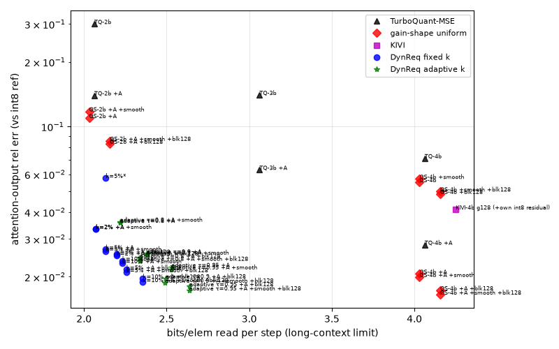

# E11 Low-hanging improvements + TurboQuant-MSE baseline (offline, int8 reference, 5 corpora × 4 layers)

**TL;DR:** E8 config DYN k=5%: attn err 0.0577. Adding (A) an exact sink+recent set outside the budget → 0.0268;
plus (C) block-local centering (128-token fp16 means) → 0.0216 at 2.26 bits (long-context limit); (B) key smoothing alone: 0.0264. References: GS-4b +A 0.0206 (4.03 b),
TurboQuant-MSE 2/3/4b (+A): 0.1397 / 0.0629 / 0.0282, KIVI-4b 0.0411 (4.25 b).
Adaptive k (τ=0.9, +A, +blk128): 0.0197 at 2.49 bits. GS-4b +A +blk128: 0.0173.

## Config
- A = first 4 tokens + last 128 tokens at reference (int8) precision, not counted in k. bits@8K include A (8.06 b for ~132 of ~8K tokens);
  the long-context limit drops A (→ coarse + 2·hot fraction).
- Smoothing: s_c = (E[(k_c−μ_c)²]/E[q_c²])^(1/4) per KV head from prefill keys and prefill queries (group-averaged); keys stored as (k−μ)/s, queries scaled by s.
- TurboQuant-MSE: RHT + Lloyd-Max N(0,1/d) codebook + fp16 norm, no mean removal, no QJL; b + 16/256 bits.
- Block centering: per-channel mean of each complete 128-token block (fp16), subtracted from K and V before RHT; +0.125 bits/elem.
- Adaptive: per query head smallest k s.t. estimated mass (coarse logits; exact for A) ≥ τ, capped at 20%; union over the query heads of a group.

| scheme | bits @8K | bits (long ctx) | attn err | attn err worst | resid err | layer-3 attn err |
|---|---|---|---|---|---|---|
| GS-2b +A | 2.1316 | 2.0312 | 0.1095 | 0.1700 | 0.1418 | 0.0956 |
| GS-2b +A +smooth | 2.1316 | 2.0312 | 0.1176 | 0.2051 | 0.1453 | 0.0972 |
| TQ-2b | 2.0625 | 2.0625 | 0.3002 | 0.4209 | 0.3929 | 0.2711 |
| TQ-2b +A | 2.1623 | 2.0625 | 0.1397 | 0.1749 | 0.1852 | 0.1136 |
| DYN k=2% +A | 2.1717 | 2.0714 | 0.0333 | 0.0498 | 0.0413 | 0.0398 |
| DYN k=2% +A +smooth | 2.1717 | 2.0714 | 0.0334 | 0.0498 | 0.0406 | 0.0399 |
| DYN k=5% (E8 config) | 2.1314 | 2.1314 | 0.0577 | 0.0826 | 0.0729 | 0.0636 |
| DYN k=5% +A | 2.2317 | 2.1314 | 0.0268 | 0.0387 | 0.0345 | 0.0318 |
| DYN k=5% +A +smooth | 2.2317 | 2.1314 | 0.0264 | 0.0370 | 0.0335 | 0.0315 |
| GS-2b +A +blk128 | 2.2545 | 2.1562 | 0.0832 | 0.1230 | 0.1151 | 0.0842 |
| GS-2b +A +smooth +blk128 | 2.2545 | 2.1562 | 0.0858 | 0.1369 | 0.1167 | 0.0847 |
| DYN k=2% +A +blk128 | 2.2946 | 2.1964 | 0.0256 | 0.0409 | 0.0336 | 0.0335 |
| DYN k=2% +A +smooth +blk128 | 2.2946 | 2.1964 | 0.0251 | 0.0400 | 0.0326 | 0.0333 |
| DYN adaptive τ=0.8 +A +smooth | 2.3189 | 2.2186 | 0.0361 | 0.0610 | 0.0423 | 0.0221 |
| DYN adaptive τ=0.8 +A | 2.3191 | 2.2188 | 0.0356 | 0.0593 | 0.0423 | 0.0226 |
| DYN k=10% +A | 2.3317 | 2.2314 | 0.0237 | 0.0344 | 0.0316 | 0.0264 |
| DYN k=10% +A +smooth | 2.3317 | 2.2314 | 0.0231 | 0.0324 | 0.0305 | 0.0259 |
| DYN k=5% +A +blk128 | 2.3546 | 2.2564 | 0.0216 | 0.0316 | 0.0290 | 0.0275 |
| DYN k=5% +A +smooth +blk128 | 2.3546 | 2.2564 | 0.0210 | 0.0308 | 0.0280 | 0.0271 |
| DYN adaptive τ=0.8 +A +smooth +blk128 | 2.4366 | 2.3383 | 0.0237 | 0.0405 | 0.0307 | 0.0190 |
| DYN adaptive τ=0.8 +A +blk128 | 2.4370 | 2.3388 | 0.0245 | 0.0410 | 0.0315 | 0.0196 |
| DYN k=10% +A +blk128 | 2.4546 | 2.3564 | 0.0196 | 0.0284 | 0.0270 | 0.0234 |
| DYN k=10% +A +smooth +blk128 | 2.4546 | 2.3564 | 0.0189 | 0.0277 | 0.0259 | 0.0229 |
| DYN adaptive τ=0.9 +A +smooth | 2.4788 | 2.3785 | 0.0253 | 0.0400 | 0.0323 | 0.0191 |
| DYN adaptive τ=0.9 +A | 2.4798 | 2.3795 | 0.0256 | 0.0411 | 0.0330 | 0.0196 |
| DYN adaptive τ=0.9 +A +smooth +blk128 | 2.5899 | 2.4917 | 0.0188 | 0.0313 | 0.0257 | 0.0171 |
| DYN adaptive τ=0.9 +A +blk128 | 2.5915 | 2.4932 | 0.0197 | 0.0319 | 0.0268 | 0.0177 |
| DYN adaptive τ=0.95 +A +smooth | 2.6292 | 2.5288 | 0.0216 | 0.0329 | 0.0292 | 0.0184 |
| DYN adaptive τ=0.95 +A | 2.6303 | 2.5300 | 0.0222 | 0.0347 | 0.0302 | 0.0188 |
| DYN adaptive τ=0.95 +A +smooth +blk128 | 2.7351 | 2.6368 | 0.0173 | 0.0277 | 0.0244 | 0.0166 |
| DYN adaptive τ=0.95 +A +blk128 | 2.7371 | 2.6388 | 0.0181 | 0.0284 | 0.0255 | 0.0173 |
| TQ-3b | 3.0625 | 3.0625 | 0.1402 | 0.1700 | 0.1998 | 0.1264 |
| TQ-3b +A | 3.1457 | 3.0625 | 0.0629 | 0.0778 | 0.0894 | 0.0468 |
| GS-4b | 4.0312 | 4.0312 | 0.0551 | 0.0831 | 0.0710 | 0.0567 |
| GS-4b +A | 4.0983 | 4.0312 | 0.0206 | 0.0318 | 0.0292 | 0.0181 |
| GS-4b +smooth | 4.0312 | 4.0312 | 0.0571 | 0.1019 | 0.0699 | 0.0543 |
| GS-4b +A +smooth | 4.0983 | 4.0312 | 0.0200 | 0.0300 | 0.0281 | 0.0177 |
| TQ-4b | 4.0625 | 4.0625 | 0.0712 | 0.0991 | 0.1030 | 0.0621 |
| TQ-4b +A | 4.1290 | 4.0625 | 0.0282 | 0.0353 | 0.0422 | 0.0205 |
| GS-4b +blk128 | 4.1562 | 4.1562 | 0.0486 | 0.0730 | 0.0624 | 0.0515 |
| GS-4b +A +blk128 | 4.2212 | 4.1562 | 0.0173 | 0.0269 | 0.0251 | 0.0167 |
| GS-4b +smooth +blk128 | 4.1562 | 4.1562 | 0.0499 | 0.0822 | 0.0616 | 0.0495 |
| GS-4b +A +smooth +blk128 | 4.2212 | 4.1562 | 0.0165 | 0.0260 | 0.0239 | 0.0161 |
| KIVI-4b g128 (+own int8 residual) | 4.2500 | 4.2500 | 0.0411 | 0.0787 | 0.0526 | 0.0238 |

## Per layer
| layer | scheme | attn err | resid err |
|---|---|---|---|
| 3 | GS-4b +A | 0.0181 | 0.0241 |
| 3 | DYN k=5% +A | 0.0318 | 0.0359 |
| 3 | DYN k=5% +A +blk128 | 0.0275 | 0.0320 |
| 3 | DYN adaptive τ=0.9 +A +blk128 | 0.0177 | 0.0231 |
| 3 | TQ-4b +A | 0.0205 | 0.0275 |
| 3 | TQ-2b +A | 0.1136 | 0.1516 |
| 15 | GS-4b +A | 0.0278 | 0.0332 |
| 15 | DYN k=5% +A | 0.0335 | 0.0375 |
| 15 | DYN k=5% +A +blk128 | 0.0260 | 0.0307 |
| 15 | DYN adaptive τ=0.9 +A +blk128 | 0.0262 | 0.0309 |
| 15 | TQ-4b +A | 0.0293 | 0.0358 |
| 15 | TQ-2b +A | 0.1608 | 0.1673 |
| 27 | GS-4b +A | 0.0285 | 0.0356 |
| 27 | DYN k=5% +A | 0.0320 | 0.0380 |
| 27 | DYN k=5% +A +blk128 | 0.0248 | 0.0302 |
| 27 | DYN adaptive τ=0.9 +A +blk128 | 0.0277 | 0.0322 |
| 27 | TQ-4b +A | 0.0308 | 0.0383 |
| 27 | TQ-2b +A | 0.1559 | 0.1771 |
| 39 | GS-4b +A | 0.0081 | 0.0238 |
| 39 | DYN k=5% +A | 0.0098 | 0.0266 |
| 39 | DYN k=5% +A +blk128 | 0.0080 | 0.0232 |
| 39 | DYN adaptive τ=0.9 +A +blk128 | 0.0070 | 0.0211 |
| 39 | TQ-4b +A | 0.0320 | 0.0673 |
| 39 | TQ-2b +A | 0.1283 | 0.2449 |

runtime 3912s
