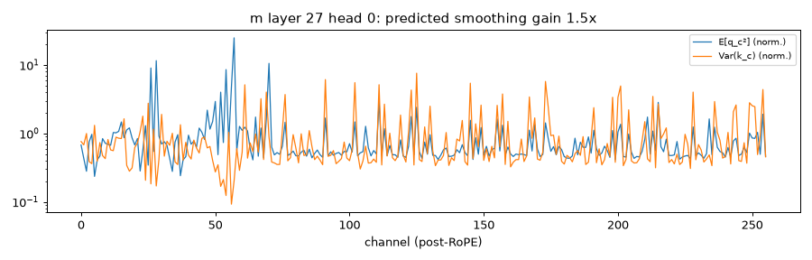
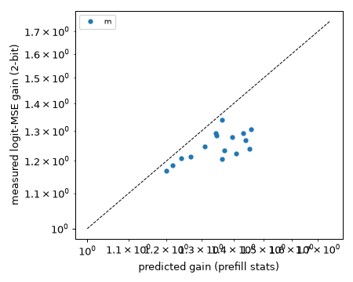

# E19 Why key smoothing matters on some models (pipeline check + characterization)

**TL;DR:** pipeline check (offline exact attention vs the model's own o_proj input), max rel. error: m 0.015.
Median predicted smoothing gain (Σq²·Σk²/(Σ√(q²k²))², from prefill stats): m 1.36x;
measured 2-bit logit-MSE gain: m 1.24x (Spearman predicted vs measured over heads 0.53).

## Config
Reference per model: {'m': 'int8'}. Corpora ['prose', 'code']; up to 4 attention layers per model; all KV heads; 2-bit (coarse) gain-shape keys with 128-token block means.
Logit error is measured on every 4th decode query over all causal positions. k² = per-channel variance of post-RoPE prefill keys,
q² = per-channel mean square of post-RoPE prefill queries (averaged over the GQA group). runtime 29s.

## (A) Pipeline check
| model | corpus | layer | rel err vs model |
|---|---|---|---|
| m | prose | 3 | 0.0083 |
| m | prose | 15 | 0.0118 |
| m | prose | 27 | 0.0093 |
| m | prose | 39 | 0.0138 |
| m | code | 3 | 0.0085 |
| m | code | 15 | 0.0096 |
| m | code | 27 | 0.0100 |
| m | code | 39 | 0.0151 |

## (B) Summary per model (medians over layer × head × corpus)
| model | n heads | Gpred median | Gpred max | measured gain median | measured max | logit err/spread (no smooth) | logit err/spread (smooth) | k² max/median | q² max/median | Spearman(q², k²) | outlier: max/median mean|k| (median) | (max) |
|---|---|---|---|---|---|---|---|---|---|---|---|---|
| m | 16 | 1.363 | 1.457 | 1.243 | 1.341 | 0.185 | 0.166 | 9.222 | 35.425 | 0.460 | 5.898 | 8.632 |

## (B) Per head
| model | corpus | layer | head | Gpred | measured gain | err/spread no smooth | err/spread smooth | k² max/med | q² max/med | ρ(q²,k²) | max/med mean|k| |
|---|---|---|---|---|---|---|---|---|---|---|---|
| m | prose | 3 | 0 | 1.217 | 1.185 | 0.185 | 0.170 | 8.318 | 17.838 | 0.456 | 6.068 |
| m | prose | 3 | 1 | 1.345 | 1.293 | 0.177 | 0.156 | 4.659 | 26.616 | 0.435 | 7.625 |
| m | prose | 15 | 0 | 1.395 | 1.280 | 0.187 | 0.165 | 10.795 | 39.505 | 0.515 | 5.994 |
| m | prose | 15 | 1 | 1.431 | 1.292 | 0.209 | 0.184 | 7.828 | 44.179 | 0.545 | 5.351 |
| m | prose | 27 | 0 | 1.457 | 1.307 | 0.185 | 0.162 | 15.414 | 44.325 | 0.350 | 5.712 |
| m | prose | 27 | 1 | 1.370 | 1.235 | 0.188 | 0.169 | 11.478 | 43.570 | 0.475 | 6.302 |
| m | prose | 39 | 0 | 1.311 | 1.246 | 0.214 | 0.192 | 4.869 | 29.188 | 0.420 | 4.773 |
| m | prose | 39 | 1 | 1.267 | 1.213 | 0.183 | 0.166 | 3.045 | 28.800 | 0.270 | 6.367 |
| m | code | 3 | 0 | 1.199 | 1.168 | 0.157 | 0.145 | 10.127 | 17.474 | 0.505 | 6.570 |
| m | code | 3 | 1 | 1.362 | 1.341 | 0.166 | 0.144 | 4.995 | 31.345 | 0.466 | 8.632 |
| m | code | 15 | 0 | 1.408 | 1.225 | 0.180 | 0.162 | 13.850 | 49.862 | 0.523 | 5.707 |
| m | code | 15 | 1 | 1.440 | 1.268 | 0.196 | 0.174 | 13.655 | 56.274 | 0.550 | 5.393 |
| m | code | 27 | 0 | 1.453 | 1.239 | 0.185 | 0.166 | 14.777 | 51.799 | 0.328 | 5.802 |
| m | code | 27 | 1 | 1.364 | 1.205 | 0.192 | 0.175 | 12.138 | 50.276 | 0.414 | 6.691 |
| m | code | 39 | 0 | 1.346 | 1.286 | 0.206 | 0.182 | 6.493 | 28.188 | 0.463 | 4.456 |
| m | code | 39 | 1 | 1.242 | 1.207 | 0.179 | 0.163 | 3.307 | 20.828 | 0.367 | 5.048 |

## Plots
 — per-channel query energy and key variance for the head with the largest predicted gain.

